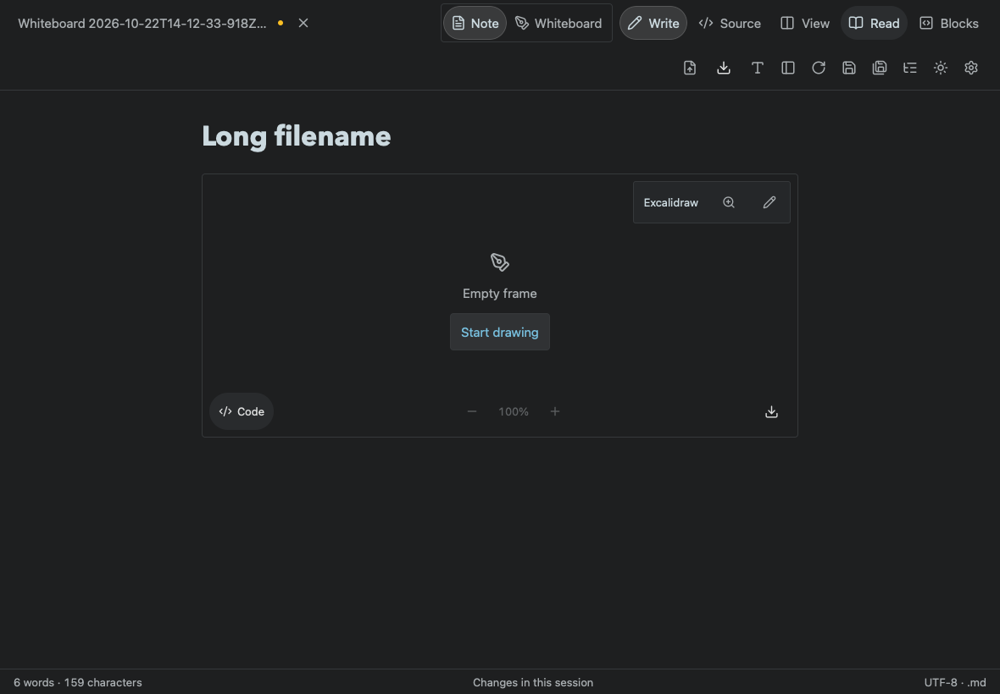
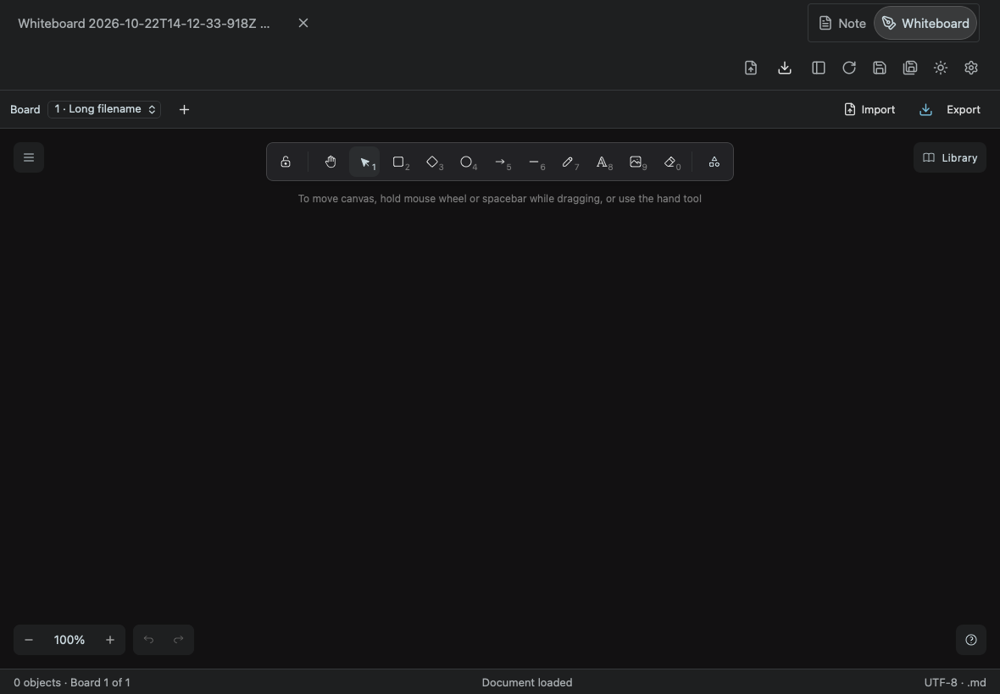
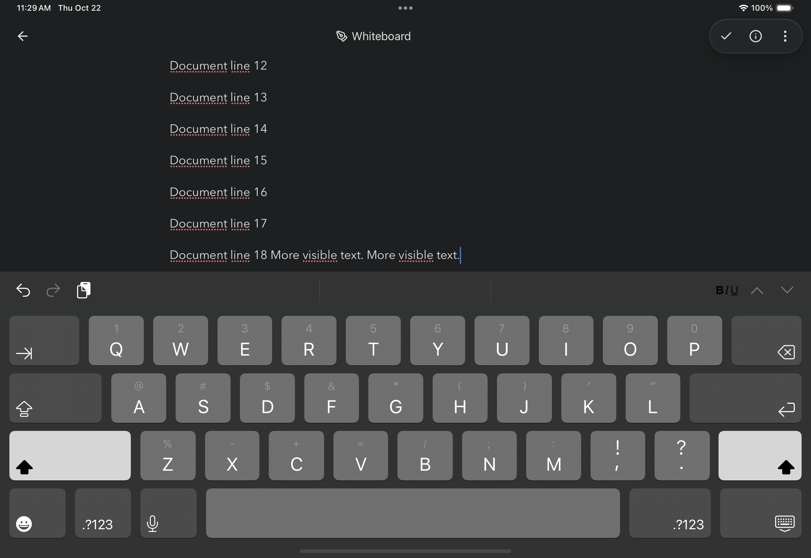
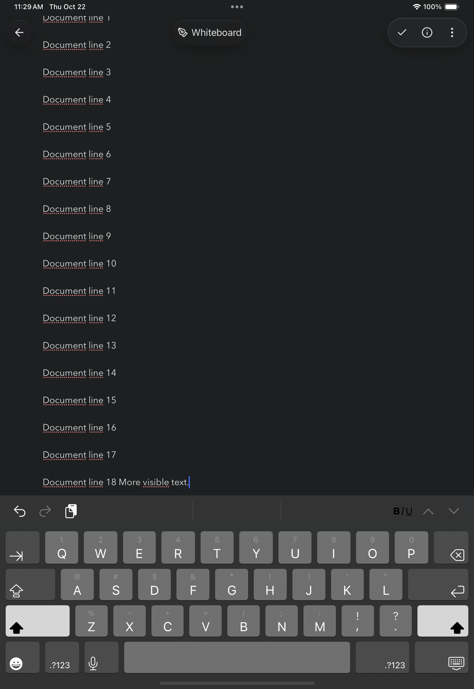

# Tablet document chrome and keyboard — build 26

Long filenames stay within their own group, with ellipsis when necessary. Tablet view choices and commands occupy deliberate rows; actions use the right edge. Tests cover Chromium and WebKit at 1024×768, 1180×820, 1440×900 and portrait rotation.

Touch devices keep the notes library closed until explicitly requested. Opening a note, interacting with the document or rotating the device dismisses it. Search inside the library remains usable.

The native web view follows UIKit's keyboard layout guide. Document scrolling keeps the caret visible without panning the entire root page. A top toolbar no longer incorrectly reduces the caret's bottom limit. Returning from a drawing preserves existing prose and inserts a separate empty writing paragraph.

Validation: `node tests/toolbar-layout.smoke.mjs`, `node tests/tablet-sidebar.smoke.mjs`, `node tests/document-naming.smoke.mjs`, `npm test` (88 passed). Actual iPad software keyboard geometry is covered by `testTabletKeyboardResizesDocument` in portrait and landscape.

The real iOS 18.6 keyboard test passed twice, including 18 lines of typing and rotation. Native web-frame bounds remain inside the display and above the keyboard.
