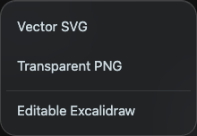
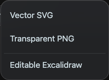

# Whiteboard export menu geometry

A toolbar-wide rule applied capsule geometry to every nested role=group, including the export menu container. Toolbar button rounding also reached its command rows. The shared style now targets the format selector explicitly and excludes command-menu descendants from capsule button styling. Embedded menu rows use the common row radius and borderless treatment.

The export list exposes menu/menuitem semantics and retains the existing SVG, transparent PNG and editable Excalidraw handlers.

Chromium smoke verified desktop (1008px) and mobile (390px): three enabled commands, a 1px panel border, bounded corner radius, compact row radius, no clipping or viewport overflow, and Escape dismissal.

Local development and simulator updates only. No App Store Connect upload was performed.
