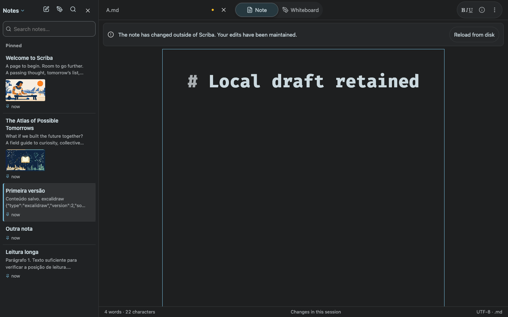
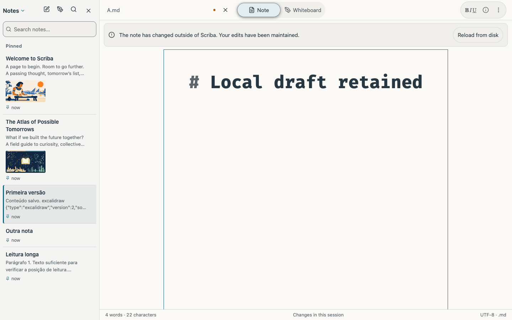
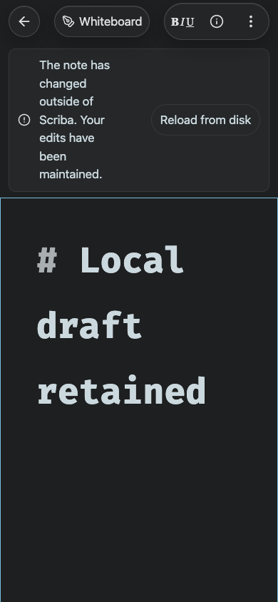

# Source revision checks during background saves

## Reproduced race

Note/Whiteboard transitions can edit the Markdown and trigger background autosave. Background operations hold `operationLock` but intentionally do not set the visible React `busy` state. The source revision poll previously ignored that lock. The disk could contain the app's newly saved bytes while Git integration/push and the HTTP acknowledgment were still pending, so a probe compared the new disk digest against the editor's old accepted revision and incorrectly reported an external edit.

The HTTP/browser regression uses two disposable Git checkouts and a bare remote. It lets the real save reach disk, holds its HTTP acknowledgment, triggers a focus probe, waits beyond the polling interval, and checks that no source-change notice appears. Before the fix this assertion failed with one visible notice. After the fix it passes. The test then releases the save, returns from Whiteboard to Note, creates a real external edit while retaining a local draft, and verifies that the genuine change is still detected without replacing the draft.

## Fix and visual behavior

The source reload guard now reads the existing synchronous operation lock alongside modal/canvas locks. Polls and replies during the app's own background write are ignored; future probes resume normally after it finishes. Autosave's pre-write revision check and backend conflict checks remain active.

Genuine external revisions use a neutral rounded notice, shared UI surface/separator/text tokens and a pill reload action. The prominent amber strip was removed. Evidence covers dark/light desktop and a narrow mobile viewport.

Only local development and simulator builds were installed; no App Store Connect upload or review modification was performed.
