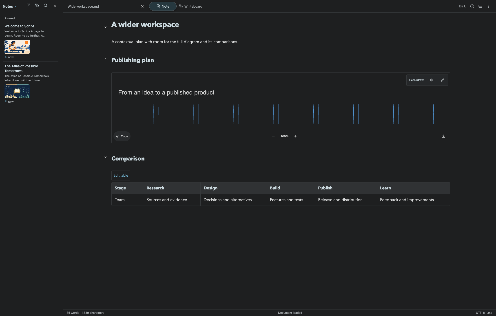
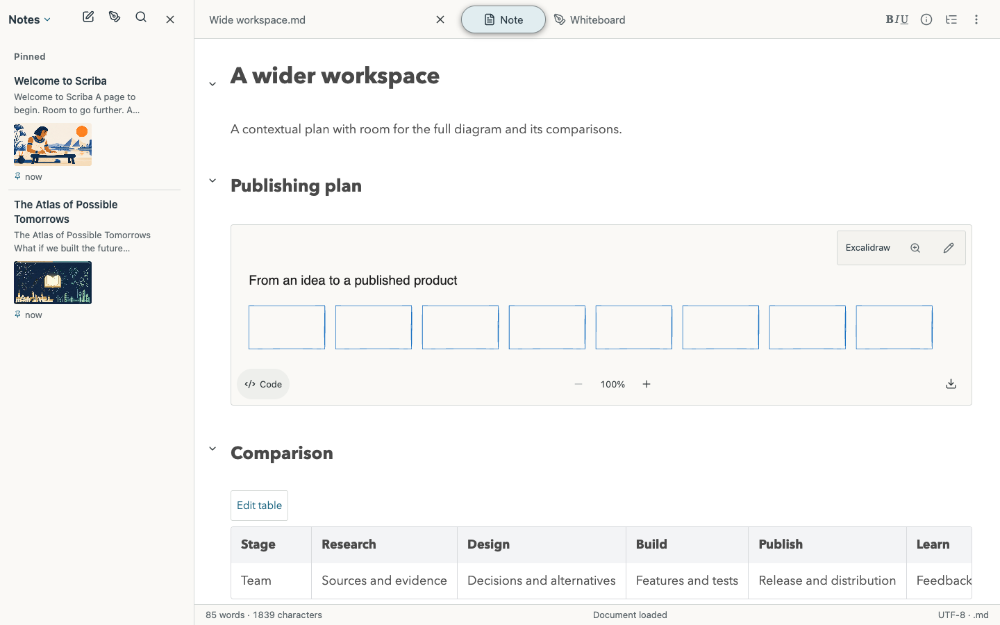
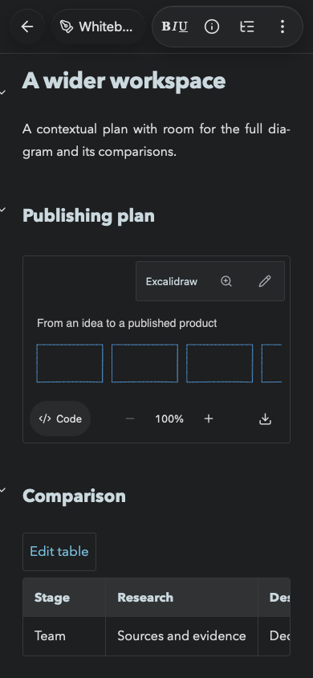
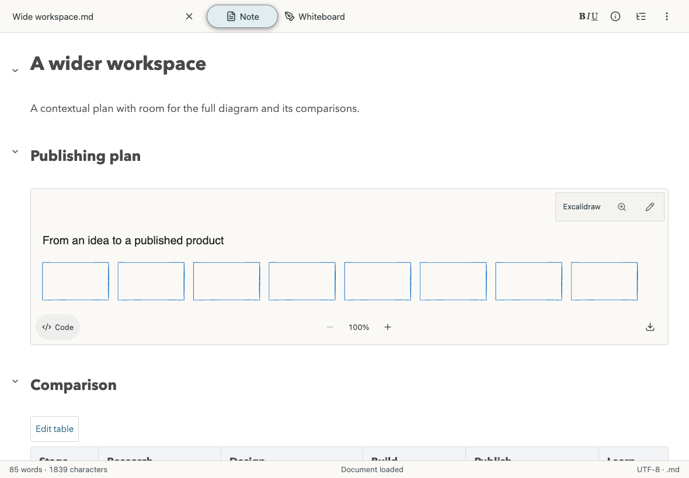

# Wider document visualization

Scriba 1.17.7 raises the standalone reading and visual-editing column limit from 800px to 1600px. The column follows its actual available pane width up to that limit. Desktop horizontal padding is reduced to a 20–40px responsive range. The mobile reader uses the same width limit, allowing tablet layouts to use their pane. Native padding uses container-relative units so a narrow Duo pane measures its own available space.

Excalidraw previews at viewport widths of at least 900px initially fit the entire drawing into the available width. Zoom buttons, wheel zoom and panning still operate on the existing SVG. Compact layouts retain the existing readable minimum width and horizontal navigation.

## Verification

- Chrome and WebKit passed real Markdown imports and diagram rendering at 2208×1408, 1440×900, 1180×820, 820×1180 and 390×844. Tablet and phone contexts enable touch. The checks cover reading and visual editing, closing the note library, opening the outline, desktop diagram fit, zoom/reset and document overflow. Both themes have screenshots. [Browser results](browser-results.json).
- Native-layout CSS is checked separately through the native chrome attribute. These checks do not run UIKit or the software keyboard in a simulator.
- The verified packaged Mac runtime passed the desktop journey against an isolated Git checkout. [Mac results](mac-results.json).
- The full suite passed 126 tests with the verified Mac bundle and no skips. [Test output](unit-tests.txt).
- Tables passed seven viewports in both engines, including horizontal keyboard navigation, visual editing and page bounds. [Chrome results](tables-chromium.json), [WebKit results](tables-webkit.json).
- The focused reading anchor survived four WebKit reflows. [Continuity output](continuity-results.txt).
- Public, local and iOS bundles passed locale validation, TypeScript and production compilation.

## Screenshots

These screenshots use a synthetic wide drawing and comparison table.

