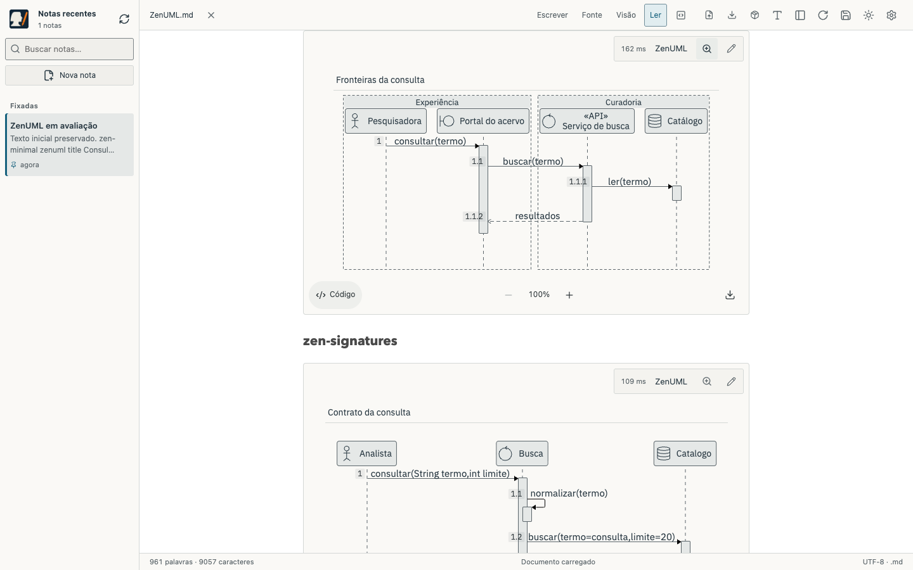
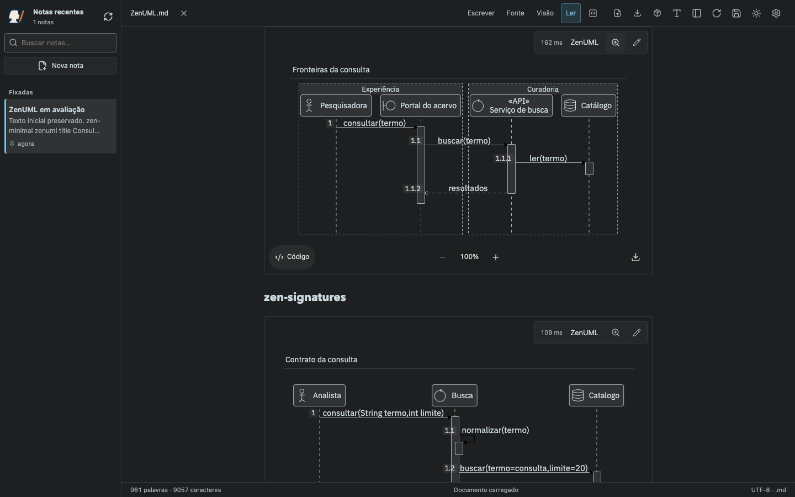
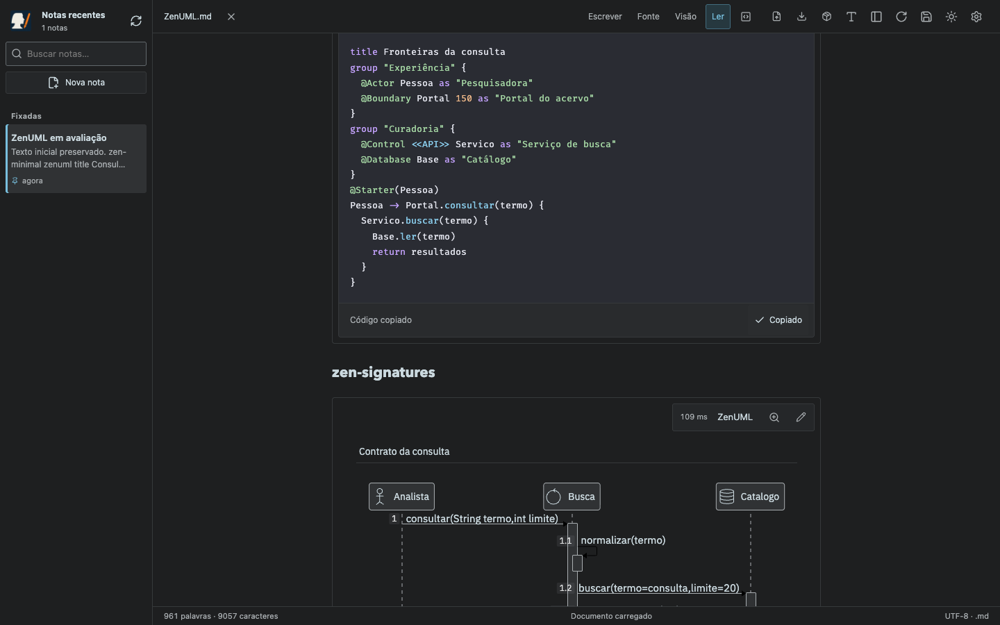
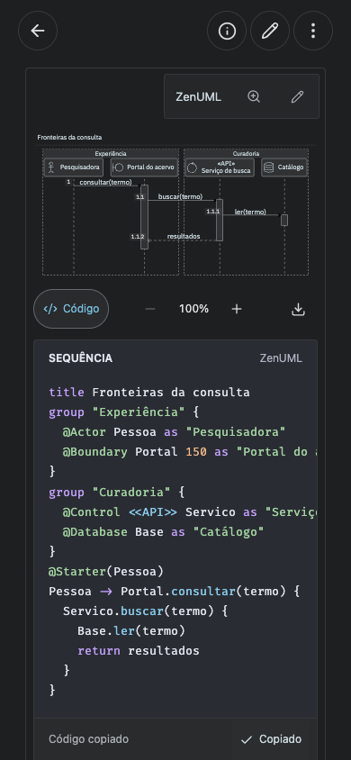

# Scriba 1.10.0 — ZenUML

Integração de `@zenuml/core` 4.7.2 com a API de SVG nativo. O manual existente foi ampliado com 25 exemplos de sequência e um catálogo de 513 anotações de ícones cloud/infraestrutura, além dos papéis UML e atalhos locais. Os 58 exemplos Mermaid continuam no mesmo arquivo.

Resultados finais: **25/25 exemplos e 513/513 ícones** em Chrome e WebKit, nos modos nativo e público; no público, com carregamento inicial offline. **52 testes HTTP** também passaram.

## Verificação funcional

O teste `tests/zenuml.smoke.mjs` abre notas de verdade no aplicativo, usando Chrome e WebKit via Playwright, com armazenamento nativo temporário ou IndexedDB de um perfil descartável. Verifica os exemplos publicados, a cerca `zenuml`, a diretiva `zenuml` em uma cerca Mermaid, cercas com til e maiúsculas, um erro de sintaxe isolado e a sequência Mermaid já existente.

Os controles testados incluem zoom por roda/botões/teclado, código com destaque e fundo distinto, cópia, lupa, download SVG e PNG com pixels transparentes, temas claro/escuro, edição visual, salvamento e preservação de cercas/CRLF. Também há verificações dos modos Visão e edição por bloco, do catálogo vetorial completo, de ícones repetidos e de IDs isolados.

O modo público inicia o primeiro carregamento do motor, fonte, ícones e highlighter **sem rede**, depois de instalar o cache da PWA. Nenhuma nota é enviada a um serviço de diagramas.









## Atualização do manual

Os testes HTTP e de navegador verificam o acréscimo da seção ZenUML uma única vez ao manual instalado, mantendo os bytes anteriores, anotações, CRLF e a decisão de desafixar. Uma seção removida depois da atualização não reaparece. Arquivos apagados ou substituídos por uma referência sem o marcador do Scriba são respeitados. O teste do GitHub usa um gateway simulado com controle de versão; o teste nativo usa um remoto Git bare temporário e confirma o conteúdo efetivamente enviado.

## Reproduzir

```sh
npm ci
npm run build
npm test
node tests/zenuml.smoke.mjs
MARKDOWN_BROWSER=webkit node tests/zenuml.smoke.mjs
node tests/diagrams.smoke.mjs
VITE_STORAGE_MODE=browser npm run build
SCRIBA_BROWSER_MODE=1 node tests/zenuml.smoke.mjs
SCRIBA_BROWSER_MODE=1 MARKDOWN_BROWSER=webkit node tests/zenuml.smoke.mjs
node tests/diagram-reference-browser.smoke.mjs
node tests/diagrams-browser.smoke.mjs
```

Os arquivos `compatibility-*.json` contêm resultados por exemplo e a cobertura do catálogo. Layouts: 320/390 px, celular e tablet nas duas orientações, desktop 1440×900. WebKit e eventos simulados não equivalem a certificação física de todos os modelos iOS.

## Limitações registradas

ZenUML é uma DSL própria de sequência. `sequenceDiagram` permanece com Mermaid/Pele/Beautiful; não há conversão automática entre linguagens. O `for` no estilo C mostrado na documentação upstream não passa no parser instalado, e `@Collections` não possui pictograma próprio no SVG desta versão. O manual apresenta alternativas e informa esses limites.

O adaptador de build remove a injeção do stylesheet do editor HTML da biblioteca e preserva o namespace do catálogo cloud diante da otimização de import do Vite. Ambos têm guardas explícitas de formato para futuras atualizações da dependência. As exportações mantêm a fonte local do motor e as cores resolvidas do Scriba.
