# Atlas dos Amanhãs Possíveis


## E se a gente reinventasse a cidade juntos?

*Uma jornada de conhecimento aberto, participação, ciência e imaginação em português brasileiro.*

> Toda cidade tem mapas. Poucas têm um mapa das perguntas que seus moradores ainda não conseguiram responder.

Imagine **Porto das Marés**, uma cidade costeira brasileira fictícia. Entre ruas alagadas, deslocamentos demorados e praias cheias de histórias, nasce o **Observatório Maré Viva**, um laboratório cidadão que conecta memórias, evidências, propostas e experimentos.

**Os números, datas, organizações, projetos e cenários deste documento são fictícios e ilustrativos.** Os exemplos de código demonstram sintaxe; não são programas executados automaticamente pelo Scriba.

**Como explorar:** leia a pergunta, abra o código do diagrama, altere uma condição ou um dado e observe como a interpretação muda.

## Índice

- [1. Perguntas que transformam uma cidade](#capitulo-1)
- [2. Participação e ciclos de vida](#capitulo-2)
- [3. Conhecimento, dados e linguagens](#capitulo-3)
- [4. Infraestrutura da colaboração](#capitulo-4)
- [5. Planejamento e aprendizagem](#capitulo-5)
- [6. Números e futuros possíveis](#capitulo-6)
- [7. Decisões sem falsas certezas](#capitulo-7)
- [8. Diagnóstico do editor](#capitulo-8)

<a id="capitulo-1"></a>
## 1. Perguntas que transformam uma cidade

Neste capítulo, uma representação diferente revela uma dimensão da vida em Porto das Marés.

### 1.1 Flow review (1/58)

**Pergunta:** Como a representação de **flowchart** ajuda a investigar um desafio do Observatório Maré Viva?

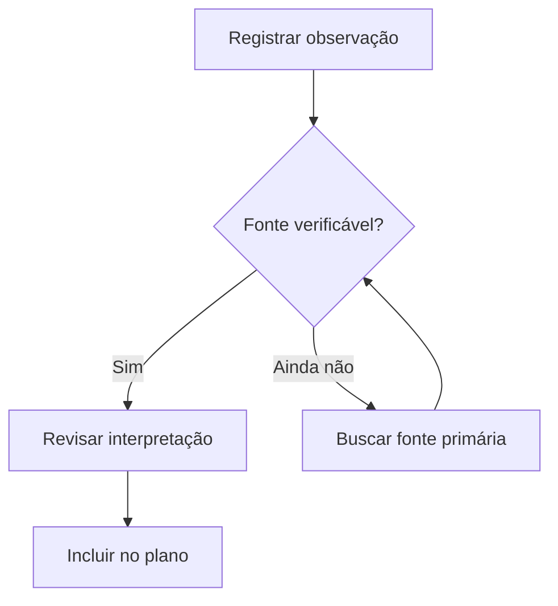

**Experimente:** altere um rótulo, uma relação, um valor ou uma etapa para refletir outra hipótese sobre Porto das Marés. Explique o que mudou.

### 1.2 Flow edges (2/58)

**Pergunta:** Como a representação de **flowchart** ajuda a investigar um desafio do Observatório Maré Viva?

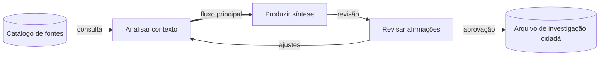

**Experimente:** altere um rótulo, uma relação, um valor ou uma etapa para refletir outra hipótese sobre Porto das Marés. Explique o que mudou.

### 1.3 Flow shapes (3/58)

**Pergunta:** Como a representação de **flowchart** ajuda a investigar um desafio do Observatório Maré Viva?

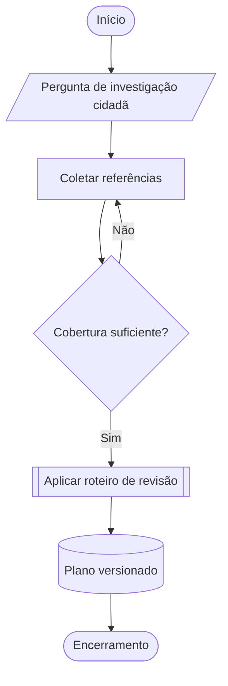

**Experimente:** altere um rótulo, uma relação, um valor ou uma etapa para refletir outra hipótese sobre Porto das Marés. Explique o que mudou.

### 1.4 Flow bt (4/58)

**Pergunta:** Como a representação de **flowchart** ajuda a investigar um desafio do Observatório Maré Viva?

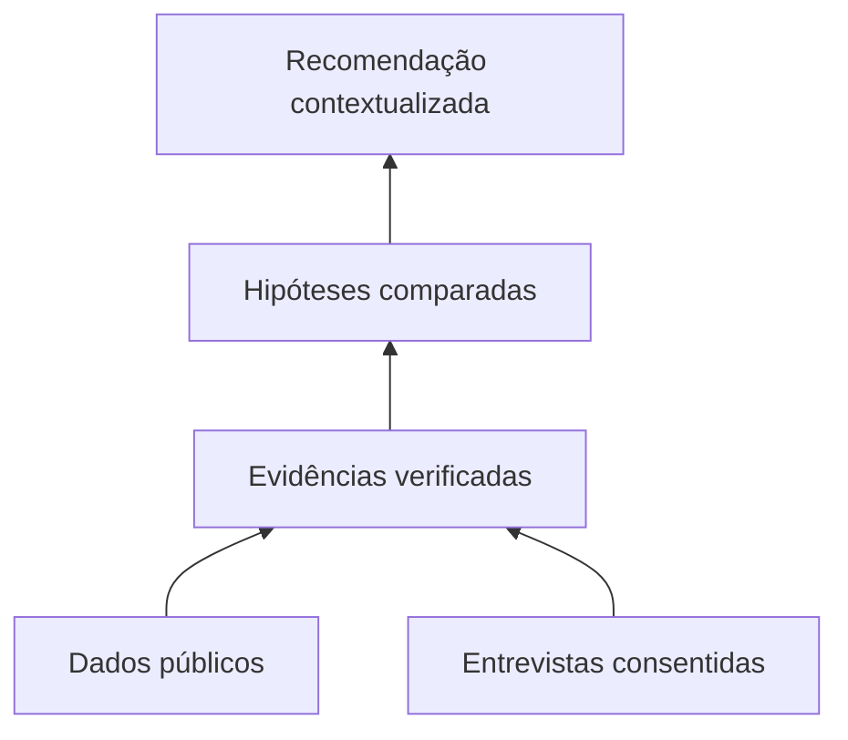

**Experimente:** altere um rótulo, uma relação, um valor ou uma etapa para refletir outra hipótese sobre Porto das Marés. Explique o que mudou.

### 1.5 Flow rl (5/58)

**Pergunta:** Como a representação de **flowchart** ajuda a investigar um desafio do Observatório Maré Viva?

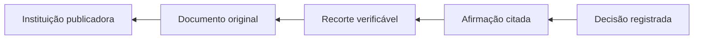

**Experimente:** altere um rótulo, uma relação, um valor ou uma etapa para refletir outra hipótese sobre Porto das Marés. Explique o que mudou.

### 1.6 Flow boundaries (6/58)

**Pergunta:** Como a representação de **flowchart** ajuda a investigar um desafio do Observatório Maré Viva?

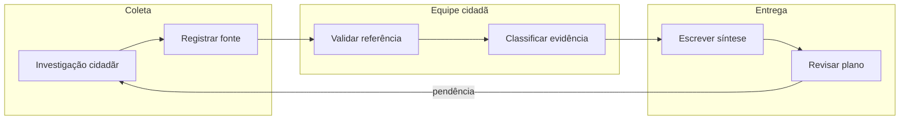

**Experimente:** altere um rótulo, uma relação, um valor ou uma etapa para refletir outra hipótese sobre Porto das Marés. Explique o que mudou.

### 1.7 Flow modern shapes (7/58)

**Pergunta:** Como a representação de **flowchart** ajuda a investigar um desafio do Observatório Maré Viva?

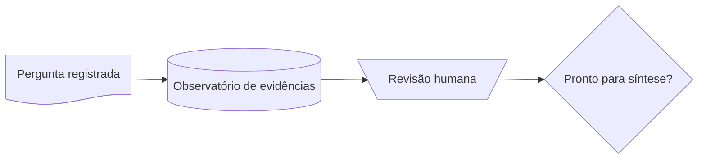

**Experimente:** altere um rótulo, uma relação, um valor ou uma etapa para refletir outra hipótese sobre Porto das Marés. Explique o que mudou.


<a id="capitulo-2"></a>
## 2. Participação e ciclos de vida

Neste capítulo, uma representação diferente revela uma dimensão da vida em Porto das Marés.

### 2.1 Swim review (8/58)

**Pergunta:** Como a representação de **swimlane** ajuda a investigar um desafio do Observatório Maré Viva?

```mermaid
swimlane-beta LR
  subgraph Research[Investigação cidadã]
    Find[Encontrar fonte] --> Submit[Enviar evidência]
  end
  subgraph Review[Revisão]
    Verify[Verificar citação] --> Accept[Aceitar referência]
  end
  subgraph Editorial[Editorial]
    Draft[Escrever síntese] --> Deliver[Entregar plano]
  end
  Submit --> Verify
  Accept --> Draft
```

**Experimente:** altere um rótulo, uma relação, um valor ou uma etapa para refletir outra hipótese sobre Porto das Marés. Explique o que mudou.

### 2.2 Usecase roles (9/58)

**Pergunta:** Como a representação de **usecase** ajuda a investigar um desafio do Observatório Maré Viva?

```mermaid
usecase-beta
direction LR
actor Researcher("Moradora")
actor Reviewer("Avaliadora")
systemBoundary Workspace["Observatório Maré Viva"]
  Capture("Registrar evidência")
  Organize("Organizar plano")
  Verify("Verificar referência")
  Review("Revisar síntese")
end
Researcher --> Capture
Researcher --> Organize
Reviewer --> Review
Capture ..> : include Verify
```

**Experimente:** altere um rótulo, uma relação, um valor ou uma etapa para refletir outra hipótese sobre Porto das Marés. Explique o que mudou.

### 2.3 Journey evidence (10/58)

**Pergunta:** Como a representação de **journey** ajuda a investigar um desafio do Observatório Maré Viva?

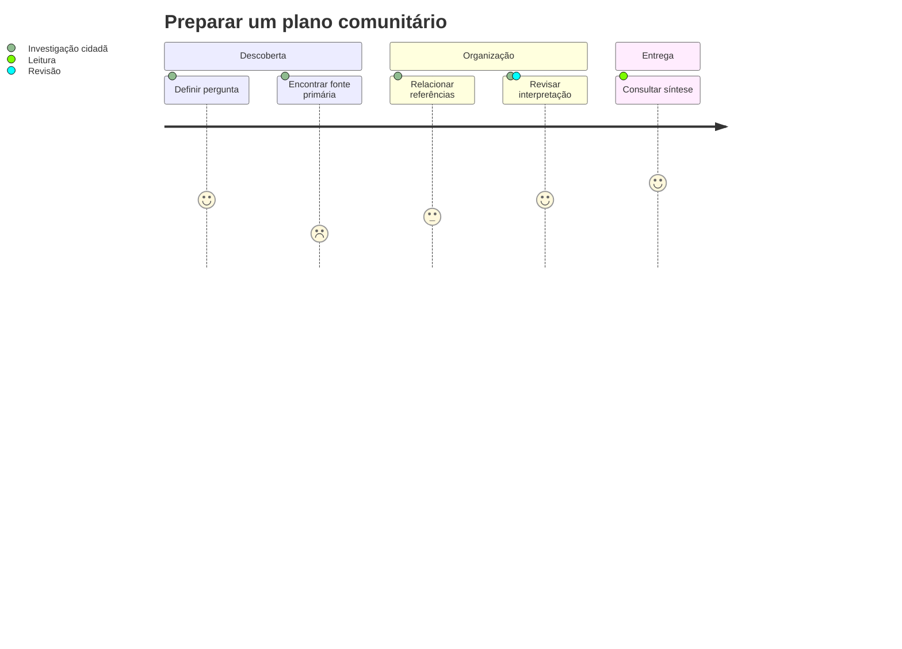

**Experimente:** altere um rótulo, uma relação, um valor ou uma etapa para refletir outra hipótese sobre Porto das Marés. Explique o que mudou.

### 2.4 Sequence save (11/58)

**Pergunta:** Como a representação de **sequence** ajuda a investigar um desafio do Observatório Maré Viva?

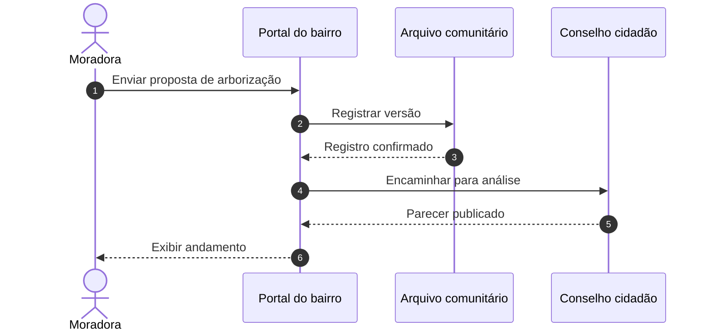

**Experimente:** altere um rótulo, uma relação, um valor ou uma etapa para refletir outra hipótese sobre Porto das Marés. Explique o que mudou.

### 2.5 Sequence retry (12/58)

**Pergunta:** Como a representação de **sequence** ajuda a investigar um desafio do Observatório Maré Viva?

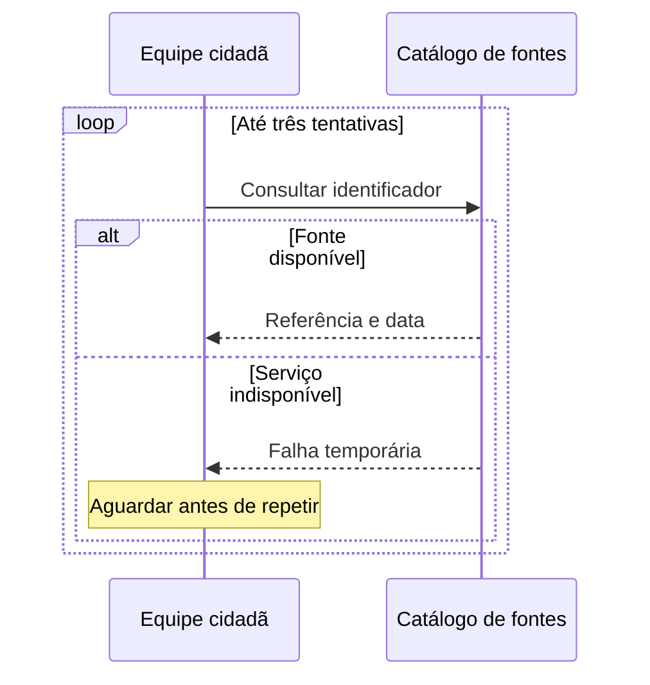

**Experimente:** altere um rótulo, uma relação, um valor ou uma etapa para refletir outra hipótese sobre Porto das Marés. Explique o que mudou.

### 2.6 Sequence parallel (13/58)

**Pergunta:** Como a representação de **sequence** ajuda a investigar um desafio do Observatório Maré Viva?

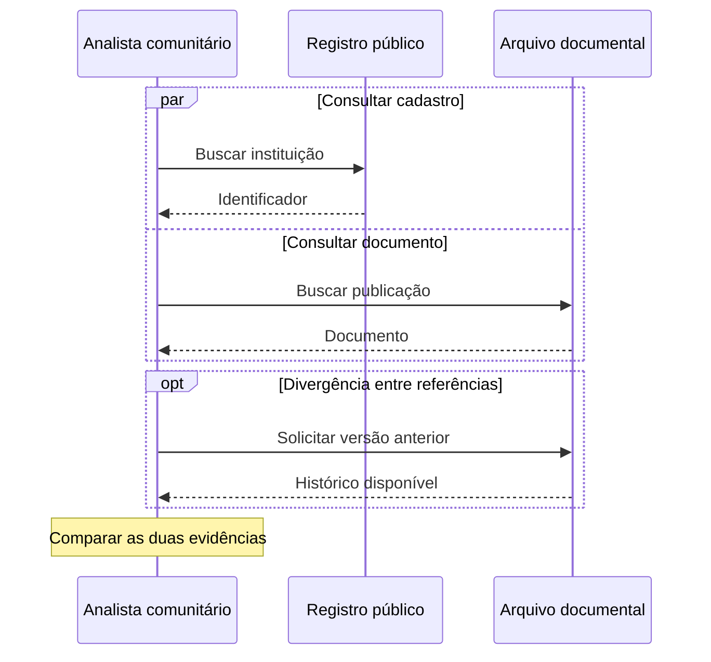

**Experimente:** altere um rótulo, uma relação, um valor ou uma etapa para refletir outra hipótese sobre Porto das Marés. Explique o que mudou.

### 2.7 Sequence async (14/58)

**Pergunta:** Como a representação de **sequence** ajuda a investigar um desafio do Observatório Maré Viva?

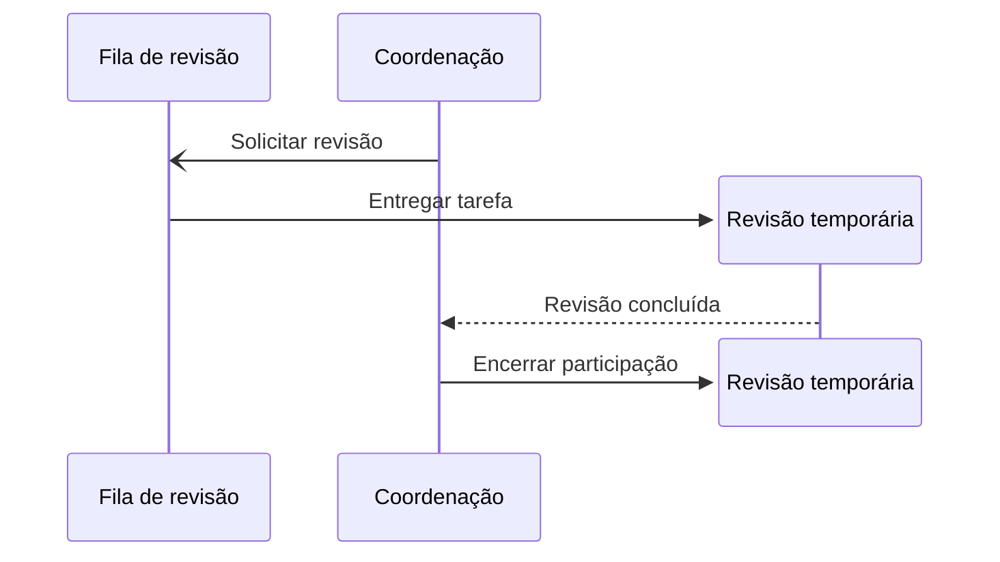

**Experimente:** altere um rótulo, uma relação, um valor ou uma etapa para refletir outra hipótese sobre Porto das Marés. Explique o que mudou.

### 2.8 State note (15/58)

**Pergunta:** Como a representação de **state** ajuda a investigar um desafio do Observatório Maré Viva?

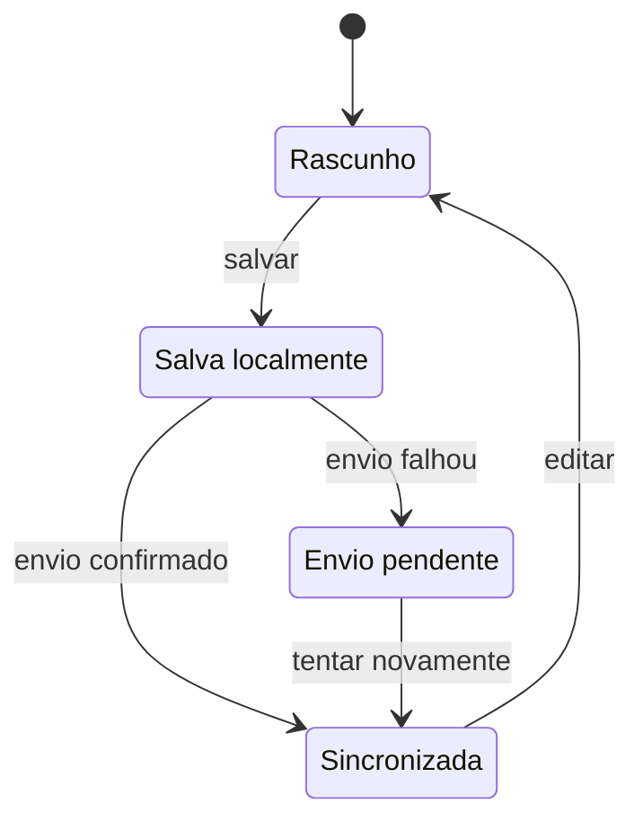

**Experimente:** altere um rótulo, uma relação, um valor ou uma etapa para refletir outra hipótese sobre Porto das Marés. Explique o que mudou.

### 2.9 State composite (16/58)

**Pergunta:** Como a representação de **state** ajuda a investigar um desafio do Observatório Maré Viva?

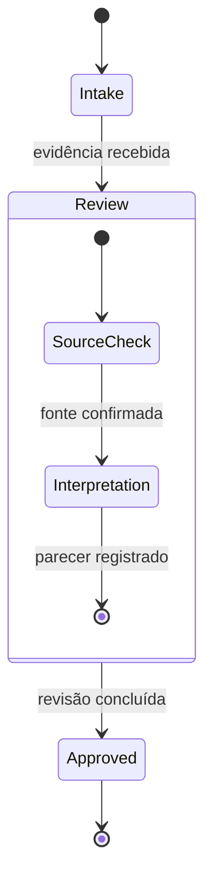

**Experimente:** altere um rótulo, uma relação, um valor ou uma etapa para refletir outra hipótese sobre Porto das Marés. Explique o que mudou.

### 2.10 State choice (17/58)

**Pergunta:** Como a representação de **state** ajuda a investigar um desafio do Observatório Maré Viva?

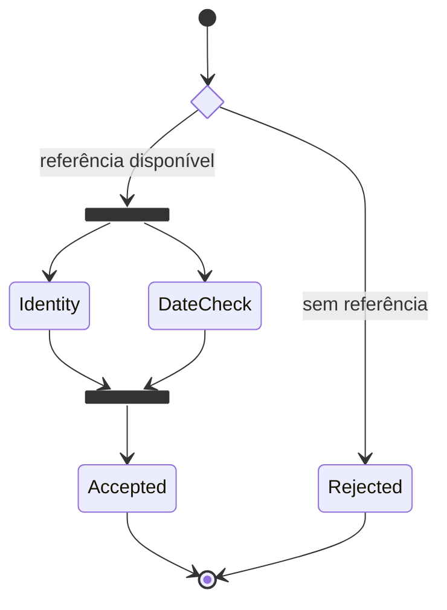

**Experimente:** altere um rótulo, uma relação, um valor ou uma etapa para refletir outra hipótese sobre Porto das Marés. Explique o que mudou.


<a id="capitulo-3"></a>
## 3. Conhecimento, dados e linguagens

Neste capítulo, uma representação diferente revela uma dimensão da vida em Porto das Marés.

### 3.1 Er notes (18/58)

**Pergunta:** Como a representação de **er** ajuda a investigar um desafio do Observatório Maré Viva?

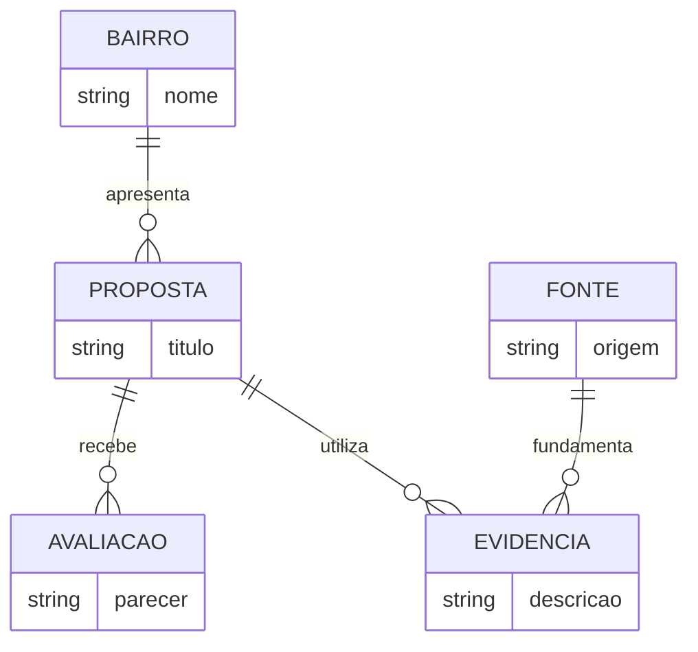

**Experimente:** altere um rótulo, uma relação, um valor ou uma etapa para refletir outra hipótese sobre Porto das Marés. Explique o que mudou.

### 3.2 Er cardinality (19/58)

**Pergunta:** Como a representação de **er** ajuda a investigar um desafio do Observatório Maré Viva?

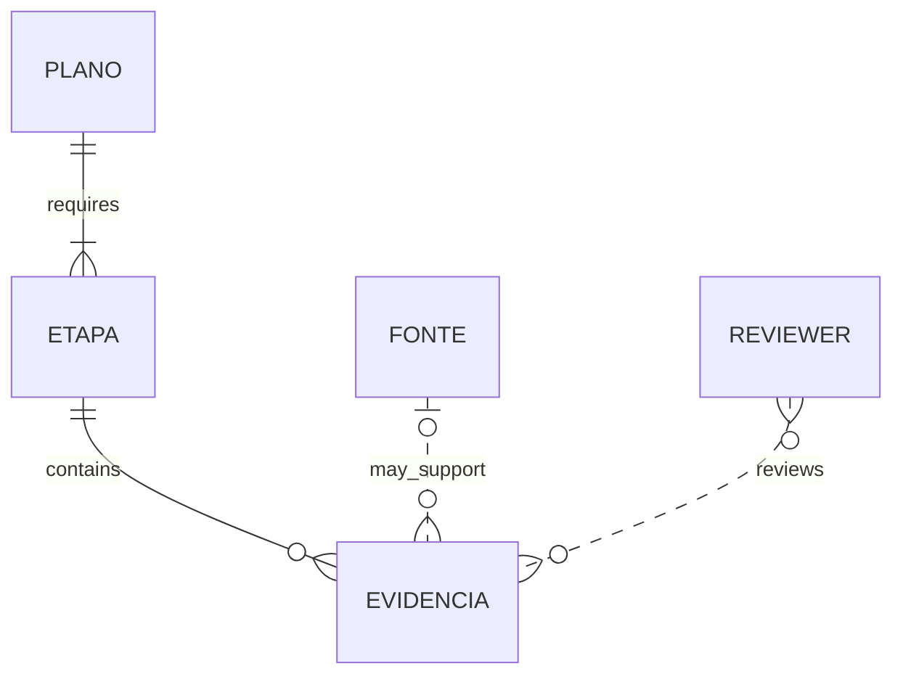

**Experimente:** altere um rótulo, uma relação, um valor ou uma etapa para refletir outra hipótese sobre Porto das Marés. Explique o que mudou.

### 3.3 Class domain (20/58)

**Pergunta:** Como a representação de **class** ajuda a investigar um desafio do Observatório Maré Viva?

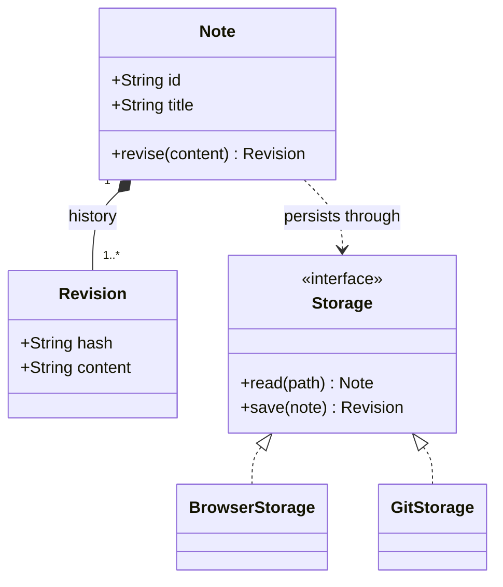

**Experimente:** altere um rótulo, uma relação, um valor ou uma etapa para refletir outra hipótese sobre Porto das Marés. Explique o que mudou.

### 3.4 Class relations (21/58)

**Pergunta:** Como a representação de **class** ajuda a investigar um desafio do Observatório Maré Viva?

```mermaid
classDiagram
  Document <|-- Report : specializes
  Collection "1" o-- "0..*" Document : groups
  Reviewer "1" --> "0..*" Document : reviews
  ExportService ..> Document : reads
  class Document {
    <<abstract>>
    +String title
    +render() String
  }
```

**Experimente:** altere um rótulo, uma relação, um valor ou uma etapa para refletir outra hipótese sobre Porto das Marés. Explique o que mudou.

### 3.5 Requirements evidence (22/58)

**Pergunta:** Como a representação de **requirement** ajuda a investigar um desafio do Observatório Maré Viva?

```mermaid
requirementDiagram
  requirement PreserveDraft {
    id: REQ_01
    text: Preserve unsaved note after reload
    risk: high
    verifymethod: test
  }
  element DraftStore {
    type: component
  }
  element ReloadTest {
    type: browser_test
  }
  DraftStore - satisfies -> PreserveDraft
  ReloadTest - verifies -> PreserveDraft
```

**Experimente:** altere um rótulo, uma relação, um valor ou uma etapa para refletir outra hipótese sobre Porto das Marés. Explique o que mudou.

### 3.6 Mindmap context (23/58)

**Pergunta:** Como a representação de **mindmap** ajuda a investigar um desafio do Observatório Maré Viva?

```mermaid
mindmap
  root((Contexto de investigação cidadã))
    Pergunta
      Escopo territorial
      Horizonte temporal
    Atores
      Instituições
      Pessoas afetadas
    Evidências
      Fontes primárias
      Contrapontos
    Entregas
      Síntese
      Lacunas abertas
```

**Experimente:** altere um rótulo, uma relação, um valor ou uma etapa para refletir outra hipótese sobre Porto das Marés. Explique o que mudou.

### 3.7 Tree files (24/58)

**Pergunta:** Como a representação de **treeView** ajuda a investigar um desafio do Observatório Maré Viva?

```mermaid
treeView-beta
├── notes/
│   ├── context.md
│   ├── evidence.md
│   └── decisions.md
├── assets/
│   ├── source-table.png
│   └── field-photo.jpg
└── exports/
    └── research-package.zip
```

**Experimente:** altere um rótulo, uma relação, um valor ou uma etapa para refletir outra hipótese sobre Porto das Marés. Explique o que mudou.

### 3.8 Railroad combinators (25/58)

**Pergunta:** Como a representação de **railroad** ajuda a investigar um desafio do Observatório Maré Viva?

```mermaid
railroad-beta
title Referência para uma seção
reference = sequence(nonterminal("note"), optional(sequence(terminal("#"), nonterminal("heading")))) ;
note = oneOrMore(nonterminal("letter")) ;
heading = oneOrMore(nonterminal("letter")) ;
letter = choice(terminal("a"), terminal("b"), terminal("c")) ;
```

**Experimente:** altere um rótulo, uma relação, um valor ou uma etapa para refletir outra hipótese sobre Porto das Marés. Explique o que mudou.

### 3.9 Railroad ebnf (26/58)

**Pergunta:** Como a representação de **railroad** ajuda a investigar um desafio do Observatório Maré Viva?

```mermaid
railroad-ebnf-beta
title Referência em EBNF
reference = name, [ "#", name ] ;
name = letter, { letter } ;
letter = "a" | "b" | "c" ;
```

**Experimente:** altere um rótulo, uma relação, um valor ou uma etapa para refletir outra hipótese sobre Porto das Marés. Explique o que mudou.

### 3.10 Railroad abnf (27/58)

**Pergunta:** Como a representação de **railroad** ajuda a investigar um desafio do Observatório Maré Viva?

```mermaid
railroad-abnf-beta
title Referência em ABNF
reference = name [ "#" name ] ;
name = 1*ALPHA ;
```

**Experimente:** altere um rótulo, uma relação, um valor ou uma etapa para refletir outra hipótese sobre Porto das Marés. Explique o que mudou.

### 3.11 Railroad peg (28/58)

**Pergunta:** Como a representação de **railroad** ajuda a investigar um desafio do Observatório Maré Viva?

```mermaid
railroad-peg-beta
title Referência em PEG
Reference <- Name ("#" Name)? ;
Name <- Letter+ ;
Letter <- "a" / "b" / "c" ;
```

**Experimente:** altere um rótulo, uma relação, um valor ou uma etapa para refletir outra hipótese sobre Porto das Marés. Explique o que mudou.


<a id="capitulo-4"></a>
## 4. Infraestrutura da colaboração

Neste capítulo, uma representação diferente revela uma dimensão da vida em Porto das Marés.

### 4.1 Block layout (29/58)

**Pergunta:** Como a representação de **block** ajuda a investigar um desafio do Observatório Maré Viva?

```mermaid
block-beta
  columns 3
  Header["Busca e ações"]:3
  Navigation["Notas"] Reading["Documento"]:2
  Footer["Estado e estatísticas"]:3
```

**Experimente:** altere um rótulo, uma relação, um valor ou uma etapa para refletir outra hipótese sobre Porto das Marés. Explique o que mudou.

### 4.2 Architecture services (30/58)

**Pergunta:** Como a representação de **architecture** ajuda a investigar um desafio do Observatório Maré Viva?

```mermaid
architecture-beta
  group workspace(cloud)[Observatório Maré Viva]
  service api(server)[Consulta] in workspace
  service metadata(database)[Metadados] in workspace
  service files(disk)[Documentos] in workspace
  api:R -- L:metadata
  api:B -- T:files
```

**Experimente:** altere um rótulo, uma relação, um valor ou uma etapa para refletir outra hipótese sobre Porto das Marés. Explique o que mudou.

### 4.3 C4 context (31/58)

**Pergunta:** Como a representação de **c4** ajuda a investigar um desafio do Observatório Maré Viva?

```mermaid
C4Context
  title Contexto do Observatório Maré Viva
  Person(analyst, "Analista comunitário", "Investiga uma pergunta")
  System(workspace, "Observatório Maré Viva", "Organiza evidências e sínteses")
  System_Ext(sources, "Fontes primárias", "Publicam documentos verificáveis")
  Rel(analyst, workspace, "Consulta e organiza")
  Rel(workspace, sources, "Referencia")
```

**Experimente:** altere um rótulo, uma relação, um valor ou uma etapa para refletir outra hipótese sobre Porto das Marés. Explique o que mudou.

### 4.4 C4 container (32/58)

**Pergunta:** Como a representação de **c4** ajuda a investigar um desafio do Observatório Maré Viva?

```mermaid
C4Container
  title Containers do Observatório Maré Viva
  Person(analyst, "Analista comunitário")
  System_Boundary(workspace, "Observatório Maré Viva") {
    Container(web, "Consulta web", "Navegador", "Apresenta planos")
    Container(api, "API de consulta", "HTTP", "Resolve consultas")
    ContainerDb(store, "Observatório", "Armazenamento", "Mantém referências")
  }
  Rel(analyst, web, "Consulta")
  Rel(web, api, "Solicita referências", "HTTPS")
  Rel(api, store, "Lê metadados")
```

**Experimente:** altere um rótulo, uma relação, um valor ou uma etapa para refletir outra hipótese sobre Porto das Marés. Explique o que mudou.

### 4.5 C4 component (33/58)

**Pergunta:** Como a representação de **c4** ajuda a investigar um desafio do Observatório Maré Viva?

```mermaid
C4Component
  title Componentes de consulta
  Container_Boundary(api, "API de consulta") {
    Component(entry, "Entrada HTTP", "Handler", "Recebe consultas")
    Component(check, "Validação", "Contrato", "Verifica parâmetros")
    Component(search, "Busca", "Serviço", "Localiza referências")
  }
  Rel(entry, check, "Valida")
  Rel(check, search, "Encaminha consulta válida")
```

**Experimente:** altere um rótulo, uma relação, um valor ou uma etapa para refletir outra hipótese sobre Porto das Marés. Explique o que mudou.

### 4.6 C4 dynamic (34/58)

**Pergunta:** Como a representação de **c4** ajuda a investigar um desafio do Observatório Maré Viva?

```mermaid
C4Dynamic
  title Abrir um plano no sistema hipotético
  Person(analyst, "Analista comunitário")
  Container(web, "Consulta web", "Navegador")
  Container(api, "API", "HTTP")
  Rel(analyst, web, "Abre plano")
  Rel(web, api, "Solicita metadados")
  Rel(api, web, "Entrega referências")
```

**Experimente:** altere um rótulo, uma relação, um valor ou uma etapa para refletir outra hipótese sobre Porto das Marés. Explique o que mudou.

### 4.7 C4 deployment (35/58)

**Pergunta:** Como a representação de **c4** ajuda a investigar um desafio do Observatório Maré Viva?

```mermaid
C4Deployment
  title Implantação hipotética do Observatório Maré Viva
  Deployment_Node(device, "Dispositivo da analista", "Computador") {
    Container(web, "Consulta web", "Navegador", "Apresenta o plano")
  }
  Deployment_Node(cloud, "Ambiente de consulta", "Serviço remoto") {
    Container(api, "API", "HTTP", "Responde consultas públicas")
  }
  Rel(web, api, "Consulta metadados", "HTTPS")
```

**Experimente:** altere um rótulo, uma relação, um valor ou uma etapa para refletir outra hipótese sobre Porto das Marés. Explique o que mudou.

### 4.8 Packet envelope (36/58)

**Pergunta:** Como a representação de **packet** ajuda a investigar um desafio do Observatório Maré Viva?

```mermaid
packet-beta
  0-7: "Versão"
  8-15: "Tipo de proposta"
  16-31: "Tamanho"
  32-63: "Identificador público"
```

**Experimente:** altere um rótulo, uma relação, um valor ou uma etapa para refletir outra hipótese sobre Porto das Marés. Explique o que mudou.

### 4.9 Agentflow review (37/58)

**Pergunta:** Como a representação de **agentflow** ajuda a investigar um desafio do Observatório Maré Viva?

```mermaid
agentflow-beta LR
  question["Pergunta"]@{ shape: input }
  flow research["Investigação cidadã assistida"]
    gather["Reunir evidências"]@{ shape: task }
    catalog["Consultar catálogo"]@{ shape: tool }
    protocol["Protocolo de fontes"]@{ shape: refdoc }
    gather --> catalog
    gather -.- protocol
  end
  human["Revisão humana"]@{ shape: decision }
  deliver["Registrar síntese aprovada"]@{ shape: action }
  question --> research --> human
  human --> deliver
```

**Experimente:** altere um rótulo, uma relação, um valor ou uma etapa para refletir outra hipótese sobre Porto das Marés. Explique o que mudou.


<a id="capitulo-5"></a>
## 5. Planejamento e aprendizagem

Neste capítulo, uma representação diferente revela uma dimensão da vida em Porto das Marés.

### 5.1 Gantt research (38/58)

**Pergunta:** Como a representação de **gantt** ajuda a investigar um desafio do Observatório Maré Viva?

```mermaid
gantt
  title Rodada ilustrativa de investigação cidadã
  dateFormat YYYY-MM-DD
  excludes weekends
  section Preparação
    Definir pergunta :done, scope, 2027-02-01, 2d
  section Evidências
    Coletar fontes :active, collect, after scope, 4d
    Revisar referências :crit, review, after collect, 2d
  section Entrega
    Publicar plano :milestone, delivery, after review, 0d
```

**Experimente:** altere um rótulo, uma relação, um valor ou uma etapa para refletir outra hipótese sobre Porto das Marés. Explique o que mudou.

### 5.2 Gantt parallel (39/58)

**Pergunta:** Como a representação de **gantt** ajuda a investigar um desafio do Observatório Maré Viva?

```mermaid
gantt
  title Trilhas paralelas de preparação
  dateFormat YYYY-MM-DD
  section Conteúdo
    Revisar corpus :content, 2027-03-01, 3d
  section Experiência
    Observar uso :experience, 2027-03-01, 3d
  section Integração
    Comparar achados :merge, 2027-03-04, 2d
    Fechar rodada :milestone, after merge, 0d
```

**Experimente:** altere um rótulo, uma relação, um valor ou uma etapa para refletir outra hipótese sobre Porto das Marés. Explique o que mudou.

### 5.3 Timeline learning (40/58)

**Pergunta:** Como a representação de **timeline** ajuda a investigar um desafio do Observatório Maré Viva?

```mermaid
timeline
  title Jornada de uma proposta contra alagamentos
  section Escuta
    Semana 1 : Moradores relatam inundações
  section Investigação
    Semana 2 : Equipe analisa mapas
  section Teste
    Semana 3 : Bairro testa jardins de chuva
  section Devolutiva
    Semana 4 : Resultados são publicados
```

**Experimente:** altere um rótulo, uma relação, um valor ou uma etapa para refletir outra hipótese sobre Porto das Marés. Explique o que mudou.

### 5.4 Kanban backlog (41/58)

**Pergunta:** Como a representação de **kanban** ajuda a investigar um desafio do Observatório Maré Viva?

```mermaid
kanban
  planned[Planejado]
    scope[Delimitar a pergunta]
  collecting[Coletando]
    sources[Localizar fonte primária]@{ priority: 'High' }
  reviewing[Em revisão]
    claims[Conferir duas afirmações]
  complete[Concluído]
    glossary[Registrar glossário]
```

**Experimente:** altere um rótulo, uma relação, um valor ou uma etapa para refletir outra hipótese sobre Porto das Marés. Explique o que mudou.

### 5.5 Git review (42/58)

**Pergunta:** Como a representação de **gitGraph** ajuda a investigar um desafio do Observatório Maré Viva?

```mermaid
gitGraph
  commit id: "escopo"
  branch research
  checkout research
  commit id: "fontes"
  commit id: "revisao"
  checkout main
  merge research
  commit id: "entrega" tag: "dossie-v1"
```

**Experimente:** altere um rótulo, uma relação, um valor ou uma etapa para refletir outra hipótese sobre Porto das Marés. Explique o que mudou.

### 5.6 Git maintenance (43/58)

**Pergunta:** Como a representação de **gitGraph** ajuda a investigar um desafio do Observatório Maré Viva?

```mermaid
gitGraph
  commit id: "base" tag: "v1"
  branch correction
  commit id: "corrigir-citacao" type: HIGHLIGHT
  checkout main
  branch evolution
  commit id: "nova-secao"
  checkout main
  merge correction
  merge evolution
  commit id: "consolidar" tag: "v2"
```

**Experimente:** altere um rótulo, uma relação, um valor ou uma etapa para refletir outra hipótese sobre Porto das Marés. Explique o que mudou.


<a id="capitulo-6"></a>
## 6. Números e futuros possíveis

Neste capítulo, uma representação diferente revela uma dimensão da vida em Porto das Marés.

### 6.1 Pie corpus (44/58)

**Pergunta:** Como a representação de **pie** ajuda a investigar um desafio do Observatório Maré Viva?

```mermaid
pie showData
  title Propostas por tema (100 casos fictícios)
  "Água e drenagem" : 35
  "Mobilidade" : 30
  "Áreas verdes" : 20
  "Cultura" : 15
```

**Experimente:** altere um rótulo, uma relação, um valor ou uma etapa para refletir outra hipótese sobre Porto das Marés. Explique o que mudou.

### 6.2 Quadrant priority (45/58)

**Pergunta:** Como a representação de **quadrantChart** ajuda a investigar um desafio do Observatório Maré Viva?

```mermaid
quadrantChart
  title Prioridades hipotéticas de Porto das Marés
  x-axis Menor esforço --> Maior esforço
  y-axis Menor impacto --> Maior impacto
  quadrant-1 Projetos estruturantes
  quadrant-2 Ganhos rápidos
  quadrant-3 Reavaliar
  quadrant-4 Experimentar
  "Mutirão de limpeza": [0.23, 0.72]
  "Rede de ciclovias": [0.81, 0.85]
  "Aplicativo novo": [0.73, 0.29]
  "Placas educativas": [0.21, 0.22]
```

**Experimente:** altere um rótulo, uma relação, um valor ou uma etapa para refletir outra hipótese sobre Porto das Marés. Explique o que mudou.

### 6.3 Xy bars (46/58)

**Pergunta:** Como a representação de **xychart** ajuda a investigar um desafio do Observatório Maré Viva?

```mermaid
xychart-beta
  title "Evidências revisadas por rodada"
  x-axis [R1, R2, R3, R4]
  y-axis "Documentos" 0 --> 80
  bar [25, 40, 60, 72]
```

**Experimente:** altere um rótulo, uma relação, um valor ou uma etapa para refletir outra hipótese sobre Porto das Marés. Explique o que mudou.

### 6.4 Xy line (47/58)

**Pergunta:** Como a representação de **xychart** ajuda a investigar um desafio do Observatório Maré Viva?

```mermaid
xychart-beta
  title "Cobertura ilustrativa de fontes"
  x-axis [S1, S2, S3, S4]
  y-axis "Cobertura percentual" 0 --> 100
  line [20, 45, 70, 85]
```

**Experimente:** altere um rótulo, uma relação, um valor ou uma etapa para refletir outra hipótese sobre Porto das Marés. Explique o que mudou.

### 6.5 Xy combined (48/58)

**Pergunta:** Como a representação de **xychart** ajuda a investigar um desafio do Observatório Maré Viva?

```mermaid
xychart-beta
  title "Entrada e revisão de documentos"
  x-axis [R1, R2, R3, R4]
  y-axis "Documentos" 0 --> 80
  bar [50, 65, 70, 75]
  line [25, 40, 60, 72]
```

**Experimente:** altere um rótulo, uma relação, um valor ou uma etapa para refletir outra hipótese sobre Porto das Marés. Explique o que mudou.

### 6.6 Radar quality (49/58)

**Pergunta:** Como a representação de **radar** ajuda a investigar um desafio do Observatório Maré Viva?

```mermaid
radar-beta
  title Dois futuros hipotéticos para a cidade
  axis agua[Água], acesso[Acesso], clima[Clima], cultura[Cultura]
  curve A["Cenário A"]{agua: 4, acesso: 3, clima: 2, cultura: 4}
  curve B["Cenário B"]{agua: 3, acesso: 4, clima: 5, cultura: 3}
  max 5
  min 0
```

**Experimente:** altere um rótulo, uma relação, um valor ou uma etapa para refletir outra hipótese sobre Porto das Marés. Explique o que mudou.

### 6.7 Sankey triage (50/58)

**Pergunta:** Como a representação de **sankey** ajuda a investigar um desafio do Observatório Maré Viva?

```mermaid
sankey-beta
"Energia solar","Residências",35
"Energia solar","Escolas",15
"Energia solar","Comércio",10
"Energia eólica","Residências",25
"Energia eólica","Escolas",5
"Energia eólica","Comércio",10
```

**Experimente:** altere um rótulo, uma relação, um valor ou uma etapa para refletir outra hipótese sobre Porto das Marés. Explique o que mudou.

### 6.8 Treemap acervo (51/58)

**Pergunta:** Como a representação de **treemap** ajuda a investigar um desafio do Observatório Maré Viva?

```mermaid
treemap-beta
"Investimentos fictícios"
  "Infraestrutura verde"
    "Drenagem": 30
    "Parques": 20
  "Mobilidade"
    "Calçadas": 25
    "Ciclovias": 15
  "Cultura"
    "Bibliotecas": 10
```

**Experimente:** altere um rótulo, uma relação, um valor ou uma etapa para refletir outra hipótese sobre Porto das Marés. Explique o que mudou.

### 6.9 Venn evidence (52/58)

**Pergunta:** Como a representação de **venn** ajuda a investigar um desafio do Observatório Maré Viva?

```mermaid
venn-beta
  title Valores para um futuro compartilhado
  set Inclusao["Inclusão"]
  set Evidencias["Evidências"]
  set Ambiente["Cuidado ambiental"]
  Inclusao & Evidencias : "Participação informada"
  Inclusao & Ambiente : "Justiça territorial"
  Evidencias & Ambiente : "Decisão fundamentada"
  Inclusao & Evidencias & Ambiente : "Bem comum"
```

**Experimente:** altere um rótulo, uma relação, um valor ou uma etapa para refletir outra hipótese sobre Porto das Marés. Explique o que mudou.


<a id="capitulo-7"></a>
## 7. Decisões sem falsas certezas

Neste capítulo, uma representação diferente revela uma dimensão da vida em Porto das Marés.

### 7.1 Events command (53/58)

**Pergunta:** Como a representação de **eventmodeling** ajuda a investigar um desafio do Observatório Maré Viva?

```mermaid
eventmodeling
  tf 01 ui EvidenceForm
  tf 02 cmd RegisterEvidence { sourceId: string }
  tf 03 evt EvidenceRegistered { evidenceId: string }
```

**Experimente:** altere um rótulo, uma relação, um valor ou uma etapa para refletir outra hipótese sobre Porto das Marés. Explique o que mudou.

### 7.2 Events projection (54/58)

**Pergunta:** Como a representação de **eventmodeling** ajuda a investigar um desafio do Observatório Maré Viva?

```mermaid
eventmodeling
  tf 01 evt EvidenceReviewed
  tf 02 rmo ReviewedEvidenceIndex
  tf 03 ui ResearchDashboard
```

**Experimente:** altere um rótulo, uma relação, um valor ou uma etapa para refletir outra hipótese sobre Porto das Marés. Explique o que mudou.

### 7.3 Ishikawa delay (55/58)

**Pergunta:** Como a representação de **ishikawa** ajuda a investigar um desafio do Observatório Maré Viva?

```mermaid
ishikawa-beta
  Atraso na implantação de ciclovias
  Planejamento
    Rotas sem integração
    Etapas pouco claras
  Participação
    Escuta insuficiente
  Recursos
    Orçamento limitado
  Dados
    Contagens desatualizadas
```

**Experimente:** altere um rótulo, uma relação, um valor ou uma etapa para refletir outra hipótese sobre Porto das Marés. Explique o que mudou.

### 7.4 Wardley capabilities (56/58)

**Pergunta:** Como a representação de **wardley** ajuda a investigar um desafio do Observatório Maré Viva?

```mermaid
wardley-beta
title Capacidades de uma cidade que aprende
anchor "Decisão pública informada" [0.95, 0.60]
component "Debate comunitário" [0.78, 0.35]
component "Dados abertos" [0.58, 0.50]
component "Infraestrutura digital" [0.22, 0.85]
"Decisão pública informada" -> "Debate comunitário"
"Debate comunitário" -> "Dados abertos"
"Dados abertos" -> "Infraestrutura digital"
```

**Experimente:** altere um rótulo, uma relação, um valor ou uma etapa para refletir outra hipótese sobre Porto das Marés. Explique o que mudou.

### 7.5 Cynefin decisions (57/58)

**Pergunta:** Como a representação de **cynefin** ajuda a investigar um desafio do Observatório Maré Viva?

```mermaid
cynefin-beta
  title Abordagens para desafios urbanos
  clear
    "Publicar calendário de reuniões"
  complicated
    "Dimensionar sistema de drenagem"
  complex
    "Construir confiança entre bairros"
  chaotic
    "Responder a uma enchente repentina"
  disorder
    "Investigar antes de classificar"
```

**Experimente:** altere um rótulo, uma relação, um valor ou uma etapa para refletir outra hipótese sobre Porto das Marés. Explique o que mudou.


<a id="capitulo-8"></a>
## 8. Diagnóstico do editor

Neste capítulo, uma representação diferente revela uma dimensão da vida em Porto das Marés.

### 8.1 Renderer info (58/58)

**Pergunta:** Como a representação de **info** ajuda a investigar um desafio do Observatório Maré Viva?

```mermaid
info
```

**Experimente:** altere um rótulo, uma relação, um valor ou uma etapa para refletir outra hipótese sobre Porto das Marés. Explique o que mudou.

## Oficina de linguagens: da pergunta ao protótipo

### Console
```console
$ mkdir mare-viva
$ cd mare-viva
$ printf "# Propostas do bairro\n" > propostas.md
$ cat propostas.md
```

### HTML
```html
<section aria-label="Participação comunitária">
  <h2>Que futuro você imagina para o bairro?</h2>
  <p>Compartilhe uma proposta para Porto das Marés.</p>
  <button type="button">Registrar ideia</button>
</section>
```

### Python
```python
cenarios = {"Bairro verde": [4, 5], "Mobilidade ativa": [5, 3]}
for nome, notas in cenarios.items():
    print(nome, sum(notas))
```

### JSON
```json
{"bairro": "Orla", "tema": "drenagem", "situacao": "em análise"}
```

### YAML
```yaml
laboratorio: Maré Viva
principios:
  - participação
  - transparência
  - cuidado ambiental
```

### JavaScript
```javascript
const proposta = { impacto: 4, viabilidade: 3 };
console.log(proposta.impacto + proposta.viabilidade);
```

### TypeScript
```typescript
type Proposta = { bairro: string; tema: string; publicada: boolean };
```

### SQL
```sql
SELECT bairro, COUNT(*) AS total
FROM propostas
GROUP BY bairro;
```

### CSS
```css
.pergunta { border-left: 4px solid currentColor; padding: 1rem; }
```

### Bash
```bash
find . -name "*.md" -type f
```

### Diff
```diff
- Hipótese: construir mais vias reduz o trânsito.
+ Hipótese: combinar transporte coletivo e mobilidade ativa reduz deslocamentos.
```

### LaTeX
```latex
\[ I = \frac{\text{propostas avaliadas}}{\text{propostas recebidas}} \times 100 \]
```

## Elementos visuais: HTML, Lucide e SVG

<div style="padding:16px;border:1px solid currentColor;border-radius:12px">
  <h3><i data-lucide="users" aria-hidden="true"></i> Uma cidade feita por pessoas</h3>
  <p><i data-lucide="sprout" aria-hidden="true"></i> Cuidar do território também é produzir conhecimento.</p>
  <p><i data-lucide="git-branch" aria-hidden="true"></i> Uma ideia pode seguir caminhos diferentes.</p>
</div>

<svg viewBox="0 0 320 100" width="320" height="100" role="img" aria-label="Três etapas: escutar, testar e aprender">
<circle cx="45" cy="50" r="28" fill="none" stroke="currentColor" stroke-width="2"/>
<circle cx="160" cy="50" r="28" fill="none" stroke="currentColor" stroke-width="2"/>
<circle cx="275" cy="50" r="28" fill="none" stroke="currentColor" stroke-width="2"/>
<path d="M75 50 H130 M190 50 H245" stroke="currentColor" stroke-width="2"/>
<text x="45" y="54" text-anchor="middle" fill="currentColor" font-size="9">Escutar</text>
<text x="160" y="54" text-anchor="middle" fill="currentColor" font-size="9">Testar</text>
<text x="275" y="54" text-anchor="middle" fill="currentColor" font-size="9">Aprender</text>
</svg>

## Sua vez

Escolha uma proposta para seu bairro. Registre uma hipótese, uma evidência que poderia contrariá-la e um pequeno experimento para aprender com a realidade. O futuro não precisa ser uma previsão: pode começar como uma pergunta melhor.
