# Die Werkstatt der vernetzten Zukunft


> **Redaktioneller Hinweis:** Morgenfeld ist eine erfundene Stadt. Alle Zahlen, Systeme, Personen und Planungen sind didaktische Beispiele, keine tatsächlichen Stadtstatistiken. Jede Grafik lädt dazu ein, ihre Annahmen zu prüfen und selbst zu verändern.


## *Was wäre, wenn wir Zukunft gemeinsam gestalten?*

**Von Gutenberg über das Bauhaus bis zur künstlichen Intelligenz: eine interaktive Expedition durch die fiktive Stadt Morgenfeld.**

> Was wäre, wenn die nächste große Erfindung keine Maschine, sondern eine bessere Frage wäre?

Vom Buchdruck über das Bauhaus bis zur heutigen Forschung haben Menschen Wissen zugänglich und gestaltbar gemacht. In unserer fiktiven Stadt Morgenfeld treffen Ingenieurinnen, Künstler, Forschende und Bürgerinnen aufeinander: Gemeinsam entwerfen sie eine lebenswerte Zukunft.

<div style="border:1px solid currentColor;border-radius:12px;padding:14px"><i data-lucide="lightbulb" style="font-size:24px"></i> <strong>Willkommen in der Werkstatt der Möglichkeiten.</strong><p>Jeder Diagramm eröffnet eine andere Sicht. Verändern Sie es, hinterfragen Sie Annahmen und entwickeln Sie eigene Ideen.</p></div>

**So funktioniert es:** Öffnen Sie den Quelltext einer Darstellung, ändern Sie eine Beziehung und beobachten Sie, wie sich ihre Bedeutung verschiebt. Alle Zahlen, Szenarien und Systeme sind **frei erfundene Lernbeispiele**. Die Beispiele zeigen Markdown-Syntax; ihre Darstellung hängt vom gewählten Renderer ab.

## Inhalt

- 1. Eine Frage verändert die Welt
- 2. Die Architektur der Wissen
- 3. Eine Stadt denkt gemeinsam
- 4. Maschinen und Menschen im Dialog
- 5. Die Sprachen der Gestaltung
- 6. Die Zukunft in Zahlen
- 7. Von der Idee zum Prototyp
- 8. Entscheidungen ohne Gewissheit
- 9. Ideen sichtbar machen
- 10. Ihre Werkstatt der Zukunft

---

## 1. Eine Frage verändert die Welt

**Leitgedanke:** Die fiktive Stadt Morgenfeld dient als gemeinsamer Prüfstand: Was können wir bauen, was sollten wir hinterfragen und wer darf entscheiden?

### 1.1 Wege zur Erkenntnis : flow-review

****Leitfrage:**** Wie wird aus einer offenen Frage ein überprüfbarer Vorschlag für Morgenfeld?

<!-- scriba-example: flow-review family=flowchart -->

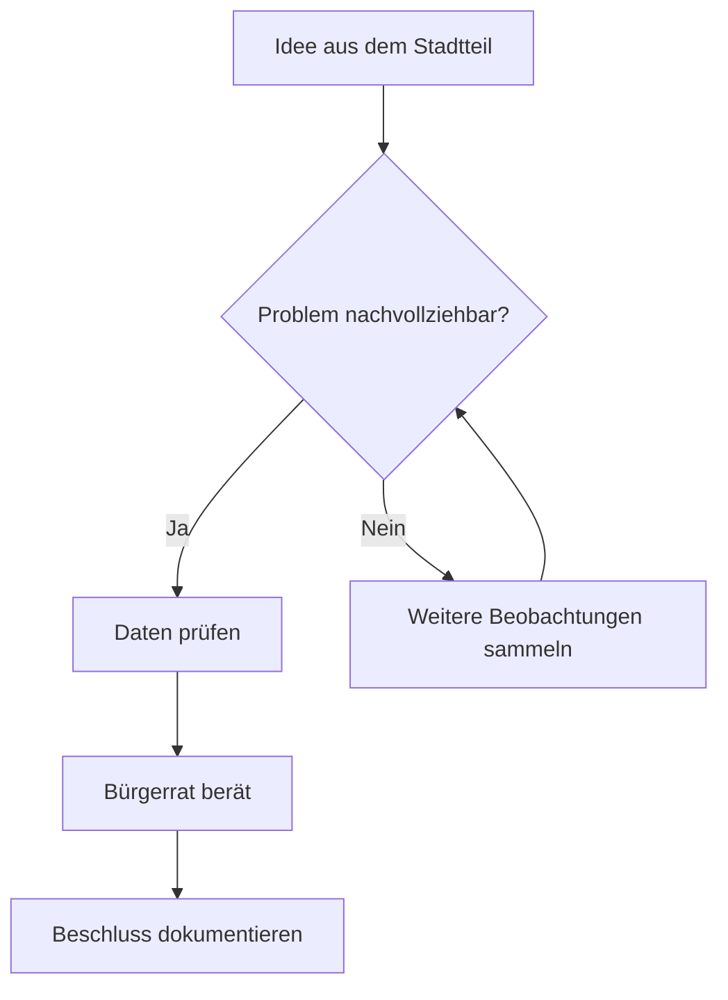

****Einordnung:**** Dies ist ein bewusst vereinfachtes Modell von Morgenfeld, keine Beschreibung eines realen Systems. Die Darstellung macht bestimmte Beziehungen sichtbar und blendet andere aus.

**Zum Ausprobieren:** Ergänzen Sie eine Rückkopplung, die eine überstürzte Entscheidung verhindert.

### 1.2 Wege zur Erkenntnis : flow-edges

****Leitfrage:**** Wie wird aus einer offenen Frage ein überprüfbarer Vorschlag für Morgenfeld?

<!-- scriba-example: flow-edges family=flowchart -->

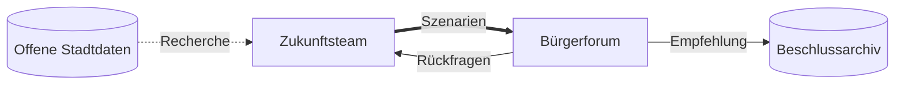

****Einordnung:**** Dies ist ein bewusst vereinfachtes Modell von Morgenfeld, keine Beschreibung eines realen Systems. Die Darstellung macht bestimmte Beziehungen sichtbar und blendet andere aus.

**Zum Ausprobieren:** Ergänzen Sie eine Rückkopplung, die eine überstürzte Entscheidung verhindert.

### 1.3 Wege zur Erkenntnis : flow-shapes

****Leitfrage:**** Wie wird aus einer offenen Frage ein überprüfbarer Vorschlag für Morgenfeld?

<!-- scriba-example: flow-shapes family=flowchart -->

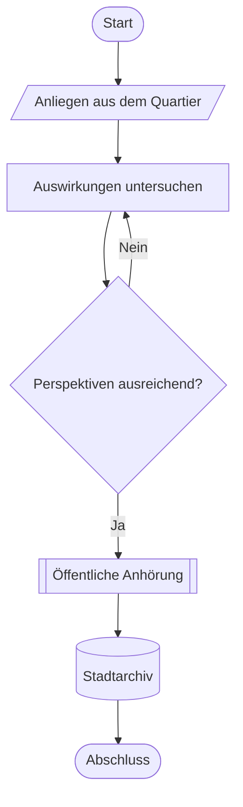

****Einordnung:**** Dies ist ein bewusst vereinfachtes Modell von Morgenfeld, keine Beschreibung eines realen Systems. Die Darstellung macht bestimmte Beziehungen sichtbar und blendet andere aus.

**Zum Ausprobieren:** Ergänzen Sie eine Rückkopplung, die eine überstürzte Entscheidung verhindert.

### 1.4 Wege zur Erkenntnis : flow-bt

****Leitfrage:**** Wie wird aus einer offenen Frage ein überprüfbarer Vorschlag für Morgenfeld?

<!-- scriba-example: flow-bt family=flowchart -->

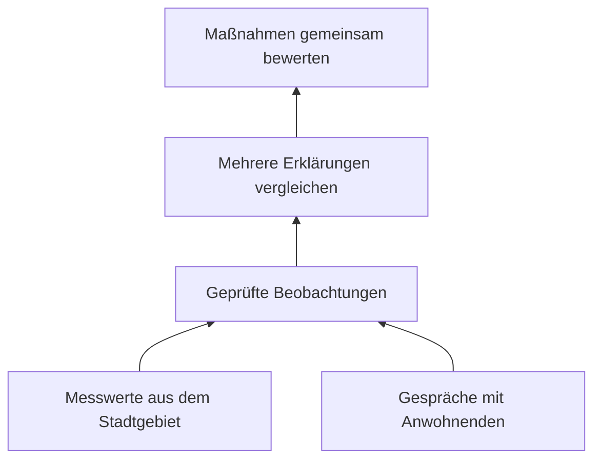

****Einordnung:**** Dies ist ein bewusst vereinfachtes Modell von Morgenfeld, keine Beschreibung eines realen Systems. Die Darstellung macht bestimmte Beziehungen sichtbar und blendet andere aus.

**Zum Ausprobieren:** Ergänzen Sie eine Rückkopplung, die eine überstürzte Entscheidung verhindert.

### 1.5 Wege zur Erkenntnis : flow-rl

****Leitfrage:**** Wie wird aus einer offenen Frage ein überprüfbarer Vorschlag für Morgenfeld?

<!-- scriba-example: flow-rl family=flowchart -->

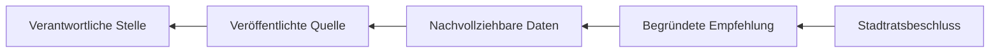

****Einordnung:**** Dies ist ein bewusst vereinfachtes Modell von Morgenfeld, keine Beschreibung eines realen Systems. Die Darstellung macht bestimmte Beziehungen sichtbar und blendet andere aus.

**Zum Ausprobieren:** Ergänzen Sie eine Rückkopplung, die eine überstürzte Entscheidung verhindert.

### 1.6 Wege zur Erkenntnis : flow-boundaries

****Leitfrage:**** Wie wird aus einer offenen Frage ein überprüfbarer Vorschlag für Morgenfeld?

<!-- scriba-example: flow-boundaries family=flowchart -->

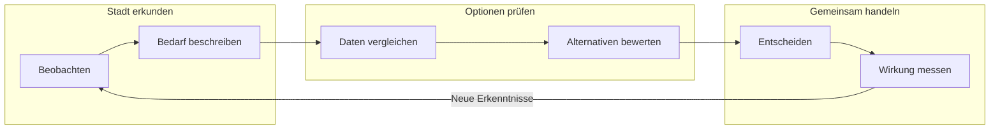

****Einordnung:**** Dies ist ein bewusst vereinfachtes Modell von Morgenfeld, keine Beschreibung eines realen Systems. Die Darstellung macht bestimmte Beziehungen sichtbar und blendet andere aus.

**Zum Ausprobieren:** Ergänzen Sie eine Rückkopplung, die eine überstürzte Entscheidung verhindert.

### 1.7 Wege zur Erkenntnis : flow-modern-shapes

****Leitfrage:**** Wie wird aus einer offenen Frage ein überprüfbarer Vorschlag für Morgenfeld?

<!-- scriba-example: flow-modern-shapes family=flowchart -->

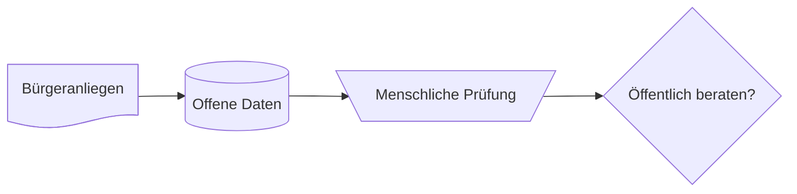

****Einordnung:**** Dies ist ein bewusst vereinfachtes Modell von Morgenfeld, keine Beschreibung eines realen Systems. Die Darstellung macht bestimmte Beziehungen sichtbar und blendet andere aus.

**Zum Ausprobieren:** Ergänzen Sie eine Rückkopplung, die eine überstürzte Entscheidung verhindert.

### 1.8 Stationen des Wissenswandels : timeline-learning

****Leitfrage:**** Welche Umbrüche der Wissensvermittlung prägen unsere Gegenwart?

<!-- scriba-example: timeline-learning family=timeline -->

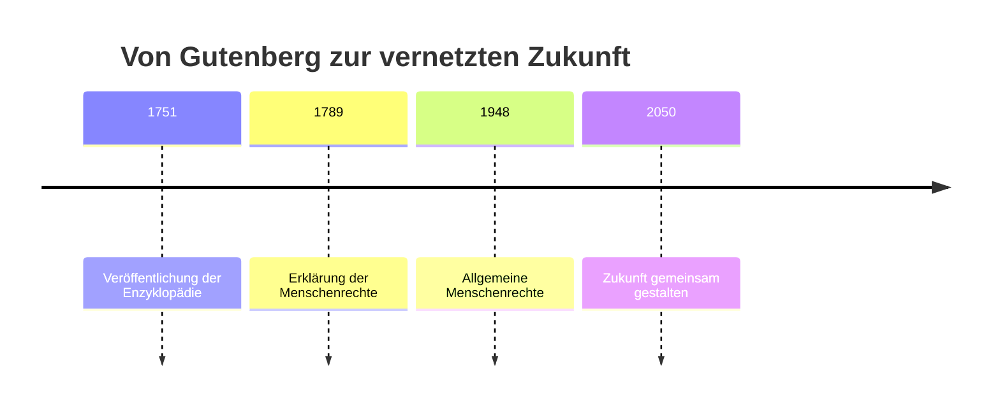

****Einordnung:**** Dies ist ein bewusst vereinfachtes Modell von Morgenfeld, keine Beschreibung eines realen Systems. Die Darstellung macht bestimmte Beziehungen sichtbar und blendet andere aus.

**Zum Ausprobieren:** Ergänzen Sie einen Meilenstein der offenen Wissenschaft.

## 2. Die Architektur der Wissen

**Leitgedanke:** Die fiktive Stadt Morgenfeld dient als gemeinsamer Prüfstand: Was können wir bauen, was sollten wir hinterfragen und wer darf entscheiden?

### 2.1 Akteure und Beziehungen : er-notes

****Leitfrage:**** Welche Daten braucht Morgenfeld, ohne Menschen auf Datensätze zu reduzieren?

<!-- scriba-example: er-notes family=er -->

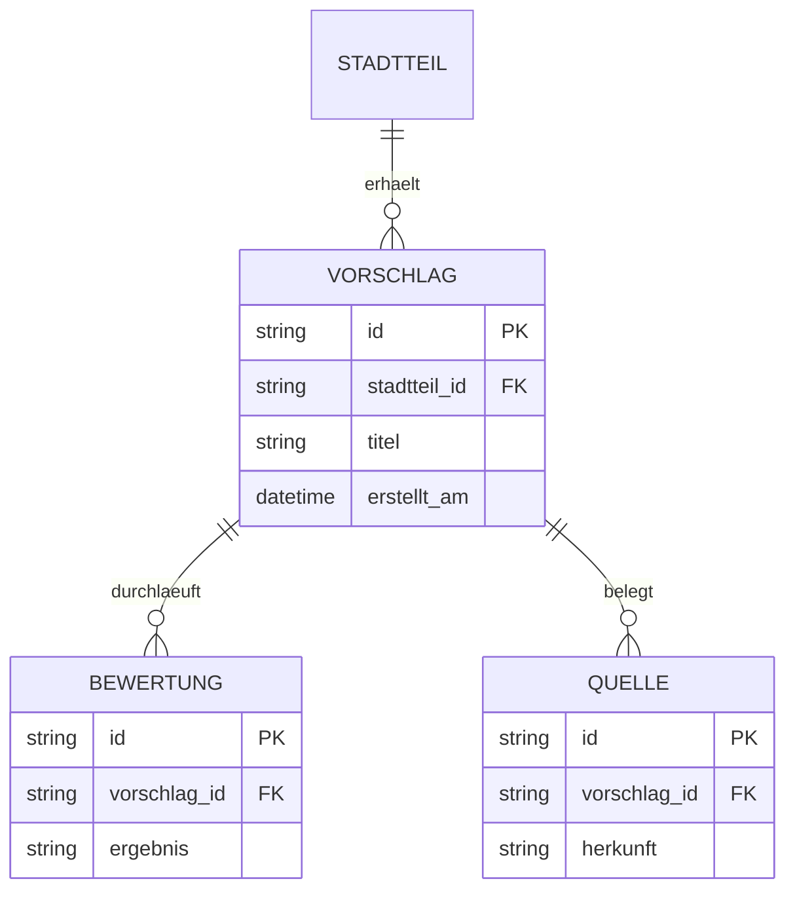

****Einordnung:**** Dies ist ein bewusst vereinfachtes Modell von Morgenfeld, keine Beschreibung eines realen Systems. Die Darstellung macht bestimmte Beziehungen sichtbar und blendet andere aus.

**Zum Ausprobieren:** Ergänzen Sie eine Entität für Einwilligungen.

### 2.2 Akteure und Beziehungen : er-cardinality

****Leitfrage:**** Welche Daten braucht Morgenfeld, ohne Menschen auf Datensätze zu reduzieren?

<!-- scriba-example: er-cardinality family=er -->

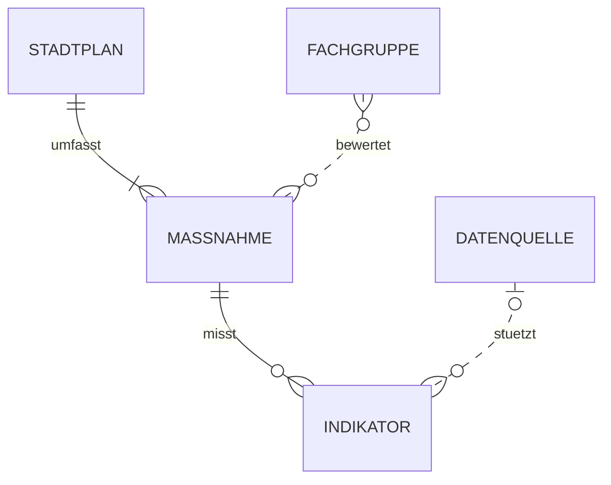

****Einordnung:**** Dies ist ein bewusst vereinfachtes Modell von Morgenfeld, keine Beschreibung eines realen Systems. Die Darstellung macht bestimmte Beziehungen sichtbar und blendet andere aus.

**Zum Ausprobieren:** Ergänzen Sie eine Entität für Einwilligungen.

### 2.3 Konzepte und Objekte : class-domain

****Leitfrage:**** Was macht diese Darstellung in Morgenfeld verständlicher?

<!-- scriba-example: class-domain family=class -->

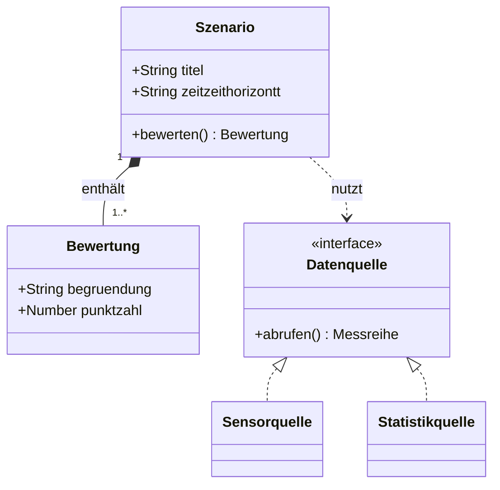

****Einordnung:**** Dies ist ein bewusst vereinfachtes Modell von Morgenfeld, keine Beschreibung eines realen Systems. Die Darstellung macht bestimmte Beziehungen sichtbar und blendet andere aus.

**Zum Ausprobieren:** Ändern Sie einen Akteur, eine Verbindung oder ein Kriterium. Welche neue Perspektive entsteht?

### 2.4 Konzepte und Objekte : class-relations

****Leitfrage:**** Was macht diese Darstellung in Morgenfeld verständlicher?

<!-- scriba-example: class-relations family=class -->

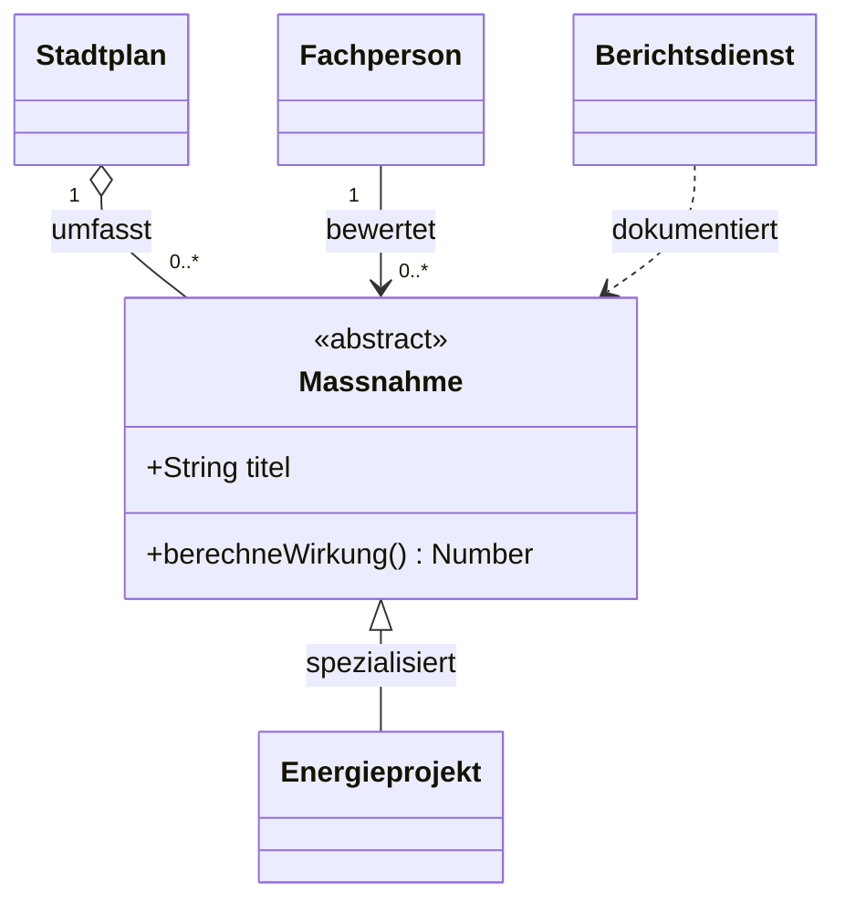

****Einordnung:**** Dies ist ein bewusst vereinfachtes Modell von Morgenfeld, keine Beschreibung eines realen Systems. Die Darstellung macht bestimmte Beziehungen sichtbar und blendet andere aus.

**Zum Ausprobieren:** Ändern Sie einen Akteur, eine Verbindung oder ein Kriterium. Welche neue Perspektive entsteht?

### 2.5 Landkarte der Möglichkeiten : mindmap-context

****Leitfrage:**** Welche Ideen verbinden Bauhaus, Technik und gesellschaftliche Teilhabe?

<!-- scriba-example: mindmap-context family=mindmap -->

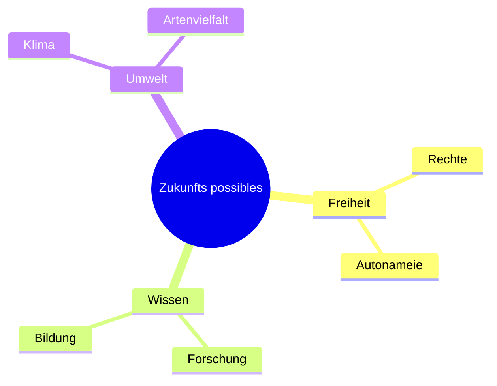

****Einordnung:**** Dies ist ein bewusst vereinfachtes Modell von Morgenfeld, keine Beschreibung eines realen Systems. Die Darstellung macht bestimmte Beziehungen sichtbar und blendet andere aus.

**Zum Ausprobieren:** Ergänzen Sie einen Ast für Barrierefreiheit.

### 2.6 Wissenbaum : tree-files

****Leitfrage:**** Wie gliedern wir ein wachsendes Archiv der Zukunftsideen?

<!-- scriba-example: tree-files family=treeView -->


****Einordnung:**** Dies ist ein bewusst vereinfachtes Modell von Morgenfeld, keine Beschreibung eines realen Systems. Die Darstellung macht bestimmte Beziehungen sichtbar und blendet andere aus.

**Zum Ausprobieren:** Ergänzen Sie einen Zweig für Energie und Ressourcen.

## 3. Eine Stadt denkt gemeinsam

**Leitgedanke:** Die fiktive Stadt Morgenfeld dient als gemeinsamer Prüfstand: Was können wir bauen, was sollten wir hinterfragen und wer darf entscheiden?

### 3.1 Gemeinsame Verantwortung : swim-review

****Leitfrage:**** Wer trägt Verantwortung, wenn ein Stadtprojekt geprüft wird?

<!-- scriba-example: swim-review family=swimlane -->

```mermaid
swimlane-beta LR
  subgraph Bürgers[Bürgers]
    Idee[Idee vorschlagen] --> Debatte[Diskutieren]
  end
  subgraph Forschende[Forschende]
    Etude[Daten untersuchen] --> Beleg[Belege prüfen]
  end
  Debatte --> Etude
```

****Einordnung:**** Dies ist ein bewusst vereinfachtes Modell von Morgenfeld, keine Beschreibung eines realen Systems. Die Darstellung macht bestimmte Beziehungen sichtbar und blendet andere aus.

**Zum Ausprobieren:** Ergänzen Sie eine unabhängige Prüfstelle.

### 3.2 Bürgerdienste : usecase-roles

****Leitfrage:**** Welche Aufgaben sollen Menschen erledigen und welche darf Software unterstützen?

<!-- scriba-example: usecase-roles family=usecase -->

```mermaid
usecase-beta
direction LR
actor Bürger("Bürger")
actor Chercheur("Chercheur")
systemBoundary Atelier["Werkstatt Morgenfeld"]
  Erforschen("Idee untersuchen")
  Verifier("Quellen prüfen")
end
Bürger --> Erforschen
Chercheur --> Verifier
```

****Einordnung:**** Dies ist ein bewusst vereinfachtes Modell von Morgenfeld, keine Beschreibung eines realen Systems. Die Darstellung macht bestimmte Beziehungen sichtbar und blendet andere aus.

**Zum Ausprobieren:** Ergänzen Sie einen Anwendungsfall für Widerspruch.

### 3.3 Erkundungsreise : journey-evidence

****Leitfrage:**** Wie erlebt eine Einwohnerin den Weg von der Idee zur Entscheidung?

<!-- scriba-example: journey-evidence family=journey -->

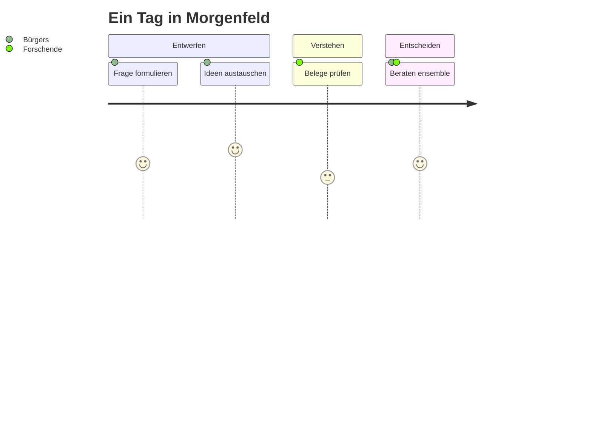

****Einordnung:**** Dies ist ein bewusst vereinfachtes Modell von Morgenfeld, keine Beschreibung eines realen Systems. Die Darstellung macht bestimmte Beziehungen sichtbar und blendet andere aus.

**Zum Ausprobieren:** Verändern Sie eine Etappe, die bisher zu kompliziert wirkt.

### 3.4 Dialog und Austausch : sequence-save

****Leitfrage:**** Wer spricht wann mit wem, wenn ein Vorschlag eingereicht wird?

<!-- scriba-example: sequence-save family=sequence -->

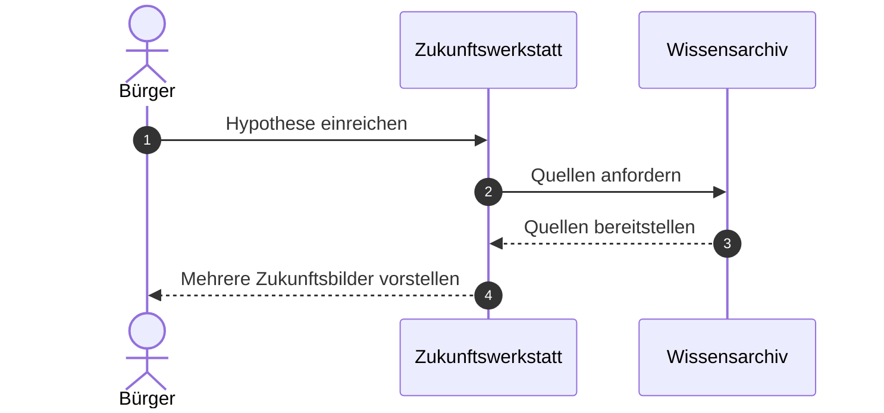

****Einordnung:**** Dies ist ein bewusst vereinfachtes Modell von Morgenfeld, keine Beschreibung eines realen Systems. Die Darstellung macht bestimmte Beziehungen sichtbar und blendet andere aus.

**Zum Ausprobieren:** Fügen Sie einen Moment ein, in dem eine Person widersprechen kann.

### 3.5 Dialog und Austausch : sequence-retry

****Leitfrage:**** Wer spricht wann mit wem, wenn ein Vorschlag eingereicht wird?

<!-- scriba-example: sequence-retry family=sequence -->


****Einordnung:**** Dies ist ein bewusst vereinfachtes Modell von Morgenfeld, keine Beschreibung eines realen Systems. Die Darstellung macht bestimmte Beziehungen sichtbar und blendet andere aus.

**Zum Ausprobieren:** Fügen Sie einen Moment ein, in dem eine Person widersprechen kann.

### 3.6 Dialog und Austausch : sequence-parallel

****Leitfrage:**** Wer spricht wann mit wem, wenn ein Vorschlag eingereicht wird?

<!-- scriba-example: sequence-parallel family=sequence -->


****Einordnung:**** Dies ist ein bewusst vereinfachtes Modell von Morgenfeld, keine Beschreibung eines realen Systems. Die Darstellung macht bestimmte Beziehungen sichtbar und blendet andere aus.

**Zum Ausprobieren:** Fügen Sie einen Moment ein, in dem eine Person widersprechen kann.

### 3.7 Dialog und Austausch : sequence-async

****Leitfrage:**** Wer spricht wann mit wem, wenn ein Vorschlag eingereicht wird?

<!-- scriba-example: sequence-async family=sequence -->

```mermaid
sequenceDiagram
  autonumber
  actor Bürger
  participant Atelier as Zukunftswerkstatt
  participant Quelles as Wissensarchiv
  Bürger->>Atelier: Hypothese einreichen
  Atelier->>Quelles: Quellen anfordern
  Quelles-->>Atelier: Quellen bereitstellen
  Atelier-->>Bürger: Mehrere Zukunftsbilder vorstellen
```

****Einordnung:**** Dies ist ein bewusst vereinfachtes Modell von Morgenfeld, keine Beschreibung eines realen Systems. Die Darstellung macht bestimmte Beziehungen sichtbar und blendet andere aus.

**Zum Ausprobieren:** Fügen Sie einen Moment ein, in dem eine Person widersprechen kann.

### 3.8 Entwicklung von Hypothesen : state-note

****Leitfrage:**** Wann gilt eine Hypothese als offen, geprüft oder verworfen?

<!-- scriba-example: state-note family=state -->

```mermaid
stateDiagram-v2
 [*] --> Entwurf
 Entwurf --> Eingereicht: veröffentlichen
 Eingereicht --> InPruefung: Prüfung beginnen
 InPruefung --> Ueberarbeitet: Rückfrage
 Ueberarbeitet --> InPruefung: erneut vorlegen
 InPruefung --> Entschieden: begründeter Beschluss
 Entschieden --> [*]
```

****Einordnung:**** Dies ist ein bewusst vereinfachtes Modell von Morgenfeld, keine Beschreibung eines realen Systems. Die Darstellung macht bestimmte Beziehungen sichtbar und blendet andere aus.

**Zum Ausprobieren:** Fügen Sie einen Zustand für neue Evidenz hinzu.

### 3.9 Entwicklung von Hypothesen : state-composite

****Leitfrage:**** Wann gilt eine Hypothese als offen, geprüft oder verworfen?

<!-- scriba-example: state-composite family=state -->

```mermaid
stateDiagram-v2
 [*] --> Eingang
 Eingang --> Pruefung: Vorschlag angenamemen
 state Pruefung {
 [*] --> Datenpruefung
 Datenpruefung --> Beteiligung: Datenlage beschrieben
 Beteiligung --> [*]: Stellungnahmen erfasst
 }
 Pruefung --> Beratung: Bericht veröffentlicht
 Beratung --> [*]
```

****Einordnung:**** Dies ist ein bewusst vereinfachtes Modell von Morgenfeld, keine Beschreibung eines realen Systems. Die Darstellung macht bestimmte Beziehungen sichtbar und blendet andere aus.

**Zum Ausprobieren:** Fügen Sie einen Zustand für neue Evidenz hinzu.

### 3.10 Entwicklung von Hypothesen : state-choice

****Leitfrage:**** Wann gilt eine Hypothese als offen, geprüft oder verworfen?

<!-- scriba-example: state-choice family=state -->

```mermaid
stateDiagram-v2
 state Quellenlage <<choice>>
 state Parallelpruefung <<fork>>
 state Abschluss <<join>>
 [*] --> Quellenlage
 Quellenlage --> Rueckfrage: Quelle fehlt
 Quellenlage --> Parallelpruefung: Quellen vorhanden
 Parallelpruefung --> Kosten
 Parallelpruefung --> Umwelt
 Kosten --> Abschluss
 Umwelt --> Abschluss
 Abschluss --> Beratung
 Beratung --> [*]
 Rueckfrage --> [*]
```

****Einordnung:**** Dies ist ein bewusst vereinfachtes Modell von Morgenfeld, keine Beschreibung eines realen Systems. Die Darstellung macht bestimmte Beziehungen sichtbar und blendet andere aus.

**Zum Ausprobieren:** Fügen Sie einen Zustand für neue Evidenz hinzu.

## 4. Maschinen und Menschen im Dialog

**Leitgedanke:** Die fiktive Stadt Morgenfeld dient als gemeinsamer Prüfstand: Was können wir bauen, was sollten wir hinterfragen und wer darf entscheiden?

### 4.1 Architektur der Werkstatt : architecture-services

****Leitfrage:**** Welche Dienste bilden die digitale Infrastruktur der Werkstatt?

<!-- scriba-example: architecture-services family=architecture -->

```mermaid
architecture-beta
  group atelier(cloud)[Zukunftswerkstatt]
  service web(server)[Tauscht sich aus] in atelier
  service sources(database)[Wissensarchiv] in atelier
  service szenarien(disk)[Szenarien] in atelier
  web:R -- L:sources
  web:B -- T:szenarien
```

****Einordnung:**** Dies ist ein bewusst vereinfachtes Modell von Morgenfeld, keine Beschreibung eines realen Systems. Die Darstellung macht bestimmte Beziehungen sichtbar und blendet andere aus.

**Zum Ausprobieren:** Ergänzen Sie einen Dienst für Datenschutz.

### 4.2 Systemgrenzen : c4-context

****Leitfrage:**** Wo liegen Systemgrenzen und menschliche Zuständigkeiten?

<!-- scriba-example: c4-context family=c4 -->

```mermaid
C4Context
  title Zukunftswerkstatt possibles
  Person(Buerger, "Bürger", "Bringt Ideen ein")
  System(atelier, "Atelier", "Untersucht Hypothesen")
  System_Ext(sources, "Wissensarchiv", "Quellen")
  Rel(Buerger, atelier, "Tauscht sich aus")
  Rel(atelier, sources, "Fragt ab")
```

****Einordnung:**** Dies ist ein bewusst vereinfachtes Modell von Morgenfeld, keine Beschreibung eines realen Systems. Die Darstellung macht bestimmte Beziehungen sichtbar und blendet andere aus.

**Zum Ausprobieren:** Markieren Sie eine externe Schnittstelle, die ausfallen könnte.

### 4.3 Systemgrenzen : c4-container

****Leitfrage:**** Wo liegen Systemgrenzen und menschliche Zuständigkeiten?

<!-- scriba-example: c4-container family=c4 -->

```mermaid
C4Context
  title Zukunftswerkstatt possibles
  Person(Buerger, "Bürger", "Bringt Ideen ein")
  System(atelier, "Atelier", "Untersucht Hypothesen")
  System_Ext(sources, "Wissensarchiv", "Quellen")
  Rel(Buerger, atelier, "Tauscht sich aus")
  Rel(atelier, sources, "Fragt ab")
```

****Einordnung:**** Dies ist ein bewusst vereinfachtes Modell von Morgenfeld, keine Beschreibung eines realen Systems. Die Darstellung macht bestimmte Beziehungen sichtbar und blendet andere aus.

**Zum Ausprobieren:** Markieren Sie eine externe Schnittstelle, die ausfallen könnte.

### 4.4 Systemgrenzen : c4-component

****Leitfrage:**** Wo liegen Systemgrenzen und menschliche Zuständigkeiten?

<!-- scriba-example: c4-component family=c4 -->

```mermaid
C4Context
  title Zukunftswerkstatt possibles
  Person(Buerger, "Bürger", "Bringt Ideen ein")
  System(atelier, "Atelier", "Untersucht Hypothesen")
  System_Ext(sources, "Wissensarchiv", "Quellen")
  Rel(Buerger, atelier, "Tauscht sich aus")
  Rel(atelier, sources, "Fragt ab")
```

****Einordnung:**** Dies ist ein bewusst vereinfachtes Modell von Morgenfeld, keine Beschreibung eines realen Systems. Die Darstellung macht bestimmte Beziehungen sichtbar und blendet andere aus.

**Zum Ausprobieren:** Markieren Sie eine externe Schnittstelle, die ausfallen könnte.

### 4.5 Systemgrenzen : c4-dynamic

****Leitfrage:**** Wo liegen Systemgrenzen und menschliche Zuständigkeiten?

<!-- scriba-example: c4-dynamic family=c4 -->

```mermaid
C4Context
  title Zukunftswerkstatt possibles
  Person(Buerger, "Bürger", "Bringt Ideen ein")
  System(atelier, "Atelier", "Untersucht Hypothesen")
  System_Ext(sources, "Wissensarchiv", "Quellen")
  Rel(Buerger, atelier, "Tauscht sich aus")
  Rel(atelier, sources, "Fragt ab")
```

****Einordnung:**** Dies ist ein bewusst vereinfachtes Modell von Morgenfeld, keine Beschreibung eines realen Systems. Die Darstellung macht bestimmte Beziehungen sichtbar und blendet andere aus.

**Zum Ausprobieren:** Markieren Sie eine externe Schnittstelle, die ausfallen könnte.

### 4.6 Systemgrenzen : c4-deployment

****Leitfrage:**** Wo liegen Systemgrenzen und menschliche Zuständigkeiten?

<!-- scriba-example: c4-deployment family=c4 -->

```mermaid
C4Context
  title Zukunftswerkstatt possibles
  Person(Buerger, "Bürger", "Bringt Ideen ein")
  System(atelier, "Atelier", "Untersucht Hypothesen")
  System_Ext(sources, "Wissensarchiv", "Quellen")
  Rel(Buerger, atelier, "Tauscht sich aus")
  Rel(atelier, sources, "Fragt ab")
```

****Einordnung:**** Dies ist ein bewusst vereinfachtes Modell von Morgenfeld, keine Beschreibung eines realen Systems. Die Darstellung macht bestimmte Beziehungen sichtbar und blendet andere aus.

**Zum Ausprobieren:** Markieren Sie eine externe Schnittstelle, die ausfallen könnte.

### 4.7 Aufbau einer Nachricht : packet-envelope

****Leitfrage:**** Welche Informationen benötigt eine nachvollziehbare Nachricht?

<!-- scriba-example: packet-envelope family=packet -->

```mermaid
packet-beta
  0-7: "Version"
  8-15: "Szenariotyp"
  16-31: "Länge"
  32-63: "Identifiant de proposition"
```

****Einordnung:**** Dies ist ein bewusst vereinfachtes Modell von Morgenfeld, keine Beschreibung eines realen Systems. Die Darstellung macht bestimmte Beziehungen sichtbar und blendet andere aus.

**Zum Ausprobieren:** Ergänzen Sie ein Feld für Herkunft und Zeitstempel.

### 4.8 Unterstützte Untersuchung : agentflow-review

****Leitfrage:**** Wie können KI und Menschen gemeinsam recherchieren, ohne Verantwortung zu verwischen?

<!-- scriba-example: agentflow-review family=agentflow -->

```mermaid
agentflow-beta LR
  question["Frage Buergerne"]@{ shape: input }
  flow inquiry["Gemeinsame Untersuchung"]
    gather["Belege zusammentragen"]@{ shape: task }
    catalog["Quellen sichten"]@{ shape: tool }
    gather --> catalog
  end
  human["Bürgerdialog humaine"]@{ shape: decision }
  deliver["Alternativen vorstellen"]@{ shape: action }
  question --> inquiry --> human
  human --> deliver
```

****Einordnung:**** Dies ist ein bewusst vereinfachtes Modell von Morgenfeld, keine Beschreibung eines realen Systems. Die Darstellung macht bestimmte Beziehungen sichtbar und blendet andere aus.

**Zum Ausprobieren:** Fügen Sie eine verpflichtende menschliche Prüfung hinzu.

## 5. Die Sprachen der Gestaltung

**Leitgedanke:** Die fiktive Stadt Morgenfeld dient als gemeinsamer Prüfstand: Was können wir bauen, was sollten wir hinterfragen und wer darf entscheiden?

### 5.1 Anforderungen an Transparenz : requirements-evidence

****Leitfrage:**** Wie wird aus einem Versprechen eine überprüfbare Anforderung?

<!-- scriba-example: requirements-evidence family=requirement -->

```mermaid
requirementDiagram
  requirement Transparence {
    id: REQ_01
    text: Automatisierte Entscheidungen erklären
    risk: high
    verifymethod: test
  }
  element InterfaceBürgerin {
    type: interface
  }
  InterfaceBürgerin - satisfies -> Transparence
```

****Einordnung:**** Dies ist ein bewusst vereinfachtes Modell von Morgenfeld, keine Beschreibung eines realen Systems. Die Darstellung macht bestimmte Beziehungen sichtbar und blendet andere aus.

**Zum Ausprobieren:** Ergänzen Sie einen Test für Transparenz.

### 5.2 Grammatik der Fragen : railroad-combinators

****Leitfrage:**** Wie formuliert man Zukunftsfragen mit klaren sprachlichen Regeln?

<!-- scriba-example: railroad-combinators family=railroad -->

```mermaid
railroad-beta
title Fragen an die Zukunft
frage = sequence(terminal("Was wäre wenn"), nonterminal("idee"), terminal("?")) ;
idee = oneOrMore(nonterminal("wort")) ;
wort = choice(terminal("Teilhabe"), terminal("Forschung")) ;
```

****Einordnung:**** Dies ist ein bewusst vereinfachtes Modell von Morgenfeld, keine Beschreibung eines realen Systems. Die Darstellung macht bestimmte Beziehungen sichtbar und blendet andere aus.

**Zum Ausprobieren:** Erweitern Sie die Grammatik um einen neuen Begriff.

### 5.3 Grammatik der Fragen : railroad-ebnf

****Leitfrage:**** Wie formuliert man Zukunftsfragen mit klaren sprachlichen Regeln?

<!-- scriba-example: railroad-ebnf family=railroad -->

```mermaid
railroad-ebnf-beta
title Grammatik einer Zukunftsfrage
frage = "Was wäre wenn", idee, "?" ;
idee = wort, { wort } ;
wort = "Freiheit" | "Gerechtigkeit" | "demain" ;
```

****Einordnung:**** Dies ist ein bewusst vereinfachtes Modell von Morgenfeld, keine Beschreibung eines realen Systems. Die Darstellung macht bestimmte Beziehungen sichtbar und blendet andere aus.

**Zum Ausprobieren:** Erweitern Sie die Grammatik um einen neuen Begriff.

### 5.4 Grammatik der Fragen : railroad-abnf

****Leitfrage:**** Wie formuliert man Zukunftsfragen mit klaren sprachlichen Regeln?

<!-- scriba-example: railroad-abnf family=railroad -->

```mermaid
packet-beta
 0-7: "Version"
 8-15: "Nachrichtentyp"
 16-31: "Nutzdatenlänge"
 32-63: "Vorgangskennung"
```

****Einordnung:**** Dies ist ein bewusst vereinfachtes Modell von Morgenfeld, keine Beschreibung eines realen Systems. Die Darstellung macht bestimmte Beziehungen sichtbar und blendet andere aus.

**Zum Ausprobieren:** Erweitern Sie die Grammatik um einen neuen Begriff.

### 5.5 Grammatik der Fragen : railroad-peg

****Leitfrage:**** Wie formuliert man Zukunftsfragen mit klaren sprachlichen Regeln?

<!-- scriba-example: railroad-peg family=railroad -->

```mermaid
railroad-peg-beta
title Sprache der Möglichkeiten
Proposition <- Wort (" " Wort)* ;
Wort <- "Teilhabe" / "Forschung" ;
```

****Einordnung:**** Dies ist ein bewusst vereinfachtes Modell von Morgenfeld, keine Beschreibung eines realen Systems. Die Darstellung macht bestimmte Beziehungen sichtbar und blendet andere aus.

**Zum Ausprobieren:** Erweitern Sie die Grammatik um einen neuen Begriff.

### 5.6 Aufbau eines Raums : block-layout

****Leitfrage:**** Wie lassen sich Teile einer Zukunftswerkstatt modular kombinieren?

<!-- scriba-example: block-layout family=block -->

```mermaid
block-beta
  columns 3
  Horizon["Lebenswerte Zukunft"]:3
  Wissen["Wissen"] Liberte["Freiheit"] Nature["Nature"]
  Action["Experiment"]:3
```

****Einordnung:**** Dies ist ein bewusst vereinfachtes Modell von Morgenfeld, keine Beschreibung eines realen Systems. Die Darstellung macht bestimmte Beziehungen sichtbar und blendet andere aus.

**Zum Ausprobieren:** Ergänzen Sie einen Block für Beteiligung.

### Eine Sprachwerkstatt: vom Terminal zum Modell

Diese Blöcke zeigen **Beispielcode**, den der Markdown-Editor nicht selbst ausführt. Alle Daten und Kennzahlen sind frei erfunden.

#### Beispiel `console`

```console
$ mkdir atelier-des-zukunft
$ cd atelier-des-zukunft
$ printf "Freiheit et savoir\n" > leitbild.txt
$ cat leitbild.txt
Freiheit et savoir
```

**Zum Ausprobieren:** Verändern Sie eine Annahme oder einen Wert und begründen Sie Ihre Entscheidung.

#### Beispiel `python`

```python
szenarien = {"Wissenstadt": [8, 7, 9], "Widerstandsfähige Stadt": [7, 9, 7]}
for nom, notes in szenarien.items():
    print(f"{nom} : {sum(notes) / len(notes):.1f}/10")
```

**Zum Ausprobieren:** Verändern Sie eine Annahme oder einen Wert und begründen Sie Ihre Entscheidung.

#### Beispiel `json`

```json
{
  "question": "Was wäre, wenn wir Zukunft gemeinsam gestalten?",
  "grundsaetze": ["Teilhabe", "Wissenszugang", "Ressourcenschutz"]
}
```

**Zum Ausprobieren:** Verändern Sie eine Annahme oder einen Wert und begründen Sie Ihre Entscheidung.

#### Beispiel `yaml`

```yaml
horizont: 2050
werte:
  - Freiheit
  - Gerechtigkeit
  - Nachhaltigkeit
```

**Zum Ausprobieren:** Verändern Sie eine Annahme oder einen Wert und begründen Sie Ihre Entscheidung.

#### Beispiel `sql`

```sql
SELECT titel, horizont FROM szenarien WHERE status = 'offen';
```

**Zum Ausprobieren:** Verändern Sie eine Annahme oder einen Wert und begründen Sie Ihre Entscheidung.

#### Beispiel `javascript`

```javascript
const fragen = ["Freiheit", "Gerechtigkeit"].map(wert => `Wie schützen wir ${wert}?`);
console.log(questions);
```

**Zum Ausprobieren:** Verändern Sie eine Annahme oder einen Wert und begründen Sie Ihre Entscheidung.

#### Beispiel `typescript`

```typescript
type Zukunftsbild = { titel: string; horizont: number };
const entwurf: Zukunftsbild = { titel: "Morgenfeld lernt", horizont: 2050 };
```

**Zum Ausprobieren:** Verändern Sie eine Annahme oder einen Wert und begründen Sie Ihre Entscheidung.

#### Beispiel `css`

```css
.idee { border: 1px solid currentColor; border-radius: 12px; padding: 1rem; }
```

**Zum Ausprobieren:** Verändern Sie eine Annahme oder einen Wert und begründen Sie Ihre Entscheidung.

#### Beispiel `diff`

```diff
- Eine Maschine entscheidet allein über unsere Zukunft.
+ Die Bürgerschaft berät gemeinsam über die vorgeschlagenen Möglichkeiten.
```

**Zum Ausprobieren:** Verändern Sie eine Annahme oder einen Wert und begründen Sie Ihre Entscheidung.

#### Beispiel `latex`

```latex
\[ I = \frac{L + J + D}{3} \]
```

**Zum Ausprobieren:** Verändern Sie eine Annahme oder einen Wert und begründen Sie Ihre Entscheidung.

#### Beispiel `bash`

```bash
mkdir -p zukunft/sources
printf "Offene Debatte\n" > zukunft/leitbild.txt
```

**Zum Ausprobieren:** Verändern Sie eine Annahme oder einen Wert und begründen Sie Ihre Entscheidung.

## 6. Die Zukunft in Zahlen

**Leitgedanke:** Die fiktive Stadt Morgenfeld dient als gemeinsamer Prüfstand: Was können wir bauen, was sollten wir hinterfragen und wer darf entscheiden?

### 6.1 Fiktive Verteilung : pie-corpus

****Leitfrage:**** Wie verteilen wir ein fiktives Budget nachvollziehbar?

<!-- scriba-example: pie-corpus family=pie -->

```mermaid
pie showData
  title Fiktiver Bürgerhaushalt
  "Bildung" : 35
  "Umwelt" : 30
  "Gesundheit" : 20
  "Kultur" : 15
```

****Einordnung:**** Dies ist ein bewusst vereinfachtes Modell von Morgenfeld, keine Beschreibung eines realen Systems. Die Darstellung macht bestimmte Beziehungen sichtbar und blendet andere aus.

**Zum Ausprobieren:** Ändern Sie die Verteilung und erläutern Sie den Zielkonflikt.

### 6.2 Auswahl und Prioritäten : quadrant-priority

****Leitfrage:**** Welche Projekte sind wirkungsvoll und zugleich umsetzbar?

<!-- scriba-example: quadrant-priority family=quadrantChart -->

```mermaid
quadrantChart
  title Entscheidungen für Morgenfeld
  x-axis Geringer Aufwand --> Hoher Aufwand
  y-axis Geringe Wirkung --> Hohe Wirkung
  quadrant-1 Große Vorhaben
  quadrant-2 Prioritäten
  quadrant-3 Neu prüfen
  quadrant-4 Erproben
  "Bibliotheken": [0.2, 0.8]
  "Verkehr": [0.8, 0.9]
```

****Einordnung:**** Dies ist ein bewusst vereinfachtes Modell von Morgenfeld, keine Beschreibung eines realen Systems. Die Darstellung macht bestimmte Beziehungen sichtbar und blendet andere aus.

**Zum Ausprobieren:** Verschieben Sie ein Vorhaben und begründen Sie die neue Bewertung.

### 6.3 Beispielhafte Entwicklungen : xy-bars

****Leitfrage:**** Welche Entwicklung zeigen die ausdrücklich erfundenen Messwerte?

<!-- scriba-example: xy-bars family=xychart -->

```mermaid
xychart-beta
  title "Fiktiver Zugang zu Wissen"
  x-axis [2025, 2030, 2035, 2040]
  y-axis "Beispielindex" 0 --> 100
  bar [30, 45, 65, 80]

```

****Einordnung:**** Dies ist ein bewusst vereinfachtes Modell von Morgenfeld, keine Beschreibung eines realen Systems. Die Darstellung macht bestimmte Beziehungen sichtbar und blendet andere aus.

**Zum Ausprobieren:** Verändern Sie einen Wert und prüfen Sie, wie die Aussage kippt.

### 6.4 Beispielhafte Entwicklungen : xy-line

****Leitfrage:**** Welche Entwicklung zeigen die ausdrücklich erfundenen Messwerte?

<!-- scriba-example: xy-line family=xychart -->

```mermaid
xychart-beta
  title "Fiktiver Zugang zu Wissen"
  x-axis [2025, 2030, 2035, 2040]
  y-axis "Beispielindex" 0 --> 100
  line [25, 40, 60, 90]
```

****Einordnung:**** Dies ist ein bewusst vereinfachtes Modell von Morgenfeld, keine Beschreibung eines realen Systems. Die Darstellung macht bestimmte Beziehungen sichtbar und blendet andere aus.

**Zum Ausprobieren:** Verändern Sie einen Wert und prüfen Sie, wie die Aussage kippt.

### 6.5 Beispielhafte Entwicklungen : xy-combined

****Leitfrage:**** Welche Entwicklung zeigen die ausdrücklich erfundenen Messwerte?

<!-- scriba-example: xy-combined family=xychart -->

```mermaid
xychart-beta
  title "Fiktiver Zugang zu Wissen"
  x-axis [2025, 2030, 2035, 2040]
  y-axis "Beispielindex" 0 --> 100
  bar [30, 45, 65, 80]
  line [25, 40, 60, 90]
```

****Einordnung:**** Dies ist ein bewusst vereinfachtes Modell von Morgenfeld, keine Beschreibung eines realen Systems. Die Darstellung macht bestimmte Beziehungen sichtbar und blendet andere aus.

**Zum Ausprobieren:** Verändern Sie einen Wert und prüfen Sie, wie die Aussage kippt.

### 6.6 Zielkonflikte : radar-quality

****Leitfrage:**** Welche Zielkonflikte entstehen zwischen den Kriterien?

<!-- scriba-example: radar-quality family=radar -->

```mermaid
radar-beta
  title Zwei denkbare Zukünfte
  axis Gerechtigkeit["Gerechtigkeit"], savoir["Wissen"], climat["Klima"], liberte["Freiheit"]
  curve a["Szenario A"]{4, 5, 3, 4}
  curve b["Szenario B"]{3, 3, 5, 4}
  min 0
  max 5
  graticule polygon
```

****Einordnung:**** Dies ist ein bewusst vereinfachtes Modell von Morgenfeld, keine Beschreibung eines realen Systems. Die Darstellung macht bestimmte Beziehungen sichtbar und blendet andere aus.

**Zum Ausprobieren:** Gewichten Sie ein Kriterium neu.

### 6.7 Ressourcenströme : sankey-triage

****Leitfrage:**** Wohin fließen Energie und Ressourcen in Morgenfeld?

<!-- scriba-example: sankey-triage family=sankey -->

```mermaid
sankey-beta
"Solarstrom","Wohngebäude",35
"Solarstrom","Nahverkehr",20
"Windstrom","Wohngebäude",25
"Windstrom","Gewerbe",20
```

****Einordnung:**** Dies ist ein bewusst vereinfachtes Modell von Morgenfeld, keine Beschreibung eines realen Systems. Die Darstellung macht bestimmte Beziehungen sichtbar und blendet andere aus.

**Zum Ausprobieren:** Leiten Sie einen Teilstrom in einen neuen Verbrauchsbereich um.

### 6.8 Verteilung der Investitionen : treemap-acervo

****Leitfrage:**** Welche Vorhaben beanspruchen den größten Anteil des fiktiven Budgets?

<!-- scriba-example: treemap-acervo family=treemap -->

```mermaid
treemap-beta
"Fiktive Investitionen"
  "Wissen"
    "Bildung": 35
    "Forschung": 20
  "Umwelt"
    "Energie": 25
    "Artenvielfalt": 20
```

****Einordnung:**** Dies ist ein bewusst vereinfachtes Modell von Morgenfeld, keine Beschreibung eines realen Systems. Die Darstellung macht bestimmte Beziehungen sichtbar und blendet andere aus.

**Zum Ausprobieren:** Ergänzen Sie ein Budget für öffentliche Räume.

## 7. Von der Idee zum Prototyp

**Leitgedanke:** Die fiktive Stadt Morgenfeld dient als gemeinsamer Prüfstand: Was können wir bauen, was sollten wir hinterfragen und wer darf entscheiden?

### 7.1 Forschungsarbeit planen : gantt-research

****Leitfrage:**** Welche Arbeitsschritte müssen nacheinander, welche können parallel laufen?

<!-- scriba-example: gantt-research family=gantt -->

```mermaid
gantt
  title Zukunftswerkstatt, calendrier fictif
  dateFormat YYYY-MM-DD
  section Erforschen
  Fragen sammeln :a1, 2027-01-10, 10d
  Quellen prüfen :a2, after a1, 12d
  section Entwerfen
  Szenarien vergleichen :b1, after a2, 15d
```

****Einordnung:**** Dies ist ein bewusst vereinfachtes Modell von Morgenfeld, keine Beschreibung eines realen Systems. Die Darstellung macht bestimmte Beziehungen sichtbar und blendet andere aus.

**Zum Ausprobieren:** Verschieben Sie einen Termin und untersuchen Sie die Folgen.

### 7.2 Forschungsarbeit planen : gantt-parallel

****Leitfrage:**** Welche Arbeitsschritte müssen nacheinander, welche können parallel laufen?

<!-- scriba-example: gantt-parallel family=gantt -->

```mermaid
gantt
  title Zukunftswerkstatt, calendrier fictif
  dateFormat YYYY-MM-DD
  section Erforschen
  Beteiligung organisieren :a1, 2027-01-10, 10d
  Technik erproben :a2, 2027-01-12, 12d
  section Entwerfen
  Ergebnisse diskutieren :b1, after a2, 15d
```

****Einordnung:**** Dies ist ein bewusst vereinfachtes Modell von Morgenfeld, keine Beschreibung eines realen Systems. Die Darstellung macht bestimmte Beziehungen sichtbar und blendet andere aus.

**Zum Ausprobieren:** Verschieben Sie einen Termin und untersuchen Sie die Folgen.

### 7.3 Ideen weiterentwickeln : kanban-backlog

****Leitfrage:**** Wie bewegen sich Vorschläge durch die gemeinsame Werkstatt?

<!-- scriba-example: kanban-backlog family=kanban -->

```mermaid
kanban
  colonne1[Zu hinterfragen]
    t1[Welche digitalen Rechte?]
  colonne2[Zu untersuchen]
    t2[Zukunftsbilder vergleichen]
  colonne3[Zu diskutieren]
    t3[Risiken besprechen]
```

****Einordnung:**** Dies ist ein bewusst vereinfachtes Modell von Morgenfeld, keine Beschreibung eines realen Systems. Die Darstellung macht bestimmte Beziehungen sichtbar und blendet andere aus.

**Zum Ausprobieren:** Fügen Sie eine Spalte für öffentliche Rückmeldungen hinzu.

### 7.4 Hypothesen überarbeiten : git-review

****Leitfrage:**** Wie bleiben Meinungsänderungen und Korrekturen sichtbar?

<!-- scriba-example: git-review family=gitGraph -->

```mermaid
gitGraph
  commit id: "Ausgangsfrage"
  branch hypothese
  checkout hypothese
  commit id: "Neue Sichtweise"
  checkout main
  commit id: "Quellen geprüft"
  merge hypothese
```

****Einordnung:**** Dies ist ein bewusst vereinfachtes Modell von Morgenfeld, keine Beschreibung eines realen Systems. Die Darstellung macht bestimmte Beziehungen sichtbar und blendet andere aus.

**Zum Ausprobieren:** Erstellen Sie gedanklich einen Zweig für eine Gegenhypothese.

### 7.5 Hypothesen überarbeiten : git-maintenance

****Leitfrage:**** Wie bleiben Meinungsänderungen und Korrekturen sichtbar?

<!-- scriba-example: git-maintenance family=gitGraph -->

```mermaid
gitGraph
  commit id: "Ausgangsfrage"
  branch korrektur
  checkout korrektur
  commit id: "Daten korrigiert"
  checkout main
  commit id: "Quellen geprüft"
  merge korrektur
```

****Einordnung:**** Dies ist ein bewusst vereinfachtes Modell von Morgenfeld, keine Beschreibung eines realen Systems. Die Darstellung macht bestimmte Beziehungen sichtbar und blendet andere aus.

**Zum Ausprobieren:** Erstellen Sie gedanklich einen Zweig für eine Gegenhypothese.

### 7.6 Ereignisse und Entscheidungen : events-command

****Leitfrage:**** Welche Ereignisse sollen nachvollziehbar dokumentiert werden?

<!-- scriba-example: events-command family=eventmodeling -->

```mermaid
eventmodeling
 tf 01 ui Vorschlagsformular
 tf 02 cmd VorschlagEinreichen { stadtteil: string }
 tf 03 evt VorschlagEingereicht { vorgangId: string }
```

****Einordnung:**** Dies ist ein bewusst vereinfachtes Modell von Morgenfeld, keine Beschreibung eines realen Systems. Die Darstellung macht bestimmte Beziehungen sichtbar und blendet andere aus.

**Zum Ausprobieren:** Ergänzen Sie das Ereignis „Vorschlag zurückgezogen“.

### 7.7 Ereignisse und Entscheidungen : events-projection

****Leitfrage:**** Welche Ereignisse sollen nachvollziehbar dokumentiert werden?

<!-- scriba-example: events-projection family=eventmodeling -->

```mermaid
eventmodeling
 tf 01 evt VorschlagGeprueft
 tf 02 rmo GepruefteVorschlaege
 tf 03 ui Beteiligungsuebersicht
```

****Einordnung:**** Dies ist ein bewusst vereinfachtes Modell von Morgenfeld, keine Beschreibung eines realen Systems. Die Darstellung macht bestimmte Beziehungen sichtbar und blendet andere aus.

**Zum Ausprobieren:** Ergänzen Sie das Ereignis „Vorschlag zurückgezogen“.

## 8. Entscheidungen ohne Gewissheit

**Leitgedanke:** Die fiktive Stadt Morgenfeld dient als gemeinsamer Prüfstand: Was können wir bauen, was sollten wir hinterfragen und wer darf entscheiden?

### 8.1 Schnittmengen gemeinsamer Werte : venn-evidence

****Leitfrage:**** Wo überlappen Freiheit, Gerechtigkeit und Nachhaltigkeit?

<!-- scriba-example: venn-evidence family=venn -->

```mermaid
venn-beta
  title Drei Leitwerte für Morgenfeld
  set Liberte["Freiheit"]
  set Gerechtigkeit["Gerechtigkeit"]
  set Durabilite["Nachhaltigkeit"]
  union Liberte,Gerechtigkeit["Selbstbestimmung"]
  union Liberte,Durabilite["Verantwortung"]
  union Gerechtigkeit,Durabilite["Faire Teilhabe"]
  union Liberte,Gerechtigkeit,Durabilite["Lebenswerte Zukunft"]
```

****Einordnung:**** Dies ist ein bewusst vereinfachtes Modell von Morgenfeld, keine Beschreibung eines realen Systems. Die Darstellung macht bestimmte Beziehungen sichtbar und blendet andere aus.

**Zum Ausprobieren:** Benennen Sie einen konkreten Zielkonflikt in einer Schnittmenge.

### 8.2 Ursachen möglicher Verzögerungen : ishikawa-delay

****Leitfrage:**** Warum könnte die Energiewende in Morgenfeld stocken?

<!-- scriba-example: ishikawa-delay family=ishikawa -->

```mermaid
ishikawa-beta
  Verzögerte Energiewende
  Verwaltung
    Zersplitterte Entscheidungen
    Zu wenig Abstimmung
  Wissen
    Unvollständige Daten
  Ressourcen
    Begrenzte Mittel
```

****Einordnung:**** Dies ist ein bewusst vereinfachtes Modell von Morgenfeld, keine Beschreibung eines realen Systems. Die Darstellung macht bestimmte Beziehungen sichtbar und blendet andere aus.

**Zum Ausprobieren:** Ergänzen Sie eine Ursache, die nichts mit Technik zu tun hat.

### 8.3 Entwicklung gemeinsamer Fähigkeiten : wardley-capabilities

****Leitfrage:**** Welche Fähigkeiten müssen entstehen und welche sind bereits etabliert?

<!-- scriba-example: wardley-capabilities family=wardley -->

```mermaid
wardley-beta
title Fähigkeiten einer lernenden Stadt
anchor "Entscheidung der Bürgerschaft" [0.95, 0.60]
component "Bürgerdialog" [0.78, 0.35]
component "Offenes Wissen" [0.58, 0.50]
component "Infrastructure" [0.22, 0.85]
"Entscheidung der Bürgerschaft" -> "Bürgerdialog"
"Bürgerdialog" -> "Offenes Wissen"
"Offenes Wissen" -> "Infrastructure"
evolve "Bürgerdialog" 0.55
note "Unterschiedliche Sichtweisen sichtbar machen" [0.42, 0.25]
```

****Einordnung:**** Dies ist ein bewusst vereinfachtes Modell von Morgenfeld, keine Beschreibung eines realen Systems. Die Darstellung macht bestimmte Beziehungen sichtbar und blendet andere aus.

**Zum Ausprobieren:** Verschieben Sie eine Fähigkeit und erläutern Sie die Annahme.

### 8.4 Arten von Herausforderungen : cynefin-decisions

****Leitfrage:**** Welche Probleme verlangen Regeln, Fachwissen oder Experimente?

<!-- scriba-example: cynefin-decisions family=cynefin -->

```mermaid
cynefin-beta
  title Wie handeln wir?
  clear
    "Bekannte Regel anwenden"
  complicated
    "Technologie bewerten"
  complex
    "Zusammenarbeit erproben"
  chaotic
    "Menschen schützen"
  confusion
    "Ungewissheit klären"
```

****Einordnung:**** Dies ist ein bewusst vereinfachtes Modell von Morgenfeld, keine Beschreibung eines realen Systems. Die Darstellung macht bestimmte Beziehungen sichtbar und blendet andere aus.

**Zum Ausprobieren:** Ordnen Sie einen Fall neu zu und begründen Sie die Entscheidung.

## 9. Ideen sichtbar machen

**Leitgedanke:** Die fiktive Stadt Morgenfeld dient als gemeinsamer Prüfstand: Was können wir bauen, was sollten wir hinterfragen und wer darf entscheiden?

### HTML-Karten und Lucide-Symbole

<div style="border:1px solid currentColor;border-radius:12px;padding:12px"><div style="display:flex;flex-wrap:wrap;gap:10px"><div style="flex:1;min-width:150px;border:1px solid currentColor;padding:12px;border-radius:10px"><i data-lucide="book-open" style="font-size:24px"></i><br/><strong>Verstehen</strong><p>Wissen teilen.</p></div><div style="flex:1;min-width:150px;border:1px solid currentColor;padding:12px;border-radius:10px"><i data-lucide="users" style="font-size:24px"></i><br/><strong>Beraten</strong><p>Unterschiede ernst nehmen.</p></div><div style="flex:1;min-width:150px;border:1px solid currentColor;padding:12px;border-radius:10px"><i data-lucide="leaf" style="font-size:24px"></i><br/><strong>Bewahren</strong><p>Lebensräume schützen.</p></div></div></div>

### HTML-Quelltext einer Karte

```html
<div style="border:1px solid currentColor;padding:12px;border-radius:12px">
  <i data-lucide="lightbulb" style="font-size:24px"></i>
  <strong>Eine Idee zur Diskussion</strong>
  <p>Wie machen wir Wissen für alle zugänglich?</p>
</div>
```

### SVG: Vernunft begegnet Vorstellungskraft

<svg viewBox="0 0 360 100" width="360" height="100" role="img" aria-label="Vernunft und Vorstellungskraft sind verbunden"><circle cx="65" cy="50" r="34" fill="none" stroke="currentColor" stroke-width="2"/><line x1="99" y1="50" x2="261" y2="50" stroke="currentColor" stroke-width="2"/><circle cx="295" cy="50" r="34" fill="none" stroke="currentColor" stroke-width="2"/><text x="65" y="55" font-size="10" text-anchor="middle" fill="currentColor">Vernunft</text><text x="295" y="55" font-size="9" text-anchor="middle" fill="currentColor">Entwerfen</text></svg>

**Zum Ausprobieren:** Verschieben Sie die Kreise, benennen Sie sie um und ergänzen Sie einen dritten Wert.

### Excalidraw: Ideen im Raum verschieben

Eine Skizze zum Bearbeiten: Verschieben Sie « Vernunft » et « Vorstellungskraft », und ergänzen Sie « Verantwortung ».

```excalidraw
{
  "type": "excalidraw",
  "version": 2,
  "source": "scriba",
  "elements": [
    {
      "x": 20,
      "y": 30,
      "angle": 0,
      "strokeColor": "#1e1e1e",
      "backgroundColor": "transparent",
      "fillStyle": "solid",
      "strokeWidth": 2,
      "strokeStyle": "solid",
      "roughness": 1,
      "opacity": 100,
      "groupIds": [],
      "frameId": null,
      "seed": 10,
      "version": 1,
      "versionNeince": 20,
      "isDeleted": false,
      "boundElements": null,
      "updated": 1,
      "link": null,
      "locked": false,
      "id": "rect-0",
      "type": "rectangle",
      "width": 180,
      "height": 80,
      "roundness": {
        "type": 3
      }
    },
    {
      "x": 32,
      "y": 55,
      "angle": 0,
      "strokeColor": "#1e1e1e",
      "backgroundColor": "transparent",
      "fillStyle": "solid",
      "strokeWidth": 2,
      "strokeStyle": "solid",
      "roughness": 1,
      "opacity": 100,
      "groupIds": [],
      "frameId": null,
      "seed": 10,
      "version": 1,
      "versionNeince": 20,
      "isDeleted": false,
      "boundElements": null,
      "updated": 1,
      "link": null,
      "locked": false,
      "id": "text-0",
      "type": "text",
      "width": 155,
      "height": 30,
      "roundness": null,
      "text": "Vernunft",
      "fontSize": 20,
      "fontFamily": 1,
      "textAlign": "center",
      "verticalAlign": "middle",
      "baseline": 20,
      "containerId": null,
      "originalText": "Vernunft",
      "lineHeight": 1.25
    },
    {
      "x": 240,
      "y": 30,
      "angle": 0,
      "strokeColor": "#1e1e1e",
      "backgroundColor": "transparent",
      "fillStyle": "solid",
      "strokeWidth": 2,
      "strokeStyle": "solid",
      "roughness": 1,
      "opacity": 100,
      "groupIds": [],
      "frameId": null,
      "seed": 11,
      "version": 1,
      "versionNeince": 21,
      "isDeleted": false,
      "boundElements": null,
      "updated": 1,
      "link": null,
      "locked": false,
      "id": "rect-1",
      "type": "rectangle",
      "width": 180,
      "height": 80,
      "roundness": {
        "type": 3
      }
    },
    {
      "x": 252,
      "y": 55,
      "angle": 0,
      "strokeColor": "#1e1e1e",
      "backgroundColor": "transparent",
      "fillStyle": "solid",
      "strokeWidth": 2,
      "strokeStyle": "solid",
      "roughness": 1,
      "opacity": 100,
      "groupIds": [],
      "frameId": null,
      "seed": 11,
      "version": 1,
      "versionNeince": 21,
      "isDeleted": false,
      "boundElements": null,
      "updated": 1,
      "link": null,
      "locked": false,
      "id": "text-1",
      "type": "text",
      "width": 155,
      "height": 30,
      "roundness": null,
      "text": "Vorstellungskraft",
      "fontSize": 20,
      "fontFamily": 1,
      "textAlign": "center",
      "verticalAlign": "middle",
      "baseline": 20,
      "containerId": null,
      "originalText": "Vorstellungskraft",
      "lineHeight": 1.25
    }
  ],
  "appState": {
    "viewBackgroundColor": "#ffffff"
  },
  "files": {}
}
```

## 10. Ihre Werkstatt der Zukunft

**Leitgedanke:** Die fiktive Stadt Morgenfeld dient als gemeinsamer Prüfstand: Was können wir bauen, was sollten wir hinterfragen und wer darf entscheiden?

### 10.1 Diagnose der Darstellung : renderer-info

****Leitfrage:**** Welche Informationen liefert der Renderer über sich selbst?

<!-- scriba-example: renderer-info family=info -->

```mermaid
info
```

****Einordnung:**** Dies ist ein bewusst vereinfachtes Modell von Morgenfeld, keine Beschreibung eines realen Systems. Die Darstellung macht bestimmte Beziehungen sichtbar und blendet andere aus.

**Zum Ausprobieren:** Vergleichen Sie die Anzeige in den verfügbaren Renderern.

---

## Abschlusswerkstatt: Ihre Stadt von morgen

- [ ] Formulieren Sie eine Frage zum Jahr 2050.
- [ ] Entwerfen Sie zwei widersprüchliche Szenarien.
- [ ] Nennen Sie eine Quelle und unterscheiden Sie Fakten von Annahmen.
- [ ] Wählen Sie ein Diagramm, das den Konflikt sichtbar macht.
- [ ] Schlagen Sie ein begrenztes und umkehrbares Experiment vor.

| Wert | Frage | Ihr Vorschlag |
|---|---|---|
| Freiheit | Wer entscheidet? | Bitte ergänzen |
| Gerechtigkeit | Wer profitiert? | Bitte ergänzen |
| Nachhaltigkeit | Wer trägt die Folgen? | Bitte ergänzen |

**Kritischer Blick:** Auch große technische und gestalterische Bewegungen waren nie widerspruchsfrei. Nutzen Sie ihre Ideen als Anregung, nicht als unanfechtbare Autorität.

**Zum Weiterlesen:** *Die protestantische Ethik und der Geist des Kapitalismus* (Max Weber), *Das Kunstwerk im Zeitalter seiner technischen Reproduzierbarkeit* (Walter Benjamin) und ausgewählte Texte zum Bauhaus.

*Jetzt sind Sie dran: Ergänzen Sie eine eigene Seite Ihrer Zukunftswerkstatt.*
