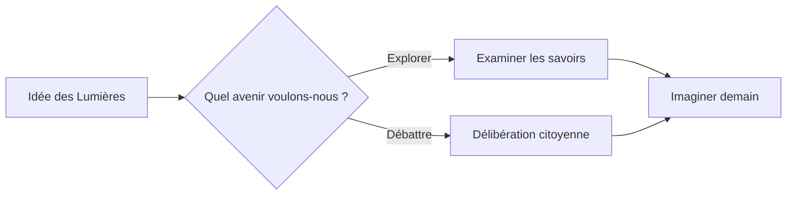
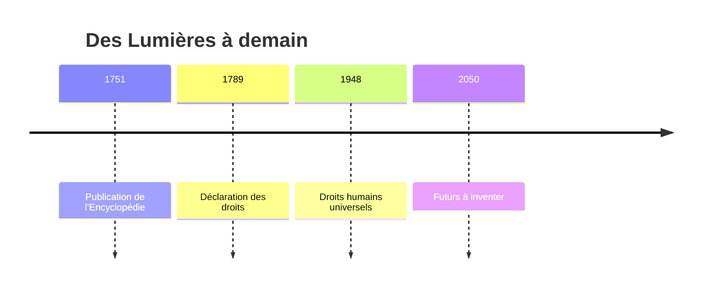
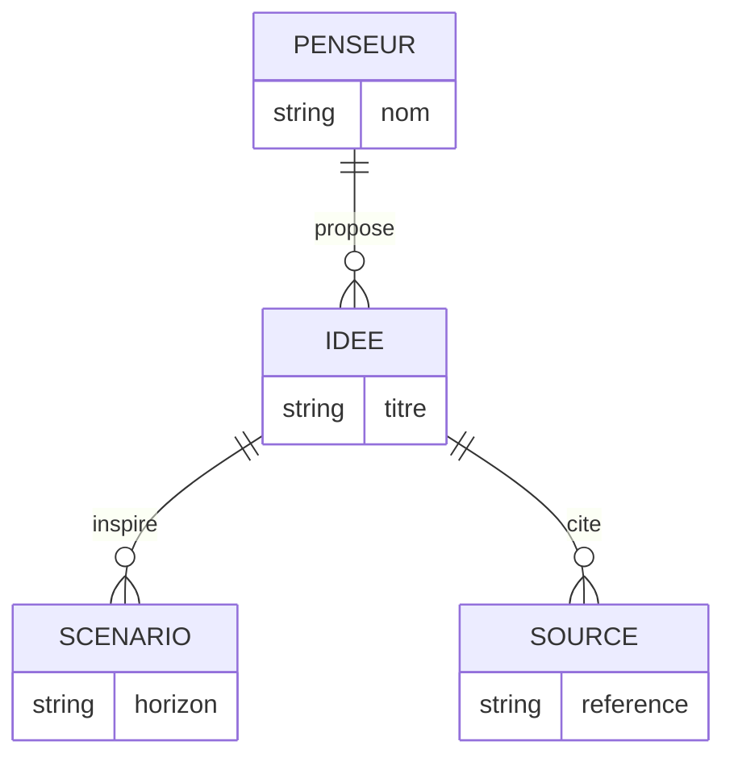
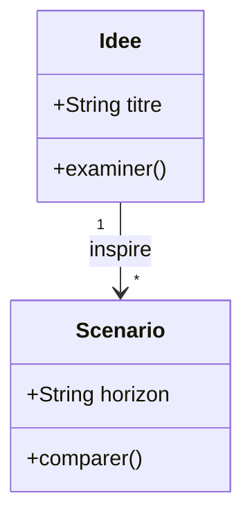
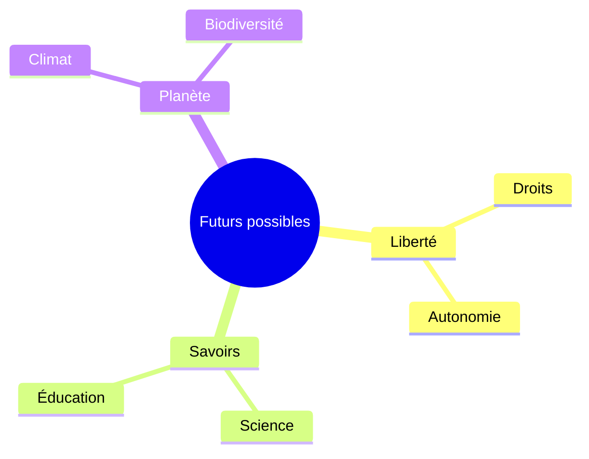
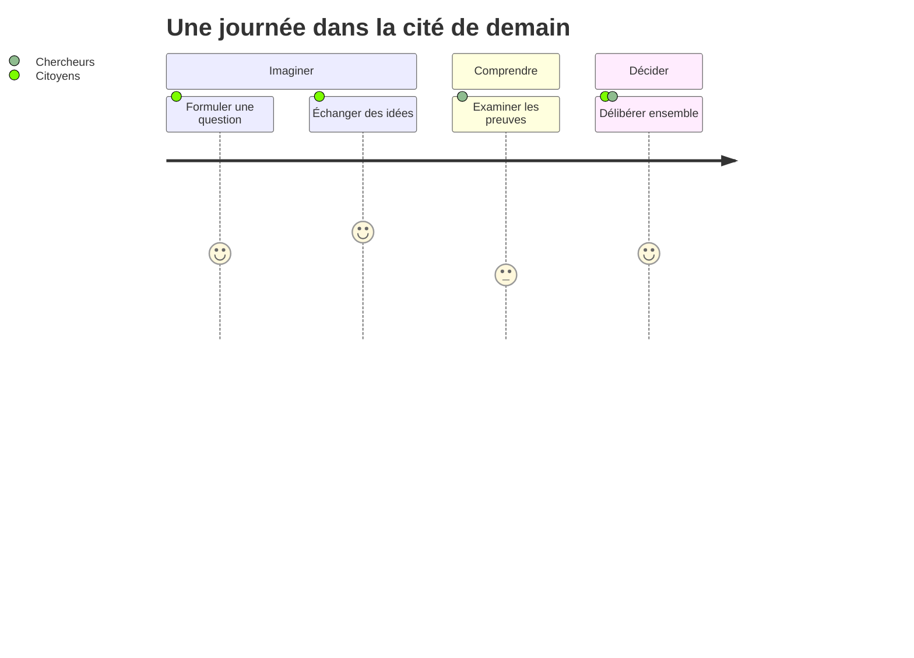
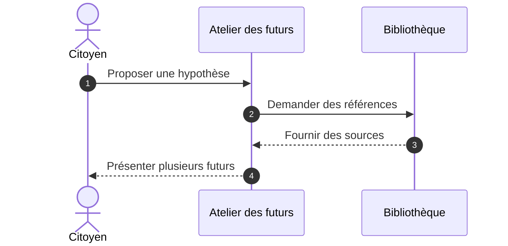

# L’Encyclopédie des futurs possibles


## *Et si nous inventions demain ?*

**Des Lumières à l’intelligence artificielle : comprendre, imaginer et construire demain.**

> Et si les Lumières n’étaient pas seulement derrière nous, mais aussi devant nous ?

Au XVIIIe siècle, l’Encyclopédie a incarné l’ambition de rassembler et de diffuser les savoirs. Aujourd’hui, que faudrait-il ajouter à cette entreprise pour explorer des futurs justes, durables et libres ?

<div style="border:1px solid currentColor;border-radius:12px;padding:14px"><i data-lucide="lightbulb" style="font-size:24px"></i> <strong>Bienvenue dans un laboratoire de questions.</strong><p>Chaque diagramme propose une façon de penser. Modifiez-le, contredisez-le, inventez la suite.</p></div>

**Mode d’emploi :** ouvrez le code de chaque dessin, changez un mot ou un lien, puis comparez les interprétations. Les nombres, scénarios et systèmes présentés sont **fictifs et pédagogiques**.

## Sommaire

- 1. L’esprit des Lumières
- 2. L’architecture du savoir
- 3. La République des idées
- 4. Les machines qui pensent
- 5. Le langage des idées
- 6. Les futurs en chiffres
- 7. La fabrique des possibles
- 8. Décider dans l’incertitude
- 9. Dessiner l’impossible
- 10. Votre encyclopédie de demain

---

## 1. L’esprit des Lumières

**Fil conducteur :** la liberté de questionner, la circulation des connaissances et la responsabilité envers les générations futures.

### 1.1 Chemins de la raison : flow-review

**Question :** que révèle cette représentation de notre manière d’imaginer l’avenir ?

<!-- scriba-example: flow-review family=flowchart -->



**À comprendre :** ce modèle propose une lecture partielle du problème. Ses relations et catégories sont des hypothèses à discuter.

**À essayer :** modifiez une relation, un acteur ou un critère. Qu’est-ce que cette transformation rend plus visible ?

### 1.2 Chemins de la raison : flow-edges

**Question :** que révèle cette représentation de notre manière d’imaginer l’avenir ?

<!-- scriba-example: flow-edges family=flowchart -->


**À comprendre :** ce modèle propose une lecture partielle du problème. Ses relations et catégories sont des hypothèses à discuter.

**À essayer :** modifiez une relation, un acteur ou un critère. Qu’est-ce que cette transformation rend plus visible ?

### 1.3 Chemins de la raison : flow-shapes

**Question :** que révèle cette représentation de notre manière d’imaginer l’avenir ?

<!-- scriba-example: flow-shapes family=flowchart -->


**À comprendre :** ce modèle propose une lecture partielle du problème. Ses relations et catégories sont des hypothèses à discuter.

**À essayer :** modifiez une relation, un acteur ou un critère. Qu’est-ce que cette transformation rend plus visible ?

### 1.4 Chemins de la raison : flow-bt

**Question :** que révèle cette représentation de notre manière d’imaginer l’avenir ?

<!-- scriba-example: flow-bt family=flowchart -->


**À comprendre :** ce modèle propose une lecture partielle du problème. Ses relations et catégories sont des hypothèses à discuter.

**À essayer :** modifiez une relation, un acteur ou un critère. Qu’est-ce que cette transformation rend plus visible ?

### 1.5 Chemins de la raison : flow-rl

**Question :** que révèle cette représentation de notre manière d’imaginer l’avenir ?

<!-- scriba-example: flow-rl family=flowchart -->


**À comprendre :** ce modèle propose une lecture partielle du problème. Ses relations et catégories sont des hypothèses à discuter.

**À essayer :** modifiez une relation, un acteur ou un critère. Qu’est-ce que cette transformation rend plus visible ?

### 1.6 Chemins de la raison : flow-boundaries

**Question :** que révèle cette représentation de notre manière d’imaginer l’avenir ?

<!-- scriba-example: flow-boundaries family=flowchart -->


**À comprendre :** ce modèle propose une lecture partielle du problème. Ses relations et catégories sont des hypothèses à discuter.

**À essayer :** modifiez une relation, un acteur ou un critère. Qu’est-ce que cette transformation rend plus visible ?

### 1.7 Chemins de la raison : flow-modern-shapes

**Question :** que révèle cette représentation de notre manière d’imaginer l’avenir ?

<!-- scriba-example: flow-modern-shapes family=flowchart -->


**À comprendre :** ce modèle propose une lecture partielle du problème. Ses relations et catégories sont des hypothèses à discuter.

**À essayer :** modifiez une relation, un acteur ou un critère. Qu’est-ce que cette transformation rend plus visible ?

### 1.8 Jalons des idées : timeline-learning

**Question :** que révèle cette représentation de notre manière d’imaginer l’avenir ?

<!-- scriba-example: timeline-learning family=timeline -->



**À comprendre :** ce modèle propose une lecture partielle du problème. Ses relations et catégories sont des hypothèses à discuter.

**À essayer :** modifiez une relation, un acteur ou un critère. Qu’est-ce que cette transformation rend plus visible ?

## 2. L’architecture du savoir

**Fil conducteur :** la liberté de questionner, la circulation des connaissances et la responsabilité envers les générations futures.

### 2.1 Entités et relations : er-notes

**Question :** que révèle cette représentation de notre manière d’imaginer l’avenir ?

<!-- scriba-example: er-notes family=er -->



**À comprendre :** ce modèle propose une lecture partielle du problème. Ses relations et catégories sont des hypothèses à discuter.

**À essayer :** modifiez une relation, un acteur ou un critère. Qu’est-ce que cette transformation rend plus visible ?

### 2.2 Entités et relations : er-cardinality

**Question :** que révèle cette représentation de notre manière d’imaginer l’avenir ?

<!-- scriba-example: er-cardinality family=er -->


**À comprendre :** ce modèle propose une lecture partielle du problème. Ses relations et catégories sont des hypothèses à discuter.

**À essayer :** modifiez une relation, un acteur ou un critère. Qu’est-ce que cette transformation rend plus visible ?

### 2.3 Concepts et objets : class-domain

**Question :** que révèle cette représentation de notre manière d’imaginer l’avenir ?

<!-- scriba-example: class-domain family=class -->



**À comprendre :** ce modèle propose une lecture partielle du problème. Ses relations et catégories sont des hypothèses à discuter.

**À essayer :** modifiez une relation, un acteur ou un critère. Qu’est-ce que cette transformation rend plus visible ?

### 2.4 Concepts et objets : class-relations

**Question :** que révèle cette représentation de notre manière d’imaginer l’avenir ?

<!-- scriba-example: class-relations family=class -->


**À comprendre :** ce modèle propose une lecture partielle du problème. Ses relations et catégories sont des hypothèses à discuter.

**À essayer :** modifiez une relation, un acteur ou un critère. Qu’est-ce que cette transformation rend plus visible ?

### 2.5 Carte des possibles : mindmap-context

**Question :** que révèle cette représentation de notre manière d’imaginer l’avenir ?

<!-- scriba-example: mindmap-context family=mindmap -->



**À comprendre :** ce modèle propose une lecture partielle du problème. Ses relations et catégories sont des hypothèses à discuter.

**À essayer :** modifiez une relation, un acteur ou un critère. Qu’est-ce que cette transformation rend plus visible ?

### 2.6 Arbre des savoirs : tree-files

**Question :** que révèle cette représentation de notre manière d’imaginer l’avenir ?

<!-- scriba-example: tree-files family=treeView -->


**À comprendre :** ce modèle propose une lecture partielle du problème. Ses relations et catégories sont des hypothèses à discuter.

**À essayer :** modifiez une relation, un acteur ou un critère. Qu’est-ce que cette transformation rend plus visible ?

## 3. La République des idées

**Fil conducteur :** la liberté de questionner, la circulation des connaissances et la responsabilité envers les générations futures.

### 3.1 Responsabilités partagées : swim-review

**Question :** que révèle cette représentation de notre manière d’imaginer l’avenir ?

<!-- scriba-example: swim-review family=swimlane -->

```mermaid
swimlane-beta LR
  subgraph Citoyens[Citoyens]
    Idee[Proposer une idée] --> Debat[Débattre]
  end
  subgraph Chercheurs[Chercheurs]
    Etude[Étudier les données] --> Preuve[Vérifier les preuves]
  end
  Debat --> Etude
```

**À comprendre :** ce modèle propose une lecture partielle du problème. Ses relations et catégories sont des hypothèses à discuter.

**À essayer :** modifiez une relation, un acteur ou un critère. Qu’est-ce que cette transformation rend plus visible ?

### 3.2 Usages citoyens : usecase-roles

**Question :** que révèle cette représentation de notre manière d’imaginer l’avenir ?

<!-- scriba-example: usecase-roles family=usecase -->

```mermaid
usecase-beta
direction LR
actor Citoyen("Citoyen")
actor Chercheur("Chercheur")
systemBoundary Atelier["Encyclopédie des futurs"]
  Explorer("Explorer une idée")
  Verifier("Vérifier les sources")
end
Citoyen --> Explorer
Chercheur --> Verifier
```

**À comprendre :** ce modèle propose une lecture partielle du problème. Ses relations et catégories sont des hypothèses à discuter.

**À essayer :** modifiez une relation, un acteur ou un critère. Qu’est-ce que cette transformation rend plus visible ?

### 3.3 Parcours d’exploration : journey-evidence

**Question :** que révèle cette représentation de notre manière d’imaginer l’avenir ?

<!-- scriba-example: journey-evidence family=journey -->



**À comprendre :** ce modèle propose une lecture partielle du problème. Ses relations et catégories sont des hypothèses à discuter.

**À essayer :** modifiez une relation, un acteur ou un critère. Qu’est-ce que cette transformation rend plus visible ?

### 3.4 Dialogue et échanges : sequence-save

**Question :** que révèle cette représentation de notre manière d’imaginer l’avenir ?

<!-- scriba-example: sequence-save family=sequence -->



**À comprendre :** ce modèle propose une lecture partielle du problème. Ses relations et catégories sont des hypothèses à discuter.

**À essayer :** modifiez une relation, un acteur ou un critère. Qu’est-ce que cette transformation rend plus visible ?

### 3.5 Dialogue et échanges : sequence-retry

**Question :** que révèle cette représentation de notre manière d’imaginer l’avenir ?

<!-- scriba-example: sequence-retry family=sequence -->


**À comprendre :** ce modèle propose une lecture partielle du problème. Ses relations et catégories sont des hypothèses à discuter.

**À essayer :** modifiez une relation, un acteur ou un critère. Qu’est-ce que cette transformation rend plus visible ?

### 3.6 Dialogue et échanges : sequence-parallel

**Question :** que révèle cette représentation de notre manière d’imaginer l’avenir ?

<!-- scriba-example: sequence-parallel family=sequence -->


**À comprendre :** ce modèle propose une lecture partielle du problème. Ses relations et catégories sont des hypothèses à discuter.

**À essayer :** modifiez une relation, un acteur ou un critère. Qu’est-ce que cette transformation rend plus visible ?

### 3.7 Dialogue et échanges : sequence-async

**Question :** que révèle cette représentation de notre manière d’imaginer l’avenir ?

<!-- scriba-example: sequence-async family=sequence -->

```mermaid
sequenceDiagram
  autonumber
  actor Citoyen
  participant Atelier as Atelier des futurs
  participant Sources as Bibliothèque
  Citoyen->>Atelier: Proposer une hypothèse
  Atelier->>Sources: Demander des références
  Sources-->>Atelier: Fournir des sources
  Atelier-->>Citoyen: Présenter plusieurs futurs
```

**À comprendre :** ce modèle propose une lecture partielle du problème. Ses relations et catégories sont des hypothèses à discuter.

**À essayer :** modifiez une relation, un acteur ou un critère. Qu’est-ce que cette transformation rend plus visible ?

### 3.8 Évolution des hypothèses : state-note

**Question :** que révèle cette représentation de notre manière d’imaginer l’avenir ?

<!-- scriba-example: state-note family=state -->

```mermaid
stateDiagram-v2
  [*] --> Question
  Question --> Hypothese: Imaginer
  Hypothese --> Evaluation: Examiner
  Evaluation --> Hypothese: Réviser
  Evaluation --> Debat: Partager
  Debat --> [*]
```

**À comprendre :** ce modèle propose une lecture partielle du problème. Ses relations et catégories sont des hypothèses à discuter.

**À essayer :** modifiez une relation, un acteur ou un critère. Qu’est-ce que cette transformation rend plus visible ?

### 3.9 Évolution des hypothèses : state-composite

**Question :** que révèle cette représentation de notre manière d’imaginer l’avenir ?

<!-- scriba-example: state-composite family=state -->

```mermaid
stateDiagram-v2
  [*] --> Question
  Question --> Hypothese: Imaginer
  Hypothese --> Evaluation: Examiner
  Evaluation --> Hypothese: Réviser
  Evaluation --> Debat: Partager
  Debat --> [*]
```

**À comprendre :** ce modèle propose une lecture partielle du problème. Ses relations et catégories sont des hypothèses à discuter.

**À essayer :** modifiez une relation, un acteur ou un critère. Qu’est-ce que cette transformation rend plus visible ?

### 3.10 Évolution des hypothèses : state-choice

**Question :** que révèle cette représentation de notre manière d’imaginer l’avenir ?

<!-- scriba-example: state-choice family=state -->

```mermaid
stateDiagram-v2
  [*] --> Question
  Question --> Hypothese: Imaginer
  Hypothese --> Evaluation: Examiner
  Evaluation --> Hypothese: Réviser
  Evaluation --> Debat: Partager
  Debat --> [*]
```

**À comprendre :** ce modèle propose une lecture partielle du problème. Ses relations et catégories sont des hypothèses à discuter.

**À essayer :** modifiez une relation, un acteur ou un critère. Qu’est-ce que cette transformation rend plus visible ?

## 4. Les machines qui pensent

**Fil conducteur :** la liberté de questionner, la circulation des connaissances et la responsabilité envers les générations futures.

### 4.1 Architecture de l’atelier : architecture-services

**Question :** que révèle cette représentation de notre manière d’imaginer l’avenir ?

<!-- scriba-example: architecture-services family=architecture -->

```mermaid
architecture-beta
  group atelier(cloud)[Atelier des futurs]
  service web(server)[Dialogue] in atelier
  service sources(database)[Bibliothèque] in atelier
  service scenarios(disk)[Scénarios] in atelier
  web:R -- L:sources
  web:B -- T:scenarios
```

**À comprendre :** ce modèle propose une lecture partielle du problème. Ses relations et catégories sont des hypothèses à discuter.

**À essayer :** modifiez une relation, un acteur ou un critère. Qu’est-ce que cette transformation rend plus visible ?

### 4.2 Frontières des systèmes : c4-context

**Question :** que révèle cette représentation de notre manière d’imaginer l’avenir ?

<!-- scriba-example: c4-context family=c4 -->

```mermaid
C4Context
  title Atelier des futurs possibles
  Person(citoyen, "Citoyen", "Propose des idées")
  System(atelier, "Atelier", "Explore les hypothèses")
  System_Ext(sources, "Bibliothèque", "Références")
  Rel(citoyen, atelier, "Dialogue")
  Rel(atelier, sources, "Consulte")
```

**À comprendre :** ce modèle propose une lecture partielle du problème. Ses relations et catégories sont des hypothèses à discuter.

**À essayer :** modifiez une relation, un acteur ou un critère. Qu’est-ce que cette transformation rend plus visible ?

### 4.3 Frontières des systèmes : c4-container

**Question :** que révèle cette représentation de notre manière d’imaginer l’avenir ?

<!-- scriba-example: c4-container family=c4 -->

```mermaid
C4Context
  title Atelier des futurs possibles
  Person(citoyen, "Citoyen", "Propose des idées")
  System(atelier, "Atelier", "Explore les hypothèses")
  System_Ext(sources, "Bibliothèque", "Références")
  Rel(citoyen, atelier, "Dialogue")
  Rel(atelier, sources, "Consulte")
```

**À comprendre :** ce modèle propose une lecture partielle du problème. Ses relations et catégories sont des hypothèses à discuter.

**À essayer :** modifiez une relation, un acteur ou un critère. Qu’est-ce que cette transformation rend plus visible ?

### 4.4 Frontières des systèmes : c4-component

**Question :** que révèle cette représentation de notre manière d’imaginer l’avenir ?

<!-- scriba-example: c4-component family=c4 -->

```mermaid
C4Context
  title Atelier des futurs possibles
  Person(citoyen, "Citoyen", "Propose des idées")
  System(atelier, "Atelier", "Explore les hypothèses")
  System_Ext(sources, "Bibliothèque", "Références")
  Rel(citoyen, atelier, "Dialogue")
  Rel(atelier, sources, "Consulte")
```

**À comprendre :** ce modèle propose une lecture partielle du problème. Ses relations et catégories sont des hypothèses à discuter.

**À essayer :** modifiez une relation, un acteur ou un critère. Qu’est-ce que cette transformation rend plus visible ?

### 4.5 Frontières des systèmes : c4-dynamic

**Question :** que révèle cette représentation de notre manière d’imaginer l’avenir ?

<!-- scriba-example: c4-dynamic family=c4 -->

```mermaid
C4Context
  title Atelier des futurs possibles
  Person(citoyen, "Citoyen", "Propose des idées")
  System(atelier, "Atelier", "Explore les hypothèses")
  System_Ext(sources, "Bibliothèque", "Références")
  Rel(citoyen, atelier, "Dialogue")
  Rel(atelier, sources, "Consulte")
```

**À comprendre :** ce modèle propose une lecture partielle du problème. Ses relations et catégories sont des hypothèses à discuter.

**À essayer :** modifiez une relation, un acteur ou un critère. Qu’est-ce que cette transformation rend plus visible ?

### 4.6 Frontières des systèmes : c4-deployment

**Question :** que révèle cette représentation de notre manière d’imaginer l’avenir ?

<!-- scriba-example: c4-deployment family=c4 -->

```mermaid
C4Context
  title Atelier des futurs possibles
  Person(citoyen, "Citoyen", "Propose des idées")
  System(atelier, "Atelier", "Explore les hypothèses")
  System_Ext(sources, "Bibliothèque", "Références")
  Rel(citoyen, atelier, "Dialogue")
  Rel(atelier, sources, "Consulte")
```

**À comprendre :** ce modèle propose une lecture partielle du problème. Ses relations et catégories sont des hypothèses à discuter.

**À essayer :** modifiez une relation, un acteur ou un critère. Qu’est-ce que cette transformation rend plus visible ?

### 4.7 Structure d’un message : packet-envelope

**Question :** que révèle cette représentation de notre manière d’imaginer l’avenir ?

<!-- scriba-example: packet-envelope family=packet -->

```mermaid
packet-beta
  0-7: "Version"
  8-15: "Type de scénario"
  16-31: "Longueur"
  32-63: "Identifiant de proposition"
```

**À comprendre :** ce modèle propose une lecture partielle du problème. Ses relations et catégories sont des hypothèses à discuter.

**À essayer :** modifiez une relation, un acteur ou un critère. Qu’est-ce que cette transformation rend plus visible ?

### 4.8 Enquête assistée : agentflow-review

**Question :** que révèle cette représentation de notre manière d’imaginer l’avenir ?

<!-- scriba-example: agentflow-review family=agentflow -->

```mermaid
agentflow-beta LR
  question["Question citoyenne"]@{ shape: input }
  flow inquiry["Enquête collective"]
    gather["Réunir les preuves"]@{ shape: task }
    catalog["Consulter les sources"]@{ shape: tool }
    gather --> catalog
  end
  human["Délibération humaine"]@{ shape: decision }
  deliver["Présenter les alternatives"]@{ shape: action }
  question --> inquiry --> human
  human --> deliver
```

**À comprendre :** ce modèle propose une lecture partielle du problème. Ses relations et catégories sont des hypothèses à discuter.

**À essayer :** modifiez une relation, un acteur ou un critère. Qu’est-ce que cette transformation rend plus visible ?

## 5. Le langage des idées

**Fil conducteur :** la liberté de questionner, la circulation des connaissances et la responsabilité envers les générations futures.

### 5.1 Exigences de transparence : requirements-evidence

**Question :** que révèle cette représentation de notre manière d’imaginer l’avenir ?

<!-- scriba-example: requirements-evidence family=requirement -->

```mermaid
requirementDiagram
  requirement Transparence {
    id: REQ_01
    text: Expliquer les choix automatisés
    risk: high
    verifymethod: test
  }
  element InterfaceCitoyenne {
    type: interface
  }
  InterfaceCitoyenne - satisfies -> Transparence
```

**À comprendre :** ce modèle propose une lecture partielle du problème. Ses relations et catégories sont des hypothèses à discuter.

**À essayer :** modifiez une relation, un acteur ou un critère. Qu’est-ce que cette transformation rend plus visible ?

### 5.2 Grammaire des questions : railroad-combinators

**Question :** que révèle cette représentation de notre manière d’imaginer l’avenir ?

<!-- scriba-example: railroad-combinators family=railroad -->

```mermaid
railroad-beta
title Question des futurs
question = sequence(terminal("Et si"), nonterminal("idee"), terminal("?")) ;
idee = oneOrMore(nonterminal("mot")) ;
mot = choice(terminal("liberté"), terminal("justice")) ;
```

**À comprendre :** ce modèle propose une lecture partielle du problème. Ses relations et catégories sont des hypothèses à discuter.

**À essayer :** modifiez une relation, un acteur ou un critère. Qu’est-ce que cette transformation rend plus visible ?

### 5.3 Grammaire des questions : railroad-ebnf

**Question :** que révèle cette représentation de notre manière d’imaginer l’avenir ?

<!-- scriba-example: railroad-ebnf family=railroad -->

```mermaid
railroad-ebnf-beta
title Grammaire d’une question
question = "Et si", idee, "?" ;
idee = mot, { mot } ;
mot = "liberté" | "justice" | "demain" ;
```

**À comprendre :** ce modèle propose une lecture partielle du problème. Ses relations et catégories sont des hypothèses à discuter.

**À essayer :** modifiez une relation, un acteur ou un critère. Qu’est-ce que cette transformation rend plus visible ?

### 5.4 Grammaire des questions : railroad-abnf

**Question :** que révèle cette représentation de notre manière d’imaginer l’avenir ?

<!-- scriba-example: railroad-abnf family=railroad -->

```mermaid
railroad-abnf-beta
title Identifiant d’une idée
idee = 1*ALPHA [ "#" 1*DIGIT ] ;
```

**À comprendre :** ce modèle propose une lecture partielle du problème. Ses relations et catégories sont des hypothèses à discuter.

**À essayer :** modifiez une relation, un acteur ou un critère. Qu’est-ce que cette transformation rend plus visible ?

### 5.5 Grammaire des questions : railroad-peg

**Question :** que révèle cette représentation de notre manière d’imaginer l’avenir ?

<!-- scriba-example: railroad-peg family=railroad -->

```mermaid
railroad-peg-beta
title Langage des possibles
Proposition <- Mot (" " Mot)* ;
Mot <- "liberté" / "justice" ;
```

**À comprendre :** ce modèle propose une lecture partielle du problème. Ses relations et catégories sont des hypothèses à discuter.

**À essayer :** modifiez une relation, un acteur ou un critère. Qu’est-ce que cette transformation rend plus visible ?

### 5.6 Composition d’un espace : block-layout

**Question :** que révèle cette représentation de notre manière d’imaginer l’avenir ?

<!-- scriba-example: block-layout family=block -->

```mermaid
block-beta
  columns 3
  Horizon["Avenir souhaitable"]:3
  Savoir["Savoir"] Liberte["Liberté"] Nature["Nature"]
  Action["Expérimentation"]:3
```

**À comprendre :** ce modèle propose une lecture partielle du problème. Ses relations et catégories sont des hypothèses à discuter.

**À essayer :** modifiez une relation, un acteur ou un critère. Qu’est-ce que cette transformation rend plus visible ?

### Un atelier de langages : du terminal aux modèles

Ces blocs sont des **exemples de code**, pas des programmes exécutés par le lecteur Markdown. Les données et les indices sont inventés.

#### Exemple `console`

```console
$ mkdir atelier-des-futurs
$ cd atelier-des-futurs
$ printf "Liberté et savoir\n" > manifeste.txt
$ cat manifeste.txt
Liberté et savoir
```

**À essayer :** changez une hypothèse, un principe ou une valeur, puis expliquez votre choix.

#### Exemple `python`

```python
scenarios = {"Cité des savoirs": [8, 7, 9], "Cité résiliente": [7, 9, 7]}
for nom, notes in scenarios.items():
    print(f"{nom} : {sum(notes) / len(notes):.1f}/10")
```

**À essayer :** changez une hypothèse, un principe ou une valeur, puis expliquez votre choix.

#### Exemple `json`

```json
{
  "question": "Et si nous inventions demain ?",
  "principes": ["liberté", "justice", "durabilité"]
}
```

**À essayer :** changez une hypothèse, un principe ou une valeur, puis expliquez votre choix.

#### Exemple `yaml`

```yaml
horizon: 2050
valeurs:
  - liberté
  - justice
  - durabilité
```

**À essayer :** changez une hypothèse, un principe ou une valeur, puis expliquez votre choix.

#### Exemple `sql`

```sql
SELECT titre, horizon FROM scenarios WHERE statut = 'à débattre';
```

**À essayer :** changez une hypothèse, un principe ou une valeur, puis expliquez votre choix.

#### Exemple `javascript`

```javascript
const questions = ["liberté", "justice"].map(x => `Comment protéger ${x} ?`);
console.log(questions);
```

**À essayer :** changez une hypothèse, un principe ou une valeur, puis expliquez votre choix.

#### Exemple `typescript`

```typescript
type Futur = { titre: string; horizon: number };
const futur: Futur = { titre: "Cité éclairée", horizon: 2050 };
```

**À essayer :** changez une hypothèse, un principe ou une valeur, puis expliquez votre choix.

#### Exemple `css`

```css
.idee { border: 1px solid currentColor; border-radius: 12px; padding: 1rem; }
```

**À essayer :** changez une hypothèse, un principe ou une valeur, puis expliquez votre choix.

#### Exemple `diff`

```diff
- Une machine choisira notre avenir.
+ Les citoyens délibéreront sur les options proposées.
```

**À essayer :** changez une hypothèse, un principe ou une valeur, puis expliquez votre choix.

#### Exemple `latex`

```latex
\[ I = \frac{L + J + D}{3} \]
```

**À essayer :** changez une hypothèse, un principe ou une valeur, puis expliquez votre choix.

#### Exemple `bash`

```bash
mkdir -p futurs/sources
printf "Débat ouvert\n" > futurs/manifeste.txt
```

**À essayer :** changez une hypothèse, un principe ou une valeur, puis expliquez votre choix.

## 6. Les futurs en chiffres

**Fil conducteur :** la liberté de questionner, la circulation des connaissances et la responsabilité envers les générations futures.

### 6.1 Répartition imaginaire : pie-corpus

**Question :** que révèle cette représentation de notre manière d’imaginer l’avenir ?

<!-- scriba-example: pie-corpus family=pie -->

```mermaid
pie showData
  title Budget citoyen fictif
  "Éducation" : 35
  "Écologie" : 30
  "Santé" : 20
  "Culture" : 15
```

**À comprendre :** ce modèle propose une lecture partielle du problème. Ses relations et catégories sont des hypothèses à discuter.

**À essayer :** modifiez une relation, un acteur ou un critère. Qu’est-ce que cette transformation rend plus visible ?

### 6.2 Choix et priorités : quadrant-priority

**Question :** que révèle cette représentation de notre manière d’imaginer l’avenir ?

<!-- scriba-example: quadrant-priority family=quadrantChart -->

```mermaid
quadrantChart
  title Choix pour la cité de demain
  x-axis Effort faible --> Effort élevé
  y-axis Impact faible --> Impact élevé
  quadrant-1 Projets ambitieux
  quadrant-2 Priorités
  quadrant-3 À revoir
  quadrant-4 À expérimenter
  "Bibliothèques": [0.2, 0.8]
  "Transports": [0.8, 0.9]
```

**À comprendre :** ce modèle propose une lecture partielle du problème. Ses relations et catégories sont des hypothèses à discuter.

**À essayer :** modifiez une relation, un acteur ou un critère. Qu’est-ce que cette transformation rend plus visible ?

### 6.3 Trajectoires illustratives : xy-bars

**Question :** que révèle cette représentation de notre manière d’imaginer l’avenir ?

<!-- scriba-example: xy-bars family=xychart -->

```mermaid
xychart-beta
  title "Accès fictif au savoir"
  x-axis [2025, 2030, 2035, 2040]
  y-axis "Indice illustratif" 0 --> 100
  bar [30, 45, 65, 80]

```

**À comprendre :** ce modèle propose une lecture partielle du problème. Ses relations et catégories sont des hypothèses à discuter.

**À essayer :** modifiez une relation, un acteur ou un critère. Qu’est-ce que cette transformation rend plus visible ?

### 6.4 Trajectoires illustratives : xy-line

**Question :** que révèle cette représentation de notre manière d’imaginer l’avenir ?

<!-- scriba-example: xy-line family=xychart -->

```mermaid
xychart-beta
  title "Accès fictif au savoir"
  x-axis [2025, 2030, 2035, 2040]
  y-axis "Indice illustratif" 0 --> 100
  line [25, 40, 60, 90]
```

**À comprendre :** ce modèle propose une lecture partielle du problème. Ses relations et catégories sont des hypothèses à discuter.

**À essayer :** modifiez une relation, un acteur ou un critère. Qu’est-ce que cette transformation rend plus visible ?

### 6.5 Trajectoires illustratives : xy-combined

**Question :** que révèle cette représentation de notre manière d’imaginer l’avenir ?

<!-- scriba-example: xy-combined family=xychart -->

```mermaid
xychart-beta
  title "Accès fictif au savoir"
  x-axis [2025, 2030, 2035, 2040]
  y-axis "Indice illustratif" 0 --> 100
  bar [30, 45, 65, 80]
  line [25, 40, 60, 90]
```

**À comprendre :** ce modèle propose une lecture partielle du problème. Ses relations et catégories sont des hypothèses à discuter.

**À essayer :** modifiez une relation, un acteur ou un critère. Qu’est-ce que cette transformation rend plus visible ?

### 6.6 Critères en tension : radar-quality

**Question :** que révèle cette représentation de notre manière d’imaginer l’avenir ?

<!-- scriba-example: radar-quality family=radar -->

```mermaid
radar-beta
  title Deux futurs imaginaires
  axis justice["Justice"], savoir["Savoir"], climat["Climat"], liberte["Liberté"]
  curve a["Scénario A"]{4, 5, 3, 4}
  curve b["Scénario B"]{3, 3, 5, 4}
  min 0
  max 5
  graticule polygon
```

**À comprendre :** ce modèle propose une lecture partielle du problème. Ses relations et catégories sont des hypothèses à discuter.

**À essayer :** modifiez une relation, un acteur ou un critère. Qu’est-ce que cette transformation rend plus visible ?

### 6.7 Flux de ressources : sankey-triage

**Question :** que révèle cette représentation de notre manière d’imaginer l’avenir ?

<!-- scriba-example: sankey-triage family=sankey -->

```mermaid
sankey-beta
Soleil,Habitat,35
Soleil,Transports,20
Vent,Habitat,25
Vent,Industrie,20
```

**À comprendre :** ce modèle propose une lecture partielle du problème. Ses relations et catégories sont des hypothèses à discuter.

**À essayer :** modifiez une relation, un acteur ou un critère. Qu’est-ce que cette transformation rend plus visible ?

### 6.8 Hiérarchie des investissements : treemap-acervo

**Question :** que révèle cette représentation de notre manière d’imaginer l’avenir ?

<!-- scriba-example: treemap-acervo family=treemap -->

```mermaid
treemap-beta
"Investissements imaginaires"
  "Connaissance"
    "Éducation": 35
    "Recherche": 20
  "Planète"
    "Énergie": 25
    "Biodiversité": 20
```

**À comprendre :** ce modèle propose une lecture partielle du problème. Ses relations et catégories sont des hypothèses à discuter.

**À essayer :** modifiez une relation, un acteur ou un critère. Qu’est-ce que cette transformation rend plus visible ?

## 7. La fabrique des possibles

**Fil conducteur :** la liberté de questionner, la circulation des connaissances et la responsabilité envers les générations futures.

### 7.1 Planifier les enquêtes : gantt-research

**Question :** que révèle cette représentation de notre manière d’imaginer l’avenir ?

<!-- scriba-example: gantt-research family=gantt -->

```mermaid
gantt
  title Atelier des futurs, calendrier fictif
  dateFormat YYYY-MM-DD
  section Explorer
  Recueillir les questions :a1, 2027-01-10, 10d
  Étudier les sources :a2, after a1, 12d
  section Imaginer
  Comparer les scénarios :b1, after a2, 15d
```

**À comprendre :** ce modèle propose une lecture partielle du problème. Ses relations et catégories sont des hypothèses à discuter.

**À essayer :** modifiez une relation, un acteur ou un critère. Qu’est-ce que cette transformation rend plus visible ?

### 7.2 Planifier les enquêtes : gantt-parallel

**Question :** que révèle cette représentation de notre manière d’imaginer l’avenir ?

<!-- scriba-example: gantt-parallel family=gantt -->

```mermaid
gantt
  title Atelier des futurs, calendrier fictif
  dateFormat YYYY-MM-DD
  section Explorer
  Recueillir les questions :a1, 2027-01-10, 10d
  Étudier les sources :a2, after a1, 12d
  section Imaginer
  Comparer les scénarios :b1, after a2, 15d
```

**À comprendre :** ce modèle propose une lecture partielle du problème. Ses relations et catégories sont des hypothèses à discuter.

**À essayer :** modifiez une relation, un acteur ou un critère. Qu’est-ce que cette transformation rend plus visible ?

### 7.3 Faire progresser les idées : kanban-backlog

**Question :** que révèle cette représentation de notre manière d’imaginer l’avenir ?

<!-- scriba-example: kanban-backlog family=kanban -->

```mermaid
kanban
  colonne1[À questionner]
    t1[Quels droits numériques ?]
  colonne2[À explorer]
    t2[Comparer les futurs]
  colonne3[À débattre]
    t3[Discuter des risques]
```

**À comprendre :** ce modèle propose une lecture partielle du problème. Ses relations et catégories sont des hypothèses à discuter.

**À essayer :** modifiez une relation, un acteur ou un critère. Qu’est-ce que cette transformation rend plus visible ?

### 7.4 Révisions des hypothèses : git-review

**Question :** que révèle cette représentation de notre manière d’imaginer l’avenir ?

<!-- scriba-example: git-review family=gitGraph -->

```mermaid
gitGraph
  commit id: "Question initiale"
  branch hypothese
  checkout hypothese
  commit id: "Nouvelle perspective"
  checkout main
  commit id: "Sources examinées"
  merge hypothese
```

**À comprendre :** ce modèle propose une lecture partielle du problème. Ses relations et catégories sont des hypothèses à discuter.

**À essayer :** modifiez une relation, un acteur ou un critère. Qu’est-ce que cette transformation rend plus visible ?

### 7.5 Révisions des hypothèses : git-maintenance

**Question :** que révèle cette représentation de notre manière d’imaginer l’avenir ?

<!-- scriba-example: git-maintenance family=gitGraph -->

```mermaid
gitGraph
  commit id: "Question initiale"
  branch hypothese
  checkout hypothese
  commit id: "Nouvelle perspective"
  checkout main
  commit id: "Sources examinées"
  merge hypothese
```

**À comprendre :** ce modèle propose une lecture partielle du problème. Ses relations et catégories sont des hypothèses à discuter.

**À essayer :** modifiez une relation, un acteur ou un critère. Qu’est-ce que cette transformation rend plus visible ?

### 7.6 Événements et décisions : events-command

**Question :** que révèle cette représentation de notre manière d’imaginer l’avenir ?

<!-- scriba-example: events-command family=eventmodeling -->

```mermaid
eventmodeling
  tf 01 ui AtelierCitoyen
  tf 02 cmd ProposerScenario { titre: string }
  tf 03 evt ScenarioPropose { identifiant: string }
```

**À comprendre :** ce modèle propose une lecture partielle du problème. Ses relations et catégories sont des hypothèses à discuter.

**À essayer :** modifiez une relation, un acteur ou un critère. Qu’est-ce que cette transformation rend plus visible ?

### 7.7 Événements et décisions : events-projection

**Question :** que révèle cette représentation de notre manière d’imaginer l’avenir ?

<!-- scriba-example: events-projection family=eventmodeling -->

```mermaid
eventmodeling
  tf 01 evt ScenarioPropose
  tf 02 rmo IndexDesScenarios
  tf 03 ui TableauDesFuturs
```

**À comprendre :** ce modèle propose une lecture partielle du problème. Ses relations et catégories sont des hypothèses à discuter.

**À essayer :** modifiez une relation, un acteur ou un critère. Qu’est-ce que cette transformation rend plus visible ?

## 8. Décider dans l’incertitude

**Fil conducteur :** la liberté de questionner, la circulation des connaissances et la responsabilité envers les générations futures.

### 8.1 Intersections de valeurs : venn-evidence

**Question :** que révèle cette représentation de notre manière d’imaginer l’avenir ?

<!-- scriba-example: venn-evidence family=venn -->

```mermaid
venn-beta
  title Trois principes pour demain
  set Liberte["Liberté"]
  set Justice["Justice"]
  set Durabilite["Durabilité"]
  union Liberte,Justice["Émancipation"]
  union Liberte,Durabilite["Responsabilité"]
  union Justice,Durabilite["Équité"]
  union Liberte,Justice,Durabilite["Avenir souhaitable"]
```

**À comprendre :** ce modèle propose une lecture partielle du problème. Ses relations et catégories sont des hypothèses à discuter.

**À essayer :** modifiez une relation, un acteur ou un critère. Qu’est-ce que cette transformation rend plus visible ?

### 8.2 Hypothèses causales : ishikawa-delay

**Question :** que révèle cette représentation de notre manière d’imaginer l’avenir ?

<!-- scriba-example: ishikawa-delay family=ishikawa -->

```mermaid
ishikawa-beta
  Transition écologique ralentie
  Institutions
    Décisions fragmentées
    Concertation insuffisante
  Savoirs
    Données incomplètes
  Ressources
    Financement limité
```

**À comprendre :** ce modèle propose une lecture partielle du problème. Ses relations et catégories sont des hypothèses à discuter.

**À essayer :** modifiez une relation, un acteur ou un critère. Qu’est-ce que cette transformation rend plus visible ?

### 8.3 Évolution des capacités : wardley-capabilities

**Question :** que révèle cette représentation de notre manière d’imaginer l’avenir ?

<!-- scriba-example: wardley-capabilities family=wardley -->

```mermaid
wardley-beta
title Capacités d’une démocratie éclairée
anchor "Décision citoyenne" [0.95, 0.60]
component "Délibération" [0.78, 0.35]
component "Savoirs accessibles" [0.58, 0.50]
component "Infrastructure" [0.22, 0.85]
"Décision citoyenne" -> "Délibération"
"Délibération" -> "Savoirs accessibles"
"Savoirs accessibles" -> "Infrastructure"
evolve "Délibération" 0.55
note "Rendre visibles les désaccords" [0.42, 0.25]
```

**À comprendre :** ce modèle propose une lecture partielle du problème. Ses relations et catégories sont des hypothèses à discuter.

**À essayer :** modifiez une relation, un acteur ou un critère. Qu’est-ce que cette transformation rend plus visible ?

### 8.4 Nature des problèmes : cynefin-decisions

**Question :** que révèle cette représentation de notre manière d’imaginer l’avenir ?

<!-- scriba-example: cynefin-decisions family=cynefin -->

```mermaid
cynefin-beta
  title Choisir comment agir
  clear
    "Appliquer une règle connue"
  complicated
    "Évaluer une technologie"
  complex
    "Tester une coopération"
  chaotic
    "Protéger les personnes"
  confusion
    "Clarifier l’incertitude"
```

**À comprendre :** ce modèle propose une lecture partielle du problème. Ses relations et catégories sont des hypothèses à discuter.

**À essayer :** modifiez une relation, un acteur ou un critère. Qu’est-ce que cette transformation rend plus visible ?

## 9. Dessiner l’impossible

**Fil conducteur :** la liberté de questionner, la circulation des connaissances et la responsabilité envers les générations futures.

### Cartes HTML et icônes Lucide

<div style="border:1px solid currentColor;border-radius:12px;padding:12px"><div style="display:flex;flex-wrap:wrap;gap:10px"><div style="flex:1;min-width:150px;border:1px solid currentColor;padding:12px;border-radius:10px"><i data-lucide="book-open" style="font-size:24px"></i><br/><strong>Comprendre</strong><p>Partager les savoirs.</p></div><div style="flex:1;min-width:150px;border:1px solid currentColor;padding:12px;border-radius:10px"><i data-lucide="users" style="font-size:24px"></i><br/><strong>Délibérer</strong><p>Écouter les désaccords.</p></div><div style="flex:1;min-width:150px;border:1px solid currentColor;padding:12px;border-radius:10px"><i data-lucide="leaf" style="font-size:24px"></i><br/><strong>Préserver</strong><p>Respecter le vivant.</p></div></div></div>

### Le code HTML d’une carte

```html
<div style="border:1px solid currentColor;padding:12px;border-radius:12px">
  <i data-lucide="lightbulb" style="font-size:24px"></i>
  <strong>Une idée à débattre</strong>
  <p>Comment rendre le savoir accessible à tous ?</p>
</div>
```

### SVG : la raison rencontre l’imagination

<svg viewBox="0 0 360 100" width="360" height="100" role="img" aria-label="La raison et l’imagination sont reliées"><circle cx="65" cy="50" r="34" fill="none" stroke="currentColor" stroke-width="2"/><line x1="99" y1="50" x2="261" y2="50" stroke="currentColor" stroke-width="2"/><circle cx="295" cy="50" r="34" fill="none" stroke="currentColor" stroke-width="2"/><text x="65" y="55" font-size="10" text-anchor="middle" fill="currentColor">Raison</text><text x="295" y="55" font-size="9" text-anchor="middle" fill="currentColor">Imaginer</text></svg>

**À essayer :** déplacez les cercles, changez leurs noms et ajoutez une troisième valeur.

### Excalidraw : déplacer les idées

Une esquisse à éditer : déplacez « Raison » et « Imagination », puis ajoutez « Responsabilité ».

```excalidraw
{
  "type": "excalidraw",
  "version": 2,
  "source": "scriba",
  "elements": [
    {
      "x": 20,
      "y": 30,
      "angle": 0,
      "strokeColor": "#1e1e1e",
      "backgroundColor": "transparent",
      "fillStyle": "solid",
      "strokeWidth": 2,
      "strokeStyle": "solid",
      "roughness": 1,
      "opacity": 100,
      "groupIds": [],
      "frameId": null,
      "seed": 10,
      "version": 1,
      "versionNonce": 20,
      "isDeleted": false,
      "boundElements": null,
      "updated": 1,
      "link": null,
      "locked": false,
      "id": "rect-0",
      "type": "rectangle",
      "width": 180,
      "height": 80,
      "roundness": {
        "type": 3
      }
    },
    {
      "x": 32,
      "y": 55,
      "angle": 0,
      "strokeColor": "#1e1e1e",
      "backgroundColor": "transparent",
      "fillStyle": "solid",
      "strokeWidth": 2,
      "strokeStyle": "solid",
      "roughness": 1,
      "opacity": 100,
      "groupIds": [],
      "frameId": null,
      "seed": 10,
      "version": 1,
      "versionNonce": 20,
      "isDeleted": false,
      "boundElements": null,
      "updated": 1,
      "link": null,
      "locked": false,
      "id": "text-0",
      "type": "text",
      "width": 155,
      "height": 30,
      "roundness": null,
      "text": "Raison",
      "fontSize": 20,
      "fontFamily": 1,
      "textAlign": "center",
      "verticalAlign": "middle",
      "baseline": 20,
      "containerId": null,
      "originalText": "Raison",
      "lineHeight": 1.25
    },
    {
      "x": 240,
      "y": 30,
      "angle": 0,
      "strokeColor": "#1e1e1e",
      "backgroundColor": "transparent",
      "fillStyle": "solid",
      "strokeWidth": 2,
      "strokeStyle": "solid",
      "roughness": 1,
      "opacity": 100,
      "groupIds": [],
      "frameId": null,
      "seed": 11,
      "version": 1,
      "versionNonce": 21,
      "isDeleted": false,
      "boundElements": null,
      "updated": 1,
      "link": null,
      "locked": false,
      "id": "rect-1",
      "type": "rectangle",
      "width": 180,
      "height": 80,
      "roundness": {
        "type": 3
      }
    },
    {
      "x": 252,
      "y": 55,
      "angle": 0,
      "strokeColor": "#1e1e1e",
      "backgroundColor": "transparent",
      "fillStyle": "solid",
      "strokeWidth": 2,
      "strokeStyle": "solid",
      "roughness": 1,
      "opacity": 100,
      "groupIds": [],
      "frameId": null,
      "seed": 11,
      "version": 1,
      "versionNonce": 21,
      "isDeleted": false,
      "boundElements": null,
      "updated": 1,
      "link": null,
      "locked": false,
      "id": "text-1",
      "type": "text",
      "width": 155,
      "height": 30,
      "roundness": null,
      "text": "Imagination",
      "fontSize": 20,
      "fontFamily": 1,
      "textAlign": "center",
      "verticalAlign": "middle",
      "baseline": 20,
      "containerId": null,
      "originalText": "Imagination",
      "lineHeight": 1.25
    }
  ],
  "appState": {
    "viewBackgroundColor": "#ffffff"
  },
  "files": {}
}
```

## 10. Votre encyclopédie de demain

**Fil conducteur :** la liberté de questionner, la circulation des connaissances et la responsabilité envers les générations futures.

### 10.1 Diagnostic du moteur : renderer-info

**Question :** que révèle cette représentation de notre manière d’imaginer l’avenir ?

<!-- scriba-example: renderer-info family=info -->

```mermaid
info
```

**À comprendre :** ce modèle propose une lecture partielle du problème. Ses relations et catégories sont des hypothèses à discuter.

**À essayer :** modifiez une relation, un acteur ou un critère. Qu’est-ce que cette transformation rend plus visible ?

---

## Atelier final : votre Encyclopédie de demain

- [ ] Écrivez une question sur 2050.
- [ ] Imaginez deux scénarios qui ne s’accordent pas.
- [ ] Citez une source et distinguez faits et hypothèses.
- [ ] Choisissez un diagramme pour rendre votre désaccord visible.
- [ ] Proposez une expérience limitée et réversible.

| Valeur | Question | Votre proposition |
|---|---|---|
| Liberté | Qui décide ? | À compléter |
| Justice | Qui bénéficie ? | À compléter |
| Durabilité | Qui assume les conséquences ? | À compléter |

**Perspective critique :** les philosophes des Lumières n’étaient ni unanimes ni exempts de contradictions. Leur héritage peut nourrir le débat sans devenir une autorité incontestable.

**Pour aller plus loin :** *Encyclopédie* (Diderot et d’Alembert), *Du contrat social* (Rousseau), *Esquisse d’un tableau historique des progrès de l’esprit humain* (Condorcet).

*Votre tour : ajoutez une page à cette encyclopédie.*
