# The Atlas of Possible Tomorrows


## What if we built the future together?

> A field guide to curiosity, collective intelligence and futures we have not yet chosen.

Welcome to **Harborlight**, a fictional coastal city imagining the year 2040. Its residents disagree about energy, technology, freedom and fairness. This atlas invites you to explore those disagreements using different visual languages. All institutions, quantities and scenarios below are illustrative.

**How to explore:** inspect a diagram, open its source, change a meaningful assumption and explain what your change reveals. These examples illustrate notation, not existing Scriba product workflows.

## Contents

1. The city that asks better questions
2. Knowledge has an architecture
3. Democracy is a conversation
4. Where people meet machines
5. The languages of possibility
6. Numbers are stories with assumptions
7. Making an idea testable
8. Deciding without false certainty
9. Sketching tomorrow
10. Your atlas starts here

---

## 1. The city that asks better questions

**Central question:** What becomes visible when we represent a complex choice in a different way?

### 1.1 Explore: Trace how a neighborhood proposal moves from concern to public decision (1/58)

**Explore:** Trace how a neighborhood proposal moves from concern to public decision?

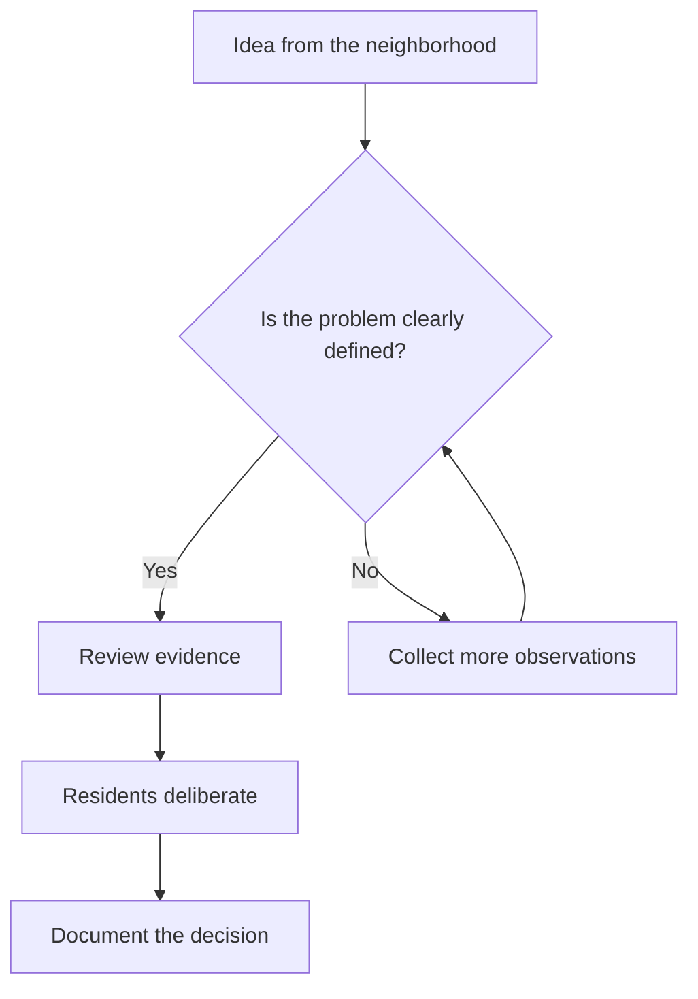

**Try it:** Change one element to describe a different future for Harborlight. Record what the new representation clarifies and what it still leaves uncertain.

### 1.2 Explore: Follow evidence as it moves between the research team and residents (2/58)

**Explore:** Follow evidence as it moves between the research team and residents?

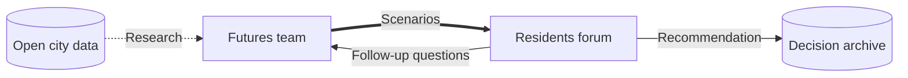

**Try it:** Change one element to describe a different future for Harborlight. Record what the new representation clarifies and what it still leaves uncertain.

### 1.3 Explore: Examine which perspectives are missing from a public hearing (3/58)

**Explore:** Examine which perspectives are missing from a public hearing?

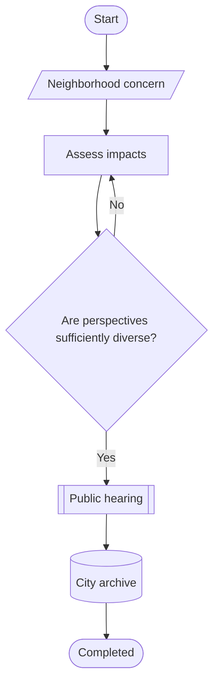

**Try it:** Change one element to describe a different future for Harborlight. Record what the new representation clarifies and what it still leaves uncertain.

### 1.4 Explore: Connect local observations to shared responses (4/58)

**Explore:** Connect local observations to shared responses?

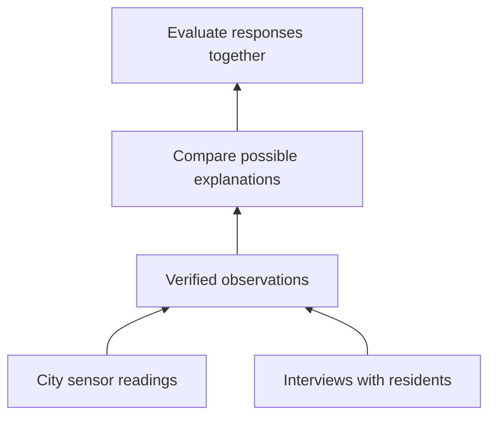

**Try it:** Change one element to describe a different future for Harborlight. Record what the new representation clarifies and what it still leaves uncertain.

### 1.5 Explore: Trace accountability backward from a decision to its evidence (5/58)

**Explore:** Trace accountability backward from a decision to its evidence?

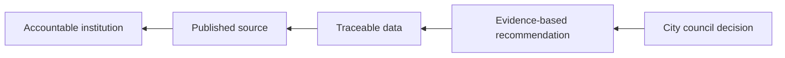

**Try it:** Change one element to describe a different future for Harborlight. Record what the new representation clarifies and what it still leaves uncertain.

### 1.6 Explore: See how discovery, evaluation, and action form a learning cycle (6/58)

**Explore:** See how discovery, evaluation, and action form a learning cycle?

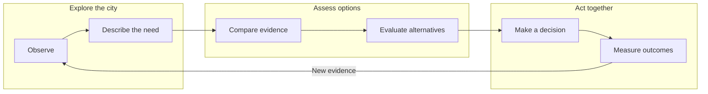

**Try it:** Change one element to describe a different future for Harborlight. Record what the new representation clarifies and what it still leaves uncertain.

### 1.7 Explore: Identify what each flowchart shape communicates (7/58)

**Explore:** Identify what each flowchart shape communicates?

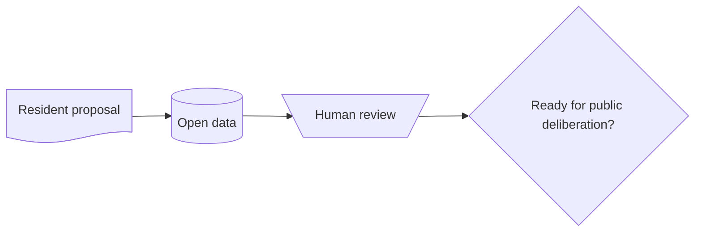

**Try it:** Change one element to describe a different future for Harborlight. Record what the new representation clarifies and what it still leaves uncertain.

### 1.8 Explore: Consider how knowledge-sharing milestones change public life (8/58)

**Explore:** Consider how knowledge-sharing milestones change public life?

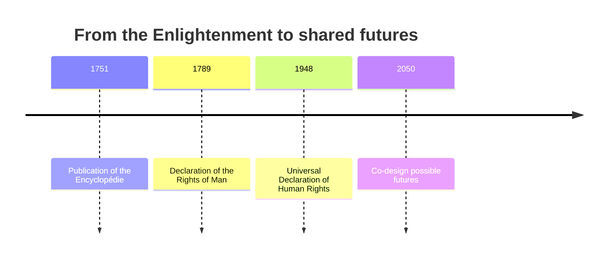

**Try it:** Change one element to describe a different future for Harborlight. Record what the new representation clarifies and what it still leaves uncertain.

## 2. Knowledge has an architecture

**Central question:** What becomes visible when we represent a complex choice in a different way?

### 2.1 Explore: Explore relationships between proposals, reviews, and cited sources (9/58)

**Explore:** Explore relationships between proposals, reviews, and cited sources?

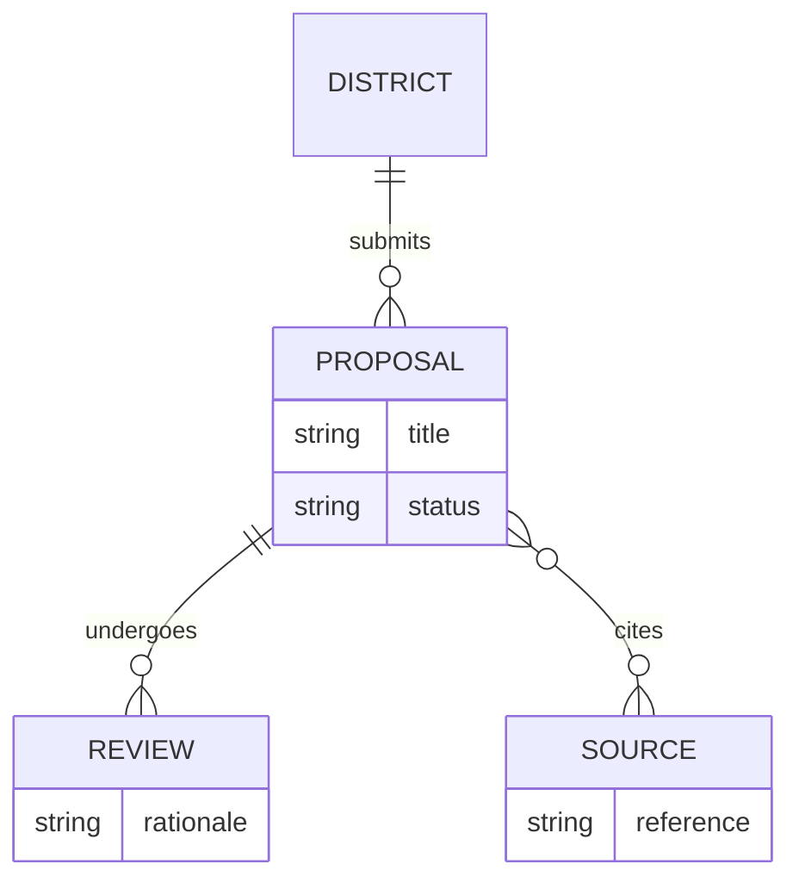

**Try it:** Change one element to describe a different future for Harborlight. Record what the new representation clarifies and what it still leaves uncertain.

### 2.2 Explore: Map a city plan to initiatives, metrics, and evidence (10/58)

**Explore:** Map a city plan to initiatives, metrics, and evidence?

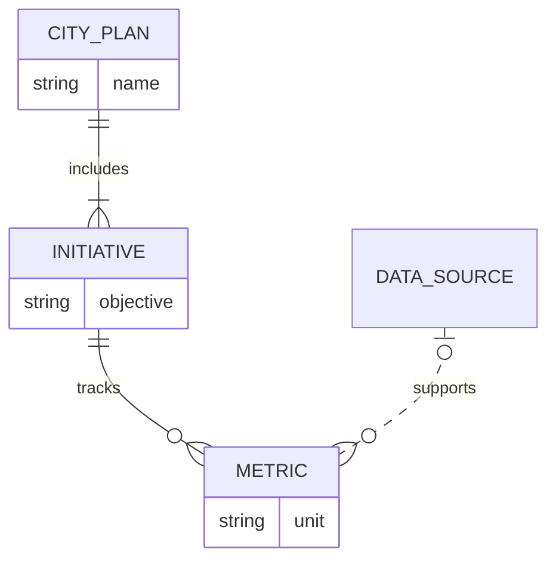

**Try it:** Change one element to describe a different future for Harborlight. Record what the new representation clarifies and what it still leaves uncertain.

### 2.3 Explore: Distinguish a scenario from its assessments (11/58)

**Explore:** Distinguish a scenario from its assessments?

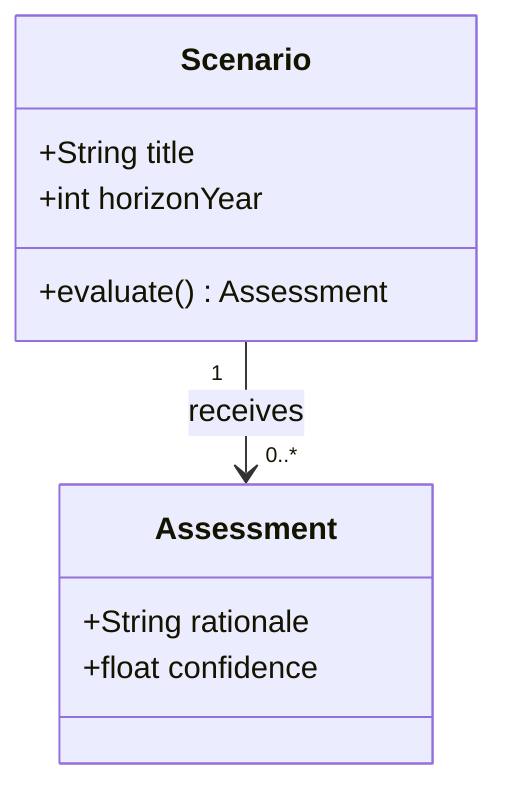

**Try it:** Change one element to describe a different future for Harborlight. Record what the new representation clarifies and what it still leaves uncertain.

### 2.4 Explore: Explore inheritance and responsibility in civic project models (12/58)

**Explore:** Explore inheritance and responsibility in civic project models?

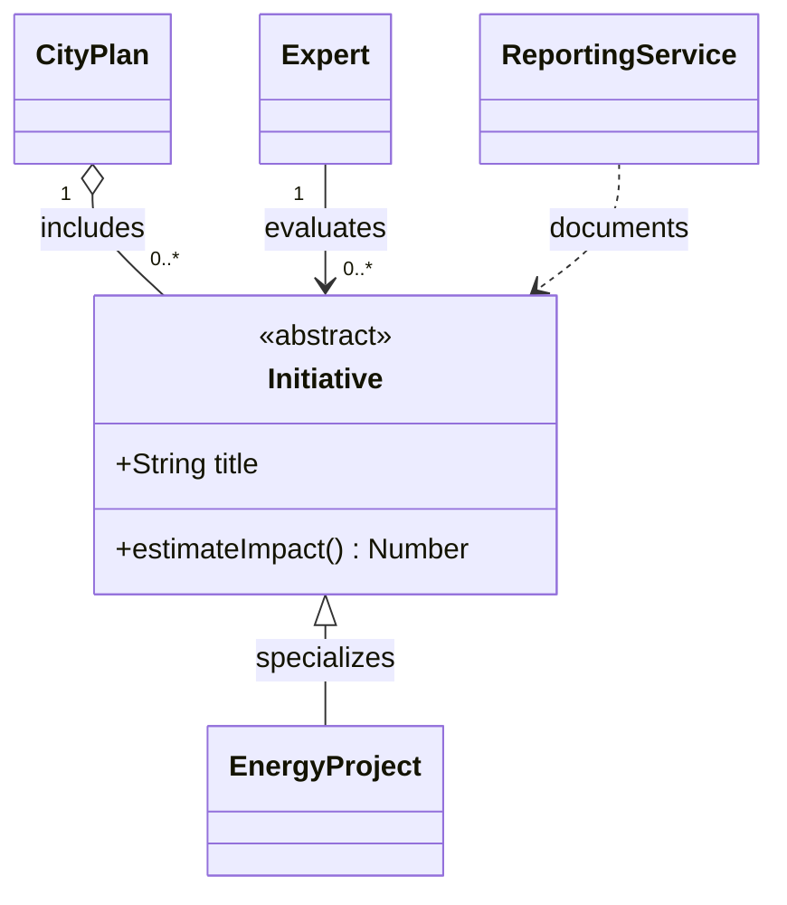

**Try it:** Change one element to describe a different future for Harborlight. Record what the new representation clarifies and what it still leaves uncertain.

### 2.5 Explore: Organize the values that shape harborlight (13/58)

**Explore:** Organize the values that shape harborlight?

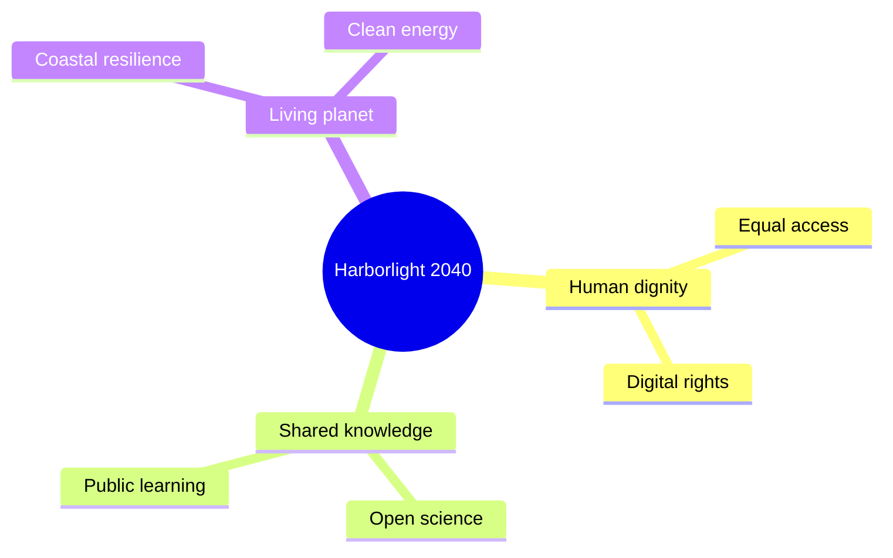

**Try it:** Change one element to describe a different future for Harborlight. Record what the new representation clarifies and what it still leaves uncertain.

### 2.6 Explore: Navigate a hierarchy of principles, places, and experiments (14/58)

**Explore:** Navigate a hierarchy of principles, places, and experiments?


**Try it:** Change one element to describe a different future for Harborlight. Record what the new representation clarifies and what it still leaves uncertain.

## 3. Democracy is a conversation

**Central question:** What becomes visible when we represent a complex choice in a different way?

### 3.1 Explore: Follow work across residents and researchers (15/58)

**Explore:** Follow work across residents and researchers?

```mermaid
swimlane-beta LR
  subgraph Residents[Residents]
    Idea[Propose an idea] --> Debatete[Discuss]
  end
  subgraph Researchers[Researchers]
    Etude[Analyze data] --> Beleg[Review evidence]
  end
  Debatete --> Etude
```

**Try it:** Change one element to describe a different future for Harborlight. Record what the new representation clarifies and what it still leaves uncertain.

### 3.2 Explore: Compare the roles of residents and researchers (16/58)

**Explore:** Compare the roles of residents and researchers?

```mermaid
usecase-beta
direction LR
actor Resident("Resident")
actor Researcher("Researcher")
systemBoundary Atelier["Harborlight workshop"]
  Explore("Explore an idea")
  Verifier("Review sources")
end
Resident --> Explore
Researcher --> Verifier
```

**Try it:** Change one element to describe a different future for Harborlight. Record what the new representation clarifies and what it still leaves uncertain.

### 3.3 Explore: Consider the emotional journey of public participation (17/58)

**Explore:** Consider the emotional journey of public participation?

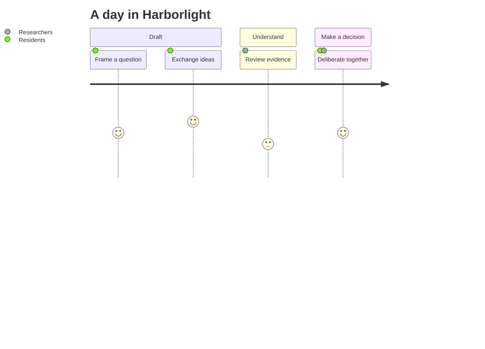

**Try it:** Change one element to describe a different future for Harborlight. Record what the new representation clarifies and what it still leaves uncertain.

### 3.4 Explore: Follow a proposal through the evidence archive (18/58)

**Explore:** Follow a proposal through the evidence archive?

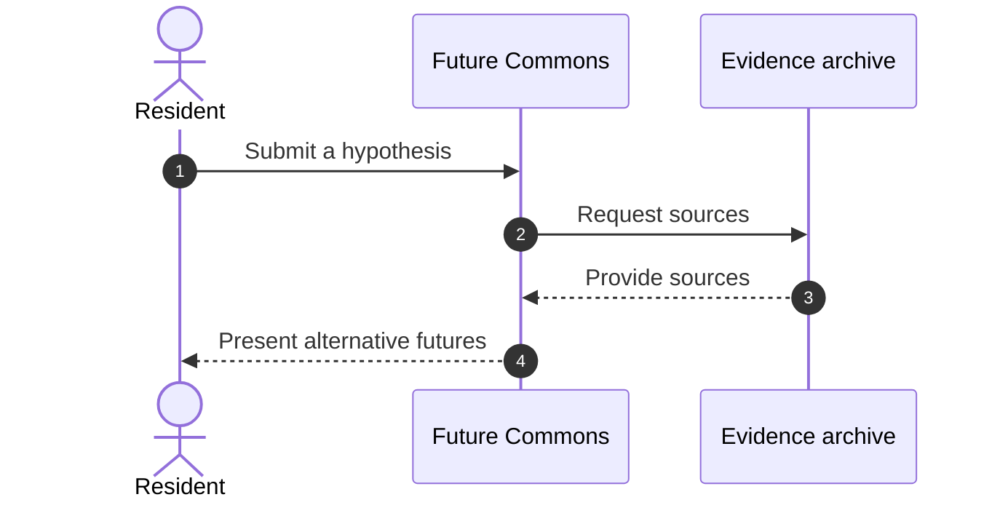

**Try it:** Change one element to describe a different future for Harborlight. Record what the new representation clarifies and what it still leaves uncertain.

### 3.5 Explore: Model a consultation with alternative outcomes (19/58)

**Explore:** Model a consultation with alternative outcomes?


**Try it:** Change one element to describe a different future for Harborlight. Record what the new representation clarifies and what it still leaves uncertain.

### 3.6 Explore: Examine optional volunteer coordination (20/58)

**Explore:** Examine optional volunteer coordination?


**Try it:** Change one element to describe a different future for Harborlight. Record what the new representation clarifies and what it still leaves uncertain.

### 3.7 Explore: Follow repeated observations and human interpretation (21/58)

**Explore:** Follow repeated observations and human interpretation?

```mermaid
sequenceDiagram
  autonumber
  actor Resident
  participant Atelier as Future Commons
  participant Sources as Evidence archive
  Resident->>Atelier: Submit a hypothesis
  Atelier->>Sources: Request sources
  Sources-->>Atelier: Provide sources
  Atelier-->>Resident: Present alternative futures
```

**Try it:** Change one element to describe a different future for Harborlight. Record what the new representation clarifies and what it still leaves uncertain.

### 3.8 Explore: Inspect how a proposal changes state (22/58)

**Explore:** Inspect how a proposal changes state?

```mermaid
stateDiagram-v2
 [*] --> Draft
 Draft --> Submitted: publish
 Submitted --> UnderReview: check evidence
 UnderReview --> Approved: supported
 UnderReview --> Revision: questions remain
 Revision --> Draft: revise
 UnderReview --> Rejected: reasons documented
 Approved --> [*]
 Rejected --> [*]
```

**Try it:** Change one element to describe a different future for Harborlight. Record what the new representation clarifies and what it still leaves uncertain.

### 3.9 Explore: Look inside the nested public review process (23/58)

**Explore:** Look inside the nested public review process?

```mermaid
stateDiagram-v2
 [*] --> Intake
 Intake --> Review: accept proposal
 state Review {
  [*] --> EvidenceCheck
  EvidenceCheck --> PublicDeliberation: sources examined
  PublicDeliberation --> [*]: discussion completed
 }
 Review --> Published: release decision
 Published --> [*]
```

**Try it:** Change one element to describe a different future for Harborlight. Record what the new representation clarifies and what it still leaves uncertain.

### 3.10 Explore: Compare parallel technical and civic review (24/58)

**Explore:** Compare parallel technical and civic review?

```mermaid
stateDiagram-v2
 state EvidenceGate <<choice>>
 state ParallelReview <<fork>>
 state ReviewComplete <<join>>
 [*] --> EvidenceGate
 EvidenceGate --> Revision: sources missing
 EvidenceGate --> ParallelReview: sources available
 ParallelReview --> TechnicalReview
 ParallelReview --> CivicReview
 TechnicalReview --> ReviewComplete
 CivicReview --> ReviewComplete
 ReviewComplete --> Published
 Revision --> [*]
 Published --> [*]
```

**Try it:** Change one element to describe a different future for Harborlight. Record what the new representation clarifies and what it still leaves uncertain.

## 4. Where people meet machines

**Central question:** What becomes visible when we represent a complex choice in a different way?

### 4.1 Explore: Trace services inside the civic platform (25/58)

**Explore:** Trace services inside the civic platform?

```mermaid
architecture-beta
  group atelier(cloud)[Future Commons]
  service web(server)[Exchanges ideas] in atelier
  service sources(database)[Evidence archive] in atelier
  service szenarien(disk)[Scenarios] in atelier
  web:R -- L:sources
  web:B -- T:szenarien
```

**Try it:** Change one element to describe a different future for Harborlight. Record what the new representation clarifies and what it still leaves uncertain.

### 4.2 Explore: Identify the people and external systems around the platform (26/58)

**Explore:** Identify the people and external systems around the platform?

```mermaid
C4Context
  title Harborlight Futures Commons
  Person(Resident, "Resident", "Submits ideas")
  System(atelier, "Atelier", "Examines hypothesiss")
  System_Ext(sources, "Evidence archive", "Sources")
  Rel(Resident, atelier, "Exchanges ideas")
  Rel(atelier, sources, "Queries")
```

**Try it:** Change one element to describe a different future for Harborlight. Record what the new representation clarifies and what it still leaves uncertain.

### 4.3 Explore: Separate interface, api, and storage responsibilities (27/58)

**Explore:** Separate interface, api, and storage responsibilities?

```mermaid
C4Context
  title Harborlight Futures Commons
  Person(Resident, "Resident", "Submits ideas")
  System(atelier, "Atelier", "Examines hypothesiss")
  System_Ext(sources, "Evidence archive", "Sources")
  Rel(Resident, atelier, "Exchanges ideas")
  Rel(atelier, sources, "Queries")
```

**Try it:** Change one element to describe a different future for Harborlight. Record what the new representation clarifies and what it still leaves uncertain.

### 4.4 Explore: Inspect the components of scenario comparison (28/58)

**Explore:** Inspect the components of scenario comparison?

```mermaid
C4Context
  title Harborlight Futures Commons
  Person(Resident, "Resident", "Submits ideas")
  System(atelier, "Atelier", "Examines hypothesiss")
  System_Ext(sources, "Evidence archive", "Sources")
  Rel(Resident, atelier, "Exchanges ideas")
  Rel(atelier, sources, "Queries")
```

**Try it:** Change one element to describe a different future for Harborlight. Record what the new representation clarifies and what it still leaves uncertain.

### 4.5 Explore: Follow a single proposal across services (29/58)

**Explore:** Follow a single proposal across services?

```mermaid
C4Context
  title Harborlight Futures Commons
  Person(Resident, "Resident", "Submits ideas")
  System(atelier, "Atelier", "Examines hypothesiss")
  System_Ext(sources, "Evidence archive", "Sources")
  Rel(Resident, atelier, "Exchanges ideas")
  Rel(atelier, sources, "Queries")
```

**Try it:** Change one element to describe a different future for Harborlight. Record what the new representation clarifies and what it still leaves uncertain.

### 4.6 Explore: Map software to its deployment environment (30/58)

**Explore:** Map software to its deployment environment?

```mermaid
C4Context
  title Harborlight Futures Commons
  Person(Resident, "Resident", "Submits ideas")
  System(atelier, "Atelier", "Examines hypothesiss")
  System_Ext(sources, "Evidence archive", "Sources")
  Rel(Resident, atelier, "Exchanges ideas")
  Rel(atelier, sources, "Queries")
```

**Try it:** Change one element to describe a different future for Harborlight. Record what the new representation clarifies and what it still leaves uncertain.

### 4.7 Explore: Interpret fields in a compact proposal message (31/58)

**Explore:** Interpret fields in a compact proposal message?

```mermaid
packet-beta
 0-7: "Version"
 8-15: "Scenario type"
 16-31: "Payload length"
 32-63: "Proposal identifier"
```

**Try it:** Change one element to describe a different future for Harborlight. Record what the new representation clarifies and what it still leaves uncertain.

### 4.8 Explore: Separate automated research from human deliberation (32/58)

**Explore:** Separate automated research from human deliberation?

```mermaid
agentflow-beta LR
  question["Resident question"]@{ shape: input }
  flow inquiry["Collective inquiry"]
    gather["Gather evidence"]@{ shape: task }
    catalog["Inspect sources"]@{ shape: tool }
    gather --> catalog
  end
  human["Public dialogue"]@{ shape: decision }
  deliver["Present alternatives"]@{ shape: action }
  question --> inquiry --> human
  human --> deliver
```

**Try it:** Change one element to describe a different future for Harborlight. Record what the new representation clarifies and what it still leaves uncertain.

## 5. The languages of possibility

**Central question:** What becomes visible when we represent a complex choice in a different way?

### 5.1 Explore: Test whether a recommendation is explainable (33/58)

**Explore:** Test whether a recommendation is explainable?

```mermaid
requirementDiagram
  requirement Transparency {
    id: REQ_01
    text: Explain automated decisions
    risk: high
    verifymethod: test
  }
  element InterfaceResident {
    type: interface
  }
  InterfaceResident - satisfies -> Transparency
```

**Try it:** Change one element to describe a different future for Harborlight. Record what the new representation clarifies and what it still leaves uncertain.

### 5.2 Explore: Construct a grammar for asking future-oriented questions (34/58)

**Explore:** Construct a grammar for asking future-oriented questions?

```mermaid
railroad-beta
title Questions for tomorrow
question = sequence(terminal("What if"), nonterminal("idee"), terminal("?")) ;
idee = oneOrMore(nonterminal("word")) ;
word = choice(terminal("Participation"), terminal("Research")) ;
```

**Try it:** Change one element to describe a different future for Harborlight. Record what the new representation clarifies and what it still leaves uncertain.

### 5.3 Explore: Compare a formal grammar with everyday language (35/58)

**Explore:** Compare a formal grammar with everyday language?

```mermaid
railroad-ebnf-beta
title Grammar of a future question
question = "What if", idee, "?" ;
idee = word, { word } ;
word = "Freedom" | "Justice" | "tomorrow" ;
```

**Try it:** Change one element to describe a different future for Harborlight. Record what the new representation clarifies and what it still leaves uncertain.

### 5.4 Explore: Read a binary message field by field (36/58)

**Explore:** Read a binary message field by field?

```mermaid
packet-beta
 0-7: "Version"
 8-15: "Message type"
 16-31: "Payload length"
 32-63: "Request identifier"
```

**Try it:** Change one element to describe a different future for Harborlight. Record what the new representation clarifies and what it still leaves uncertain.

### 5.5 Explore: Experiment with a pattern-based question language (37/58)

**Explore:** Experiment with a pattern-based question language?

```mermaid
railroad-peg-beta
title Language of possibilities
Proposition <- Word (" " Word)* ;
Word <- "Participation" / "Research" ;
```

**Try it:** Change one element to describe a different future for Harborlight. Record what the new representation clarifies and what it still leaves uncertain.

### 5.6 Explore: Group civic capabilities into a conceptual block diagram (38/58)

**Explore:** Group civic capabilities into a conceptual block diagram?

```mermaid
block-beta
  columns 3
  Horizon["A livable future"]:3
  Knowledge["Knowledge"] Freedom["Freedom"] Nature["Nature"]
  Action["Experiment"]:3
```

**Try it:** Change one element to describe a different future for Harborlight. Record what the new representation clarifies and what it still leaves uncertain.

### The same question in different code languages

Each snippet is illustrative; a fenced code block displays text and does not imply that Scriba executes it.

#### `console`

```console
$ mkdir harborlight-atlas
$ cd harborlight-atlas
$ printf "Whose future are we designing?\n" > question.txt
$ cat question.txt
Whose future are we designing?
```

#### `html`

```html
<article lang="en">
  <h2>A city of many futures</h2>
  <p>Every proposal deserves an explanation.</p>
  <button type="button">Explore an alternative</button>
</article>
```

#### `python`

```python
scenarios = {"shared": [8, 7, 9], "unequal": [4, 6, 2]}
for name, scores in scenarios.items():
    print(name, round(sum(scores) / len(scores), 2))
```

#### `json`

```json
{"city":"Harborlight","year":2040,"scenario":"shared","illustrative":true}
```

#### `yaml`

```yaml
principles:
  - fairness
  - transparency
  - ecological responsibility
```

#### `javascript`

```javascript
const choices = ["adapt", "restore", "relocate"];
console.log(choices.map((choice, i) => `${i + 1}: ${choice}`));
```

#### `typescript`

```typescript
type Scenario = { title: string; horizonYear: number; evidence: string[] };
```

#### `sql`

```sql
SELECT title, horizon_year FROM scenarios WHERE status = 'under_review';
```

#### `css`

```css
.future-card { padding: 1rem; border: 1px solid currentColor; border-radius: 12px; }
```

#### `bash`

```bash
mkdir -p harborlight/{evidence,scenarios,decisions}
find harborlight -type d
```

#### `diff`

```diff
- Decision: deploy immediately
+ Decision: run a public pilot first
```

#### `latex`

```latex
\[ S = \frac{E + R + P}{3} \]
```

## 6. Numbers are stories with assumptions

**Central question:** What becomes visible when we represent a complex choice in a different way?

### 6.1 Explore: Challenge the assumptions of an illustrative civic budget (39/58)

**Explore:** Challenge the assumptions of an illustrative civic budget?

```mermaid
pie showData
 title Illustrative civic budget
 "Public learning" : 35
 "Coastal resilience" : 30
 "Community health" : 20
 "Arts and culture" : 15
```

**Try it:** Change one element to describe a different future for Harborlight. Record what the new representation clarifies and what it still leaves uncertain.

### 6.2 Explore: Compare effort and impact across civic projects (40/58)

**Explore:** Compare effort and impact across civic projects?

```mermaid
quadrantChart
  title Decisions for Harborlight
  x-axis Low Effort --> High Effort
  y-axis Low Impact --> High Impact
  quadrant-1 Major initiatives
  quadrant-2 Priorities
  quadrant-3 Reconsider
  quadrant-4 Pilot
  "Libraries": [0.2, 0.8]
  "Transit": [0.8, 0.9]
```

**Try it:** Change one element to describe a different future for Harborlight. Record what the new representation clarifies and what it still leaves uncertain.

### 6.3 Explore: Read an illustrative knowledge-access bar chart (41/58)

**Explore:** Read an illustrative knowledge-access bar chart?

```mermaid
xychart-beta
  title "Illustrative access to knowledge"
  x-axis [2025, 2030, 2035, 2040]
  y-axis "Illustrative index" 0 --> 100
  bar [30, 45, 65, 80]
```

**Try it:** Change one element to describe a different future for Harborlight. Record what the new representation clarifies and what it still leaves uncertain.

### 6.4 Explore: Examine a projected resilience trend (42/58)

**Explore:** Examine a projected resilience trend?

```mermaid
xychart-beta
  title "Illustrative access to knowledge"
  x-axis [2025, 2030, 2035, 2040]
  y-axis "Illustrative index" 0 --> 100
  line [25, 40, 60, 90]
```

**Try it:** Change one element to describe a different future for Harborlight. Record what the new representation clarifies and what it still leaves uncertain.

### 6.5 Explore: Compare two indicators without confusing correlation and causation (43/58)

**Explore:** Compare two indicators without confusing correlation and causation?

```mermaid
xychart-beta
  title "Illustrative access to knowledge"
  x-axis [2025, 2030, 2035, 2040]
  y-axis "Illustrative index" 0 --> 100
  bar [30, 45, 65, 80]
  line [25, 40, 60, 90]
```

**Try it:** Change one element to describe a different future for Harborlight. Record what the new representation clarifies and what it still leaves uncertain.

### 6.6 Explore: Compare imagined futures across competing values (44/58)

**Explore:** Compare imagined futures across competing values?

```mermaid
radar-beta
  title Two possible futures
  axis Justice["Justice"], knowledge["Knowledge"], climate["Climate"], freedom["Freedom"]
  curve a["Scenario A"]{4, 5, 3, 4}
  curve b["Scenario B"]{3, 3, 5, 4}
  min 0
  max 5
  graticule polygon
```

**Try it:** Change one element to describe a different future for Harborlight. Record what the new representation clarifies and what it still leaves uncertain.

### 6.7 Explore: Trace illustrative energy supply to final uses (45/58)

**Explore:** Trace illustrative energy supply to final uses?

```mermaid
sankey-beta
"Solar power","Homes",35
"Solar power","Public transit",20
"Wind power","Homes",25
"Wind power","Local businesses",20
```

**Try it:** Change one element to describe a different future for Harborlight. Record what the new representation clarifies and what it still leaves uncertain.

### 6.8 Explore: Inspect a nested allocation of civic investment (46/58)

**Explore:** Inspect a nested allocation of civic investment?

```mermaid
treemap-beta
 "Illustrative investments"
  "Knowledge"
   "Public learning": 35
   "Open science": 20
  "Resilience"
   "Clean energy": 25
   "Biodiversity": 20
```

**Try it:** Change one element to describe a different future for Harborlight. Record what the new representation clarifies and what it still leaves uncertain.

## 7. Making an idea testable

**Central question:** What becomes visible when we represent a complex choice in a different way?

### 7.1 Explore: Plan sequential research activities (47/58)

**Explore:** Plan sequential research activities?

```mermaid
gantt
  title Future Commons, illustrative schedule
  dateFormat YYYY-MM-DD
  section Explore
  Collect questions :a1, 2027-01-10, 10d
  Review sources :a2, after a1, 12d
  section Draft
  Compare scenarios :b1, after a2, 15d
```

**Try it:** Change one element to describe a different future for Harborlight. Record what the new representation clarifies and what it still leaves uncertain.

### 7.2 Explore: Spot parallel activities and scheduling dependencies (48/58)

**Explore:** Spot parallel activities and scheduling dependencies?

```mermaid
gantt
  title Future Commons, illustrative schedule
  dateFormat YYYY-MM-DD
  section Explore
  Organize participation :a1, 2027-01-10, 10d
  Test technology :a2, 2027-01-12, 12d
  section Draft
  Discuss findings :b1, after a2, 15d
```

**Try it:** Change one element to describe a different future for Harborlight. Record what the new representation clarifies and what it still leaves uncertain.

### 7.3 Explore: Move a question across a collaborative board (49/58)

**Explore:** Move a question across a collaborative board?

```mermaid
kanban
  column1[Questions to ask]
    t1[Which digital rights?]
  column2[To investigate]
    t2[Compare possible futures]
  column3[To deliberate]
    t3[Discuss risks]
```

**Try it:** Change one element to describe a different future for Harborlight. Record what the new representation clarifies and what it still leaves uncertain.

### 7.4 Explore: Track a new hypothesis through a branch and merge (50/58)

**Explore:** Track a new hypothesis through a branch and merge?

```mermaid
gitGraph
  commit id: "Initial question"
  branch hypothesis
  checkout hypothesis
  commit id: "New perspective"
  checkout main
  commit id: "Sources reviewed"
  merge hypothesis
```

**Try it:** Change one element to describe a different future for Harborlight. Record what the new representation clarifies and what it still leaves uncertain.

### 7.5 Explore: Document a data correction without hiding its history (51/58)

**Explore:** Document a data correction without hiding its history?

```mermaid
gitGraph
  commit id: "Initial question"
  branch correction
  checkout correction
  commit id: "Corrected data"
  checkout main
  commit id: "Sources reviewed"
  merge correction
```

**Try it:** Change one element to describe a different future for Harborlight. Record what the new representation clarifies and what it still leaves uncertain.

### 7.6 Explore: Follow a proposal submission as a domain event (52/58)

**Explore:** Follow a proposal submission as a domain event?

```mermaid
eventmodeling
 tf 01 ui Proposalsformular
 tf 02 cmd SubmitProposal { neighborhood: string }
 tf 03 evt ProposalSubmitted { proposalId: string }
```

**Try it:** Change one element to describe a different future for Harborlight. Record what the new representation clarifies and what it still leaves uncertain.

### 7.7 Explore: Read a review event as a citizen-facing view (53/58)

**Explore:** Read a review event as a citizen-facing view?

```mermaid
eventmodeling
 tf 01 evt ProposalReviewed
 tf 02 rmo ReviewedProposals
 tf 03 ui ParticipationDashboard
```

**Try it:** Change one element to describe a different future for Harborlight. Record what the new representation clarifies and what it still leaves uncertain.

## 8. Deciding without false certainty

**Central question:** What becomes visible when we represent a complex choice in a different way?

### 8.1 Explore: Explore overlaps between freedom, fairness, and sustainability (54/58)

**Explore:** Explore overlaps between freedom, fairness, and sustainability?

```mermaid
venn-beta
 title Three values for Harborlight
 set Freedom["Freedom"]
 set Fairness["Fairness"]
 set Sustainability["Sustainability"]
 Freedom & Fairness : "Equal voice"
 Freedom & Sustainability : "Responsible choice"
 Fairness & Sustainability : "Just transition"
 Freedom & Fairness & Sustainability : "A shared future"
```

**Try it:** Change one element to describe a different future for Harborlight. Record what the new representation clarifies and what it still leaves uncertain.

### 8.2 Explore: Investigate causes of delayed energy transition (55/58)

**Explore:** Investigate causes of delayed energy transition?

```mermaid
ishikawa-beta
  Delayed energy transition
  Governance
    Fragmented decisions
    Limited coordination
  Knowledge
    Incomplete data
  Resources
    Funding constraints
```

**Try it:** Change one element to describe a different future for Harborlight. Record what the new representation clarifies and what it still leaves uncertain.

### 8.3 Explore: Map the visibility and maturity of civic capabilities (56/58)

**Explore:** Map the visibility and maturity of civic capabilities?

```mermaid
wardley-beta
title Capabilities of a learning city
anchor "Residents' decisions" [0.95, 0.60]
component "Public dialogue" [0.78, 0.35]
component "Open knowledge" [0.58, 0.50]
component "Infrastructure" [0.22, 0.85]
"Residents' decisions" -> "Public dialogue"
"Public dialogue" -> "Open knowledge"
"Open knowledge" -> "Infrastructure"
evolve "Public dialogue" 0.55
note "Make divergent perspectives visible" [0.42, 0.25]
```

**Try it:** Change one element to describe a different future for Harborlight. Record what the new representation clarifies and what it still leaves uncertain.

### 8.4 Explore: Choose responses according to uncertainty (57/58)

**Explore:** Choose responses according to uncertainty?

```mermaid
cynefin-beta
  title How should we act?
  clear
    "Apply an established rule"
  complicated
    "Evaluate technology"
  complex
    "Experiment with collaboration"
  chaotic
    "Protect people"
  confusion
    "Clarify uncertainty"
```

**Try it:** Change one element to describe a different future for Harborlight. Record what the new representation clarifies and what it still leaves uncertain.

## 9. Sketching tomorrow

**Central question:** What becomes visible when we represent a complex choice in a different way?

### HTML and Lucide icons

<div class="future-card" lang="en"><h3>Harborlight: an open question</h3><p>What do we owe the next generation?</p><i data-lucide="lightbulb"></i> <i data-lucide="users"></i></div>

### Inline SVG

<svg xmlns="http://www.w3.org/2000/svg" viewBox="0 0 260 90" role="img" aria-label="Evidence points toward imagination"><rect x="2" y="2" width="256" height="86" rx="12" fill="none" stroke="currentColor"/><text x="14" y="45" fill="currentColor">Evidence</text><path d="M95 40 H150 l-8 -8 m8 8 l-8 8" fill="none" stroke="currentColor"/><text x="165" y="45" fill="currentColor">Possibility</text></svg>

### Excalidraw

Use the Excalidraw notation documented in the Scriba manual to sketch three competing visions for the harbor. A sketch can start a conversation without pretending to settle it.

## 10. Your atlas starts here

**Central question:** What becomes visible when we represent a complex choice in a different way?

### 10.1 Explore: Inspect metadata for the diagram library (58/58)

**Explore:** Inspect metadata for the diagram library?

```mermaid
info
```

**Try it:** Change one element to describe a different future for Harborlight. Record what the new representation clarifies and what it still leaves uncertain.

## Closing invitation

The most useful future is not the one that looks most certain. It is the one whose assumptions we can inspect, question and revise together.

---

*Editorial note: Harborlight, its scenarios and figures are fictional. Mermaid examples are adapted from the documented Scriba syntax; rendering in Scriba has not been tested for this file.*
