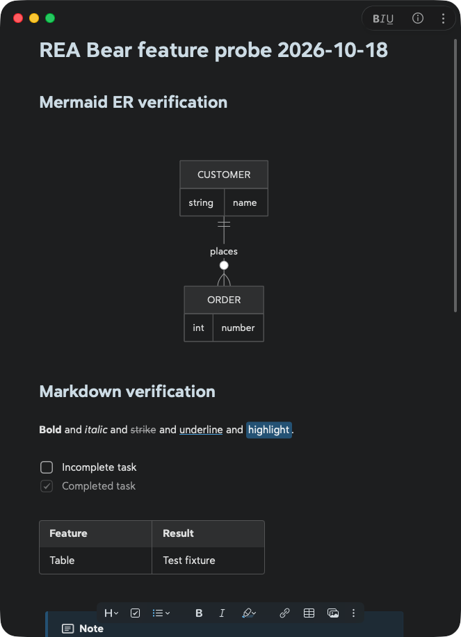
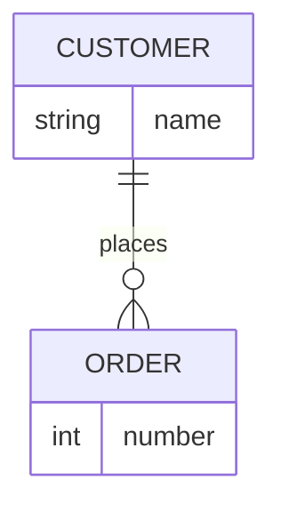
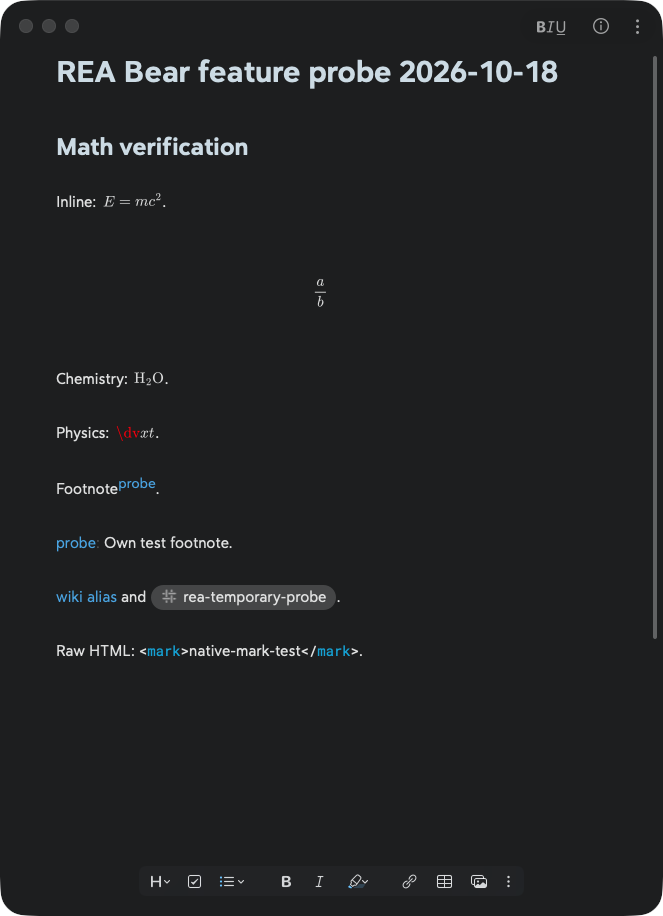

# Bear 3.0: Markdown, Mermaid e fórmulas

Investigação de `/Applications/Bear.app`, **versão 3.0, build 14827**, realizada em **18/10/2026** com a skill `reverse-engineer-anything`. Foram cruzados o pacote instalado, pseudocódigo nativo recuperado, a interface real do Bear, replay dos recursos JavaScript originais e documentação oficial.

## Resultado principal

**O Bear instalado renderiza diagramas ER.** A declaração correta é **`erDiagram`** dentro de um bloco Markdown `mermaid`. `edDiagram` não é reconhecido. Isso foi comprovado na janela nativa do Bear e também nos dois motores do replay.

O pacote contém **Mermaid 11.16.0** e **MathJax 4.1.0**. O replay executou **44 casos em cada navegador: 41 renderizaram SVG e três testes negativos foram rejeitados**. Esses 41 casos incluem aliases e variantes; não representam 41 famílias independentes nem uma validação de toda a gramática.



Captura da nota de teste própria, sem conteúdo de notas do usuário. Evidência REA: `ev_41bcf3ef2e9b87449f708a3f7fa0b6830dcc988d3f35137d7c5a1fe8c8ca7c32`, [registro completo](evidence/native-ui-er.json).

## Como Mermaid chega à tela

A análise do aplicativo mostra um editor nativo com componentes `PolarMark`, `MDTextKit` e `MDTextKitUI`. Mermaid possui um caminho específico com WebKit:

```text
Bloco Markdown mermaid
  -> MDMermaidTextAttachment / MDTextKitCoreView
  -> MDMermaidRenderer: tema, fonte, fila e requisições em andamento
  -> WKWebView com mermaid.html e scripts locais
  -> Mermaid 11.16.0 produz SVG
  -> adaptador ajusta dimensões e retorna geometria
  -> WKSnapshotConfiguration / takeSnapshot
  -> NSImage incorporada ao texto nativo
```

Essa cadeia combina observações do adaptador original, chamadas recuperadas do binário e o resultado visto na interface. Não foi recuperado o código-fonte original do Bear.

| Etapa | Evidência e localização |
| --- | --- |
| O componente de texto identifica `MDMermaidTextAttachment` e encaminha código, fonte e tema | `MDTextKitUI`, procedimento `0x1a67d0`; `ev_1744fcc74ff6dded2445c0896dfeb782ea279bec9650249ef40200075e5ad97e`; [pseudocódigo](evidence/native-mermaid-extra-2.json) |
| O renderizador prepara fila, cache e controle de renderizações em andamento | Inicialização `0x1a136c` e renderização `0x1a19f8`; `ev_ccf62a54349ecb4725e29099c5ff76d66c7de2bed1c4ab1fa02eae94a342e42b` / `ev_7039bc3df2c43eb78ecf06c74aee2a6fecdd01c0c3fb12d60ad831296e728f82`; [inicialização](evidence/native-mermaid-0.json), [renderização](evidence/native-mermaid-2.json) |
| Carrega arquivo do bundle com `WKWebView.loadFileURL` e acesso à pasta de recursos | `0x1a1498`; `ev_02a83a876718c0679b80c1bed7816993e5743a401f2497d48187052b9ae3c781`; [registro](evidence/native-webview-load.json) |
| Aguarda `ensureMermaidLoaded()` no mundo JavaScript da página | `0x1a16b0`; `ev_623f28586635b0ff7de019c4a74eb0f071e38b36b5baeeff1bfa77f3cb1228bd`; [registro](evidence/native-mermaid-1.json) |
| Serializa opções de fonte e tema | `0x1a3724`; `ev_0b3e8c228a8015118f04f2f98ee3af9843c6af566f410b0ee82d59fbde305d86`; [registro](evidence/native-mermaid-extra-1.json) |
| O adaptador aguarda BearSansUI, chama Mermaid, insere SVG e mede o resultado | `mermaid/mermaid.js`; `ev_89238a29471bed06ea5be5ba51ce24fe3ba444384722ba87d3abbfd90163be23`; [análise](evidence/mermaid-rea-wrapper-analysis.json) |
| O nativo configura e solicita snapshot da WebView | `0x1a2398`; `ev_ac7a26298dc3cede863ca4fdbe1b26689e71a8fa90e9d0632d1fd9c4fae2fc98`; [pseudocódigo](evidence/native-snapshot.json) |

O adaptador usa `startOnLoad: false`, `securityLevel: "strict"`, `look: "classic"` e `theme: "base"`, recebendo variáveis de cores e fonte do aplicativo. Há ajustes específicos para radar e Event Modeling. Erros de Mermaid são tratados e devolvidos ao chamador. Esses parâmetros foram observados; não constituem uma auditoria de segurança.

Scripts e fontes de Mermaid vêm do pacote local. Nenhum dos casos Mermaid do replay precisou de rede externa. A conclusão não se estende automaticamente às extensões de MathJax.

Ao editar um diagrama, o Bear mostra o código com o desenho abaixo; ao sair do bloco, esconde o código. Clicar no desenho volta a expô-lo. Esse comportamento é descrito no [guia oficial de Mermaid](https://bear.app/faq/how-to-add-mermaid-diagrams-in-bear/).

## Sintaxes Markdown identificadas

A coluna de confirmação distingue o que foi observado na interface do que está documentado. “CLI” refere-se ao [help incluído nesta instalação](evidence/bearcli-help.txt); “guia” refere-se à [matriz de fontes oficiais](documented-syntax.md). A presença de uma classe de AST no binário, isoladamente, não foi considerada suporte ativo.

| Recurso | Sintaxe | Confirmação |
| --- | --- | --- |
| Títulos | `#` a `######` seguidos de espaço | Guia; H1/H2 vistos na interface |
| Negrito e itálico | `**bold**`, `*italic*`, `_italic_` | Guia; asteriscos vistos na interface |
| Sublinhado | `~underline~` | CLI + interface |
| Tachado | `~~strike~~` | CLI + interface |
| Destaque | `==highlight==` | CLI + interface; CLI também documenta marcadores de cores |
| Estilos combinados | Combinar ênfase, destaque e outros delimitadores | Guia; combinações não testadas exaustivamente |
| Código em linha | Texto entre crases | Guia |
| Blocos de código | Três crases, com linguagem opcional | Guia; bloco `mermaid` testado |
| Listas e sublistas | `- item`, `* item`, `1. item` | Guia + regras de continuação do CLI |
| Tarefas | `- [ ]` e `- [x]` | CLI + interface, com caixas de seleção |
| Citações | `> texto` em cada linha | CLI + guia |
| Separador | `---` | Guia; distinguir de front matter no início da nota |
| Links | `[label](https://example.com)` | Guia |
| Imagens e anexos | ``; anexos pelo app | Recursos de onboarding + guia |
| Tabelas | Linhas com `|` **nas duas extremidades** | CLI + interface |
| Callouts | `> [!NOTE]`, `TIP`, `IMPORTANT`, `WARNING`, `CAUTION` | CLI + guia; NOTE visto na interface |
| Notas de rodapé | `[^id]` e `[^id]: texto` | Guia + interface |
| Tags | `#tag`, `#multi word tag#`, `#parent/child` | CLI + guia; tag simples vista na interface |
| Wikilinks e aliases | `[[Title]]`, `[[Title\|alias]]` | CLI + guia; alias visto na interface |
| Links para seções | `[[Title/Heading]]`; `[[/` inicia seleção na nota atual | Guia |
| YAML front matter | Abertura `---` na **primeira linha**, YAML e fechamento `---` | CLI; sem inferir banco de propriedades |
| Matemática em linha | `$E=mc^2$` | CLI + guia + interface |
| Matemática em bloco | `$$` em linhas próprias envolvendo TeX | CLI + guia + interface |
| Diagramas | Bloco de código com linguagem `mermaid` | Guia + interface + replay |

Na célula do wikilink, a barra vertical está escapada apenas para manter esta tabela Markdown válida: o usuário digita `[[Title|alias]]`.

Backlinks, sumário, recolhimento de seções e cartões de links também existem, mas são funcionalidades do aplicativo, não novos delimitadores de Markdown. O [catálogo documental](documented-syntax.md) explica essas distinções e traz as fontes de cada item.

### Diferenças relevantes de CommonMark e HTML

O CLI deste build **exclui títulos Setext, blocos de código por indentação e continuação preguiçosa de listas/citações**. Continuação de lista precisa de indentação, e cada linha de citação precisa de `>`. Quebras físicas de linha não são simplesmente recompostas em um parágrafo corrido. São regras do contrato documentado da versão instalada; não foram inferidas da descrição genérica “CommonMark” do site.

O teste nativo de `<mark>native-mark-test</mark>` mostrou as tags literais, com coloração, em vez de aplicar HTML. Isso combina com a [explicação do mantenedor sobre HTML no editor](https://community.bear.app/t/tables-could-be-exciting/17298), de 20/06/2025, que cita `table`, `div` e `span`. Exportação HTML e possíveis exceções individuais não foram testadas.

## Diagramas suportados pelo bundle testado

Todos os inícios abaixo produziram SVG em **Chromium 155.0.8059.80 e WebKit 27.2**, usando HTML, biblioteca e adaptador originais do Bear. Somente ER passou também pelo teste da interface nativa nesta investigação.

| Família | Declarações testadas |
| --- | --- |
| Fluxogramas | `flowchart LR`, `graph TD`, `flowchart-elk LR` |
| Sequência | `sequenceDiagram` |
| Classes | `classDiagram` |
| Estados | `stateDiagram`, `stateDiagram-v2` |
| Entidades e relacionamentos | `erDiagram` |
| Jornada e cronograma | `journey`, `gantt` |
| Pizza, quadrantes e requisitos | `pie`, `quadrantChart`, `requirementDiagram` |
| Git | `gitGraph` |
| C4 | `C4Context`, `C4Container`, `C4Component`, `C4Dynamic`, `C4Deployment` |
| Mapa mental e linha do tempo | `mindmap`, `timeline` |
| Sankey e XY | `sankey-beta`, `xychart-beta` |
| Blocos e pacotes | `block-beta`, `packet-beta` |
| Kanban e arquitetura | `kanban`, `architecture-beta` |
| Radar e treemap | `radar-beta`, `treemap-beta` |
| Árvore de arquivos | `treeView-beta` |
| Event Modeling | `eventmodeling` |
| Ishikawa e Venn | `ishikawa-beta`, `venn-beta` |
| Wardley e Cynefin | `wardley-beta`, `cynefin-beta` |
| Railroad | `railroad-beta`, `railroad-ebnf-beta`, `railroad-abnf-beta`, `railroad-peg-beta` |
| Swimlanes | `swimlane-beta LR` |
| Versão da biblioteca | `info` |

`edDiagram`, `zenuml` e `usecaseDiagram` foram rejeitados na detecção de tipo. Os dois últimos também não constavam no registro consultado desse bundle. Não se conclui que nunca possam existir como plugins ou em outra versão.

Exemplo completo para colar no Bear:

````markdown

````

Os [44 fixtures e resultados exatos](evidence/mermaid-replay-results.json) preservam código, dimensões, erros, versões e requisições bloqueadas. A execução final REA é `ev_17ea400f250f485328c45877d3449a204580bf089d59c9b96a9d70f018cce427`: processo encerrado com código 0, sem truncamento no registro final. [Análise detalhada e imagens do replay](mermaid-findings.md), [harness reproduzível](evidence/mermaid-replay.mjs), [evidência completa](evidence/mermaid-rea-complete-replay.json).

## Fórmulas, química e limite de física

O Bear usa **MathJax 4.1.0** em outra WebView. Seu adaptador converte TeX em SVG, mede tamanho e linha de base, e distingue fórmula em linha de fórmula em bloco. Ele tenta carregar as extensões `mhchem` e `physics`. A sintaxe de entrada `$...$` / `$$...$$` também está descrita no [guia oficial de fórmulas](https://bear.app/faq/how-to-write-math-formulas-in-bear/).

| Teste | Resultado na interface nativa |
| --- | --- |
| `$E=mc^2$` | Fórmula em linha renderizada |
| `\frac{a}{b}` entre delimitadores de bloco | Fração centralizada renderizada |
| `$\ce{H2O}$` | Fórmula química renderizada com subscrito |
| `$\dv{x}{t}$` | `\dv` aparece em vermelho, não reconhecido; não comprovou suporte a esse comando |



Evidência da interface: `ev_176cf2127a72fab41e053428c0aacedf9a74f8f88d4b168efd9153726e5b1653`; [registro](evidence/native-ui-math-final.json), [entrada exata do teste](evidence/native-probe-math.md).

No replay isolado com rede externa bloqueada, a inicialização solicitou `@mathjax/mathjax-mhchem-font-extension/svg.js` no jsDelivr e falhou nesse carregamento. A conversão direta de uma fração funcionou; química não concluiu nesse ambiente. A renderização química positiva na janela nativa não prova funcionamento offline: o aplicativo pode ter rede ou cache. Não foi medido o motivo da diferença nem garantido o conjunto completo de macros de física.

## Linguagens de código e extensões não equivalentes

O [guia de highlighting do Bear](https://bear.app/faq/show-syntax-highlighting-for-your-code-snippets-in-notes/) anuncia mais de 250 linguagens e oferece uma lista parcial. Entre os exemplos documentados estão JavaScript, TypeScript, Python, Swift, C/C++, SQL, HTML, XML, CSS, JSON, YAML, GraphQL, Bash e TeX/LaTeX.

Uma linguagem escrita depois das crases pode servir apenas para **colorir código**. `html` não implica executar HTML; `latex` não substitui os delimitadores matemáticos; `yaml` não transforma a nota num banco de propriedades. Mermaid tem integração específica de desenho, e MathJax recebe expressões por outro caminho.

Não foram certificados individualmente todos os aliases de linguagens, macros de TeX, extensões do Markdown, opções de exportação, sub/sobrescritos fora de TeX, listas de definição, comentários HTML ou variantes de links de referência. Ausência de teste não foi marcada como ausência de suporte.

## Identidade, método e cobertura

| Artefato | Identidade |
| --- | --- |
| Aplicativo | Bear 3.0, build 14827; executável universal, análise nativa arm64 |
| SHA-256 do executável Bear | `4b5f4626dd3c7a798c55053dfbb6b17390cdc8b846f3fef3966bfd276d877d24` |
| SHA-256 de MDTextKitUI | `b6d73658b148e6426b914cf38fd49ec6e1302a3a752873d00475adca763e4217` |
| Mermaid minificado | 11.16.0; `74d7c46dabca328c2294733910a8aa1ed0c37451776e8d5295da38a2b758fb9b` |
| Ferramentas | REA 6.5.0, provider Hopper para pseudocódigo; utilitários nativos macOS para identidade/AX/screenshot; replay com Playwright |
| Recursos MathJax | 4.1.0, confirmado em runtime; hashes no manifesto e no resultado do replay |

O [manifesto de artefatos](evidence/artifact-manifest.json) registra caminhos originais, tamanhos e SHA-256. Os endereços do relatório pertencem à imagem arm64 analisada, não são endereços ASLR do processo vivo.

Foram preservados os registros [iniciais](evidence/rea-initial.json), [da análise nativa](evidence/rea-static-and-replay.json) e [da observação em runtime](evidence/rea-native-runtime.json), além dos registros específicos do replay. Um export de ledger cobre a conexão/sessão que o produziu, não uma união automática de todas as análises dos colaboradores.

A decompilação fornece pseudocódigo recuperado, com possíveis perdas de tipos, limites de funções e literais Swift. Capturas AX registram lacunas de acesso a alguns filhos e truncamento da árvore; as imagens mostram apenas o conteúdo visível da janela selecionada. A execução positiva de um fixture não prova todas as opções daquela família.

A verificação da interface usou uma nota criada exclusivamente para esta pesquisa. Ela foi fechada e movida para a lixeira ao terminar; a seleção anterior foi restaurada. Nenhuma nota preexistente foi editada. A sessão nativa REA foi encerrada. Nenhuma biblioteca ou fonte proprietária foi copiada para este diretório: o harness lê os recursos da instalação existente. O código do Scriba e sua implantação não foram alterados por esta investigação.

As conferências de contagem do replay, integridade dos artefatos, links do relatório e evidências citadas estão registradas em [report-verification.json](evidence/report-verification.json).

## Avaliação para implementação no Scriba

A [comparação de motores e integrações](../diagram-renderer-evaluation/README.md) inclui Pele, Mermaid.js, Beautiful Mermaid, amrebada/markdown-viewer e o padrão react-markdown com componente próprio. Essa avaliação tem escopo próprio e não altera os resultados medidos no Bear.
