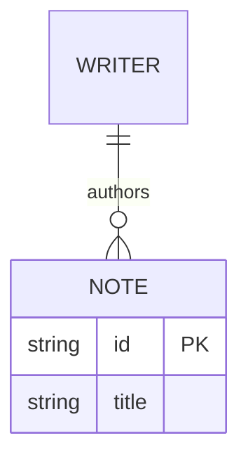

# Bear syntax: primary documentation contribution

Research date: **2026-10-18**. Target supplied by the user: `/Applications/Bear.app`, **3.0 (14827)**. This contribution covers public documentation and the installed CLI's read-only help. It does **not** claim that every feature was exercised in Bear's editor. Match the companion binary/runtime findings before marking version-specific behavior verified.

## Evidence scope

- **DOC-CLI**: `/Applications/Bear.app/Contents/MacOS/bearcli --help`, read on 2026-10-18. The `MARKDOWN` section is shipped documentation for this installed build, not a parser execution. The root investigation retains its full output and artifact identity.
- **DOC-MD**: [Bear Markdown guide](https://bear.app/faq/how-to-use-markdown-in-bear/), accessed 2026-10-18; unversioned, no publication date supplied. Useful baseline, but its broad CommonMark description must be narrowed by DOC-CLI's explicit exceptions.
- **DOC-WELCOME**: `Contents/Resources/Base.lproj/Get started with Bear.bear` → `Get started with Bear 2.textbundle/text.md`, read as a ZIP member without importing. Corroborates combined inline styles, image references, footnotes, wiki links and `#bear/welcome`. It is retained onboarding content labelled Bear 2, not a new-feature history for Bear 3.

## Supported syntax documented for this target family

| Feature | Syntax / behavior | Evidence and confidence |
| --- | --- | --- |
| ATX headings | `#` through `######` followed by a space; styled text may be nested inside headings | DOC-MD; [heading-based outline](https://bear.app/faq/how-to-use-the-info-panel-table-of-contents-and-backlinks-in-bear/) |
| Emphasis | `*sample*` / `_sample_`, `**sample**`; combine styles | DOC-MD, DOC-WELCOME; documented, not all delimiter combinations runtime-tested here |
| Underline | `~sample~` | DOC-CLI, DOC-MD |
| Strikethrough | `~~sample~~` | DOC-CLI, DOC-MD |
| Highlight | `==sample==`; DOC-CLI also documents red, blue, green, yellow and purple circle markers immediately inside the opening delimiter for colored highlights | DOC-CLI; the website cheat sheet documents the uncolored form |
| Inline code | Backtick-delimited text | DOC-MD |
| Fenced code | Three backticks around a block; optional language after the opening fence | DOC-MD; [syntax-highlighting guide](https://bear.app/faq/show-syntax-highlighting-for-your-code-snippets-in-notes/) |
| Lists | Bullets (`-` / `*`) and numbered items (`1.`); nested structures | DOC-MD; DOC-CLI requires proper indentation on continuation lines |
| Tasks | `- [ ]` and `- [x]` | DOC-CLI; [lists and todos](https://bear.app/faq/) indexes the dedicated guide |
| Block quotes | `>` prefix on each continuation line | DOC-MD, DOC-CLI |
| Rule | `---` | DOC-MD; distinguish first-line YAML and a complete fenced YAML region |
| Links | Markdown links such as `[sample](https://example.com)` | DOC-MD |
| Images / attachments | Bundled onboarding uses ``; app supports arbitrary file attachments, with special inline previews for images/PDFs | DOC-WELCOME; [attachment guide](https://bear.app/faq/insert-attachments/). Arbitrary embedded HTML images are a separate question |
| Footnotes | Reference `[^id]`, definition `[^id]: sample`; automatic numbering and bidirectional navigation | DOC-MD; [footnote guide](https://bear.app/faq/how-to-use-footnotes-in-bear/) |
| GFM-style tables | Pipe-delimited rows; **pipes required at both ends of each row** in this build's CLI contract | DOC-CLI; [tables guide](https://bear.app/faq/how-to-use-tables-in-bear/). Column alignment and inline text styles also documented in [table tips](https://blog.bear.app/2024/05/5-tips-for-using-tables-in-bear/) (2024-05-28) |
| Callouts | Quote blocks beginning `> [!NOTE]`, `[!TIP]`, `[!IMPORTANT]`, `[!WARNING]` or `[!CAUTION]`; rich inline content, custom titles and title-only blocks | DOC-CLI; [callout guide](https://bear.app/faq/callouts/) |
| Tags | `#single`, `#multiple words#`, `#parent/child`; nested multi-word tags supported | DOC-CLI; [tag guide](https://bear.app/faq/how-to-use-tags-in-bear/) |
| Wiki links | `[[Title]]`, `[[Title\|alias]]`; heading links use `/Heading`, current-note heading completion starts `[[/` | DOC-CLI; [wiki-link guide](https://bear.app/faq/how-to-link-notes-together/). The backslash before a table-cell pipe is Markdown escaping in this report, not part of Bear's syntax |
| Backlinks / outline | Linked and unlinked mentions in the Info panel; outline from H1–H6 | [Info-panel guide](https://bear.app/faq/how-to-use-the-info-panel-table-of-contents-and-backlinks-in-bear/). This is application navigation, not an additional Markdown delimiter |
| YAML front matter | Opening `---` **must be the first line of the note**, then YAML and closing `---` | DOC-CLI. Do not equate recognition/highlighting with a property database or automatic organization |
| Inline / block math | `$...$` / `$$...$$`, rendered using **MathJax** | DOC-CLI; [math guide](https://bear.app/faq/how-to-write-math-formulas-in-bear/); [release announcement](https://blog.bear.app/2025/08/bear-now-supports-math-formulas/) dated 2025-08-05 |
| Mermaid | A fenced block labelled `mermaid`, with a diagram declaration inside | [Mermaid guide](https://bear.app/faq/how-to-add-mermaid-diagrams-in-bear/); [Bear 2.9.2 announcement](https://community.bear.app/t/bear-2-9-2-mermaid-diagram-support/19655) dated 2026-07-28 |
| Folding | Headings H1–H6 and multi-level lists/tasks have fold controls | [folding guide](https://bear.app/faq/how-to-fold-sections-in-bear/). The current guide does not establish an on-disk HTML encoding; old Panda-alpha implementation claims must not be carried forward automatically |
| Link cards | Link tool's preview option replaces a plain link display with a title/image card | [link-preview guide](https://bear.app/faq/how-to-add-link-previews-to-bear-notes/). An app display option, not proof of a new standard Markdown tag |

## Explicit limits and rendering distinctions

1. **Not every CommonMark rule is enabled.** DOC-CLI explicitly excludes Setext headings, indentation-only code blocks and lazy continuation. A list continuation needs indentation; a quoted continuation needs `>`. Hard-wrapped paragraphs retain their short physical lines instead of being reflowed. The public CommonMark label alone cannot override this target-specific contract.
2. **Code highlighting is not execution.** The [code guide](https://bear.app/faq/show-syntax-highlighting-for-your-code-snippets-in-notes/) advertises more than 250 languages, but explicitly supplies only a partial list. Examples include JavaScript/`js`, TypeScript, Python/`py`, Swift, C/C++, SQL, HTML, XML, CSS, JSON, YAML, GraphQL, Bash, and TeX/LaTeX. `html`, `yaml` and `latex` fences in that list do not, by themselves, imply HTML rendering, document-property semantics or mathematical typesetting. `mermaid` is separately documented as a rendered diagram extension; math uses `$` delimiters. The exact installed highlighting inventory belongs to the bundled-resource findings.
3. **Raw HTML is not a general in-editor rendering language.** Maintainer Matteo states on [2025-06-20](https://community.bear.app/t/tables-could-be-exciting/17298) that raw HTML such as `table`, `div` and `span` is displayed/highlighted rather than rendered inside Bear, while HTML export can pass it through. That dated statement describes the native Markdown editor; it does not rule out isolated web rendering components for later diagram/math features. Individual supported exceptions, if any, require tests for this build.
4. **YAML is not Dataview.** Maintainer replies in [the YAML discussion](https://community.bear.app/t/yaml-front-matter-uses-in-bear/13105) (2025-08-06; 2026-02-19) distinguish front matter from database-backed properties, dynamic tables and note organization. Installed DOC-CLI establishes syntax recognition, not an automation engine.
5. **Export and import are separate capabilities.** [Import](https://bear.app/faq/import-your-notes/) can convert HTML and Markdown files, including folder-based attachments. [Export](https://bear.app/faq/export-your-notes/) supports Markdown/TextBundle and other formats; Pro adds HTML/PDF/DOCX/JPEG/ePub. HTML import/export does not prove raw HTML is rendered while editing. Wiki links can be converted to HTML links when exporting several notes.

## Mermaid: exact user-facing behavior and `erDiagram`

Bear's [guide](https://bear.app/faq/how-to-add-mermaid-diagrams-in-bear/) documents the following interaction: editable source appears above a live preview; moving the caret outside the fence hides the source; clicking/tapping the diagram reveals its source again. The [2.9.2 announcement](https://community.bear.app/t/bear-2-9-2-mermaid-diagram-support/19655) establishes introduction on **2026-07-28**, including availability without Pro. A 2024 community response saying there were no Mermaid plans is obsolete for this installed 3.0 build.

The ER declaration is **`erDiagram`**. The Mermaid project's [syntax reference](https://mermaid.js.org/intro/syntax-reference.html) explicitly identifies that spelling and warns that misspelled diagram declarations fail. The [ER reference](https://mermaid.js.org/syntax/entityRelationshipDiagram.html) describes crow's-foot cardinalities, relationships and entity attributes. The user's `edDiagram` is therefore likely a typo; it is not an alternate spelling established by these sources.

Minimal original example for testing (not a copied website example):

````markdown

````

The fence language is `mermaid`; `erDiagram` belongs inside it. A fence labelled `erDiagram` is not the documented activation mechanism.

### Version boundary

The official Mermaid website reported **12.2.0** on this research date. Its navigation lists flowcharts, sequences, classes, states, ER, journeys, Gantt, pie, quadrants, requirements, Git graphs, C4, mindmaps, timelines, ZenUML, Sankey, XY, blocks, packets, Kanban, architecture, radar, event modeling, treemap, Venn, Ishikawa, Wardley, Cynefin and TreeView ([current index](https://mermaid.js.org/intro/)). **That list is upstream's current catalog, not a claim that the installed Bear ships all of them.** Use the bundled Mermaid version, registered detectors and actual render results to bound Bear's support. Latest ER documentation even marks some behavior as 11.16+ or 12+, illustrating why copying current docs into a Bear capability matrix would overclaim.

Mermaid's own [syntax/configuration guide](https://mermaid.js.org/intro/syntax-reference.html) permits per-diagram YAML. This differs from first-line YAML at the note level. The 2.9.2 forum has a maintainer acknowledgement that diagram front matter works, followed by users reporting custom theme overrides not taking effect. Those user reports are not proof of current 3.0 failure; the installed wrapper's configuration and a render probe must settle title/config/theme behavior.

## Questions this contribution leaves open

- Actual registered Mermaid diagram set, exact bundled version, disabled external loaders/plugins, custom theme precedence, export treatment, diagram links and zoom: resolve from the companion shipped-resource/runtime analysis.
- Full highlighting language and alias inventory: the public guide is explicitly non-exhaustive.
- Raw HTML exceptions (`br`, comments), superscript/subscript syntaxes, definition lists, reference-link variants, alternate fence markers, escape/entity edge cases: not independently established for this build by this documentation pass. Absence from this matrix is **not** a negative runtime test.
- Full MathJax command/extension coverage and package loading: the Bear guide delegates to MathJax docs but does not pin the bundled MathJax version or configuration.
- GUI fidelity: DOC-CLI and onboarding are shipped statements; they do not substitute for visual evidence of every syntax construct.

No user notes were read, imported, edited, exported or synchronized for this contribution. No application or Scriba code was changed.
