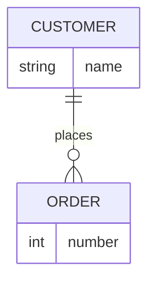

# REA Bear feature probe 2026-10-18

## Mermaid ER verification

## Markdown verification

**Bold** and *italic* and ~~strike~~ and ~underline~ and ==highlight==.

- [ ] Incomplete task
- [x] Completed task

| Feature | Result |
| --- | --- |
| Table | Test fixture |

> [!NOTE]
> Native callout fixture.

Inline math: $E=mc^2$.

$$
\frac{a}{b}
$$

A footnote[^probe] and a [[REA Missing Link|wiki alias]].

[^probe]: Own test footnote.

#rea-temporary-probe
