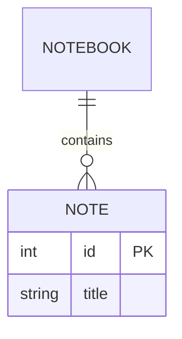
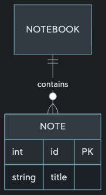
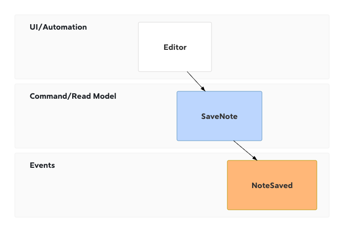

# Bear 3.0 (14827): recursos Mermaid e MathJax

Investigação do pacote instalado em `/Applications/Bear.app`, em 18/10/2026. Esta contribuição cobre o JavaScript embarcado e seu replay controlado; a cadeia nativa e a sintaxe Markdown do editor são tratadas separadamente no relatório principal.

## Resultado

O pacote contém **Mermaid 11.16.0** e **MathJax 4.1.0**. O diagrama de entidades e relacionamentos usa **`erDiagram`**, com `r`; **`edDiagram` não é um identificador reconhecido** neste pacote.

Reproduzi o HTML, a biblioteca e o adaptador de Mermaid que estão dentro do aplicativo, sem substituí-los por uma versão do npm. Os mesmos 44 casos foram executados em Chromium 155.0.8059.80 e WebKit 27.2: **41 produziram SVG**, enquanto três testes negativos foram rejeitados pela detecção de tipo: `edDiagram`, `zenuml` e `usecaseDiagram`. Isso comprova os recursos do renderizador embarcado, sem afirmar que cada exemplo passou pela interface e pelo parser Markdown nativo do Bear.

## Identidade e evidências

Diretório analisado: `/Applications/Bear.app/Contents/Frameworks/MDTextKitUI.framework/Versions/A/Resources`.

| Evidência | Conteúdo e limite |
| --- | --- |
| `ev_89238a29471bed06ea5be5ba51ce24fe3ba444384722ba87d3abbfd90163be23` | REA estático do diretório `mermaid`, com `source_paths: ["mermaid.js"]`. Inventário e identidade do pacote completos; análise semântica restrita ao adaptador, com lacunas explicitamente preservadas. Não executou JavaScript. [Registro completo](evidence/mermaid-rea-wrapper-analysis.json). |
| `ev_2a4bea27ae3bd845c08bd2da5ee2e250f5e3cfe2714a0468681a6cfff123462a` | Projeção resumida da análise anterior. [Registro](evidence/mermaid-rea-summary.json). |
| `ev_17ea400f250f485328c45877d3449a204580bf089d59c9b96a9d70f018cce427` | REA `capture_process_scenario` do replay final, encerramento 0, saída e inventário de arquivos sem truncamento. Captura processos por amostragem e arquivos antes/depois; a instrumentação de rede é do próprio harness, não do coletor de processos REA. [Registro completo](evidence/mermaid-rea-complete-replay.json). |
| `ev_451685b8be6e311006902a85da72f4a6558727f934a29e7b740c00e5ad39c982` | Replay inicial, com cinco erros de escrita dos fixtures de radar/railroad; o terminal renderizado foi parcialmente truncado, mas os eventos brutos e hashes estão preservados. Não foi usado para concluir falta de suporte. [Registro](evidence/mermaid-rea-initial-replay.json). |
| `ev_919477494aead323ea3ef45b69f1c1d799a826ed479e5364ea5b1fdbe97d6aea` | Replay intermediário já com os fixtures corrigidos, antes de aprofundar o diagnóstico MathJax. [Registro](evidence/mermaid-rea-final-replay.json). |

O [resultado estruturado](evidence/mermaid-replay-results.json) contém os códigos exatos de cada fixture, versões dos navegadores, registro de tipos, detecção, parse, dimensões, erros, rede bloqueada e hashes dos arquivos originais. O [harness reproduzível](evidence/mermaid-replay.mjs) serve os arquivos originais apenas em loopback e bloqueia requisições externas. Não lê notas, não altera o aplicativo e não inclui cópias de suas bibliotecas ou fontes.

Hashes SHA-256 dos três arquivos do Mermaid:

| Arquivo original | Bytes | SHA-256 |
| --- | ---: | --- |
| `mermaid/mermaid.html` | 1652 | `80d00777e4eadefa2bc7f099c5473b6998e4119bffbd973a73547869a6945a89` |
| `mermaid/mermaid.js` | 5231 | `38bb4e524b02b5d2d507e03f05269b19a79874ae816fba574d6fbecf9b8b141c` |
| `mermaid/mermaid.min.js` | 3565102 | `74d7c46dabca328c2294733910a8aa1ed0c37451776e8d5295da38a2b758fb9b` |

O bundle minificado contém a versão `11.16.0`, e o próprio diagrama `info` exibiu `v11.16.0` nos dois navegadores. MathJax foi identificado por `MathJax.version === "4.1.0"` e pelos módulos `core.js`/`startup.js`. Os hashes completos dos recursos MathJax constam no JSON de resultados.

## Como renderiza Mermaid

Observações no adaptador embarcado, com linhas do arquivo instalado `mermaid/mermaid.js`:

1. `mermaid.html:6–7` carrega a biblioteca minificada e depois o adaptador, ambos locais e síncronos. O HTML declara quatro fontes BearSansUI locais (`mermaid.html:9–31`).
2. `ensureMermaidLoaded`, linhas 4–18, aguarda explicitamente as quatro variantes da fonte e `document.fonts.ready`; isso evita medir o primeiro diagrama com a fonte substituta.
3. `render(code, options)`, linhas 59–71, reinicializa a biblioteca a cada renderização com `startOnLoad: false`, `securityLevel: "strict"`, `look: "classic"`, `theme: "base"` e as variáveis de tema recebidas. As cores mudam sem recarregar a página.
4. Linhas 22–54 e 73 aplicam CSS adicional para fundo de rótulos, linhas, curvas/legendas de radar e texto de Event Modeling. Não há uma lista branca de famílias de diagrama no adaptador JavaScript: ele encaminha `code` para Mermaid. Eventuais restrições do parser nativo precisam de evidência própria.
5. Linhas 78–85 limpam o alvo, chamam `await mermaid.render(id, code)` e inserem o SVG retornado no DOM.
6. Linhas 86–95 capturam erro, reduzem sua mensagem à primeira linha, removem elementos temporários e retornam `{ error }`.
7. Linhas 97–118 conferem o SVG, ajustam sua largura/altura ao `viewBox` natural e retornam `{ x, y, width, height }`. O adaptador fornece SVG e geometria ao chamador nativo; o replay não observa sozinho como o nativo captura, armazena e mostra essa imagem.

No replay, nenhum diagrama Mermaid solicitou rede externa. As fontes e os scripts vieram do pacote instalado. O `securityLevel: strict` é configuração observada, não uma auditoria completa de segurança.

## Famílias e sintaxe comprovadas

Cada linha abaixo teve pelo menos um fixture renderizado nos dois motores. Aliases e variações de versão não significam famílias independentes.

| Recurso | Início do código testado |
| --- | --- |
| Fluxograma | `flowchart LR`, `graph TD`, `flowchart-elk LR` |
| Sequência | `sequenceDiagram` |
| Classes | `classDiagram` |
| Estados | `stateDiagram`, `stateDiagram-v2` |
| Entidades e relacionamentos | `erDiagram` |
| Jornada do usuário | `journey` |
| Cronograma | `gantt` |
| Pizza | `pie` |
| Quadrantes | `quadrantChart` |
| Requisitos | `requirementDiagram` |
| Histórico Git | `gitGraph` |
| C4 | `C4Context`, `C4Container`, `C4Component`, `C4Dynamic`, `C4Deployment` |
| Mapa mental | `mindmap` |
| Linha do tempo | `timeline` |
| Sankey | `sankey-beta` |
| Gráfico XY | `xychart-beta` |
| Blocos | `block-beta` |
| Pacotes de protocolo | `packet-beta` |
| Kanban | `kanban` |
| Arquitetura | `architecture-beta` |
| Radar | `radar-beta` |
| Treemap | `treemap-beta` |
| Árvore de arquivos | `treeView-beta` |
| Event Modeling | `eventmodeling` |
| Ishikawa/espinha de peixe | `ishikawa-beta` |
| Venn | `venn-beta` |
| Wardley | `wardley-beta` |
| Cynefin | `cynefin-beta` |
| Railroad, primitivas | `railroad-beta` |
| Railroad, EBNF | `railroad-ebnf-beta` |
| Railroad, ABNF | `railroad-abnf-beta` |
| Railroad, PEG | `railroad-peg-beta` |
| Identificação da biblioteca | `info` |
| Swimlanes | `swimlane-beta LR` |

O registro runtime tem 40 IDs, incluindo os marcadores internos `error`/`---` e aliases como `flowchart`/`flowchart-v2`/`flowchart-elk`, `class`/`classDiagram`, `state`/`stateDiagram`. A lista literal completa está no JSON; não são 40 famílias independentes.

O teste de radar inicial usava rótulos sem aspas; a gramática exigia string. Railroad também encontrou o identificador reservado `title` usado como nome de regra. Corrigir os fixtures para rótulos entre aspas e o identificador `heading` fez todos renderizarem. Isso ilustra por que erro de gramática não foi classificado como família ausente.

`zenuml` e `usecaseDiagram` não aparecem no registro consultado e foram rejeitados neste pacote. Não foi demonstrado um caminho de plugin externo que os registre. A documentação atual de Mermaid pode descrever versões posteriores; ela não substitui a identidade do bundle instalado.

## Exemplo ER reproduzido

O conteúdo de um bloco `mermaid` pode ser:

Os dois navegadores retornaram SVG com `viewBox="0 0 180.46875 329.25"`, mostrando cardinalidade, relacionamento, atributos e chave primária. Trocar apenas a primeira palavra para `edDiagram` retornou `No diagram type detected matching given configuration for text: edDiagram`.

Os desenhos acima foram gerados a partir de conteúdo de teste próprio, com cores fornecidas pelo harness. Não são capturas da janela nativa do Bear nem reprodução exata de um tema seu. Os SVGs correspondentes estão em `evidence/mermaid-er-*.svg` e `evidence/mermaid-eventmodeling-*.svg`.

## MathJax: o que também está embarcado

`mathjax/math.html:6–7` carrega o adaptador local e `mathjax/tex-svg.js`. `mathjax/math.js:1–21` desativa o menu contextual e recursos explorador/fala/braille; linhas 23–29 carregam `mhchem` e depois `physics`, aguardam startup e fontes. Linhas 32–49 convertem uma string TeX em saída SVG e recebem `block` para distinguir exibição em bloco. Linhas 52–106 medem tamanho e deslocamento da linha de base para a incorporação nativa.

O runtime identificou MathJax 4.1.0 e os pacotes iniciais `base`, `ams`, `newcommand`, `textmacros`, `noundefined`, `require`, `autoload`, `configmacros`.

**Limite importante do teste offline:** `ensureMathjaxLoaded()` tentou buscar `https://cdn.jsdelivr.net/npm/@mathjax/mathjax-mhchem-font-extension/svg.js`, bloqueado intencionalmente pelo harness. A promessa de inicialização falhou nesse ponto, antes de completar o carregamento sequencial de `physics`. A conversão direta de `\frac{a}{b}` produziu SVG sem erro; `\ce{H2O}` retornou falha de carregamento de extensão; `\dv{x}{t}` gerou um nó de texto indefinido vermelho. Não classifiquei física como funcional só porque havia um SVG. A presença dos recursos locais não prova funcionamento integral de química/física sem internet, e este replay não estabelece o comportamento offline da janela nativa nem a existência de seu cache.

Os delimitadores Markdown que encaminham texto para MathJax e sua integração com Bear precisam ser confirmados pelo parser nativo/documentação. Não foram inferidos apenas dos nomes desses arquivos.

## Fontes complementares e cobertura

As seguintes fontes oficiais foram usadas para conferir a sintaxe de fixtures novos, mantendo os resultados vinculados ao bundle instalado: [Event Modeling](https://mermaid.js.org/syntax/eventmodeling), [TreeView](https://mermaid.js.org/syntax/treeView), [Venn](https://mermaid.js.org/syntax/venn.html), [Wardley](https://mermaid.js.org/syntax/wardley.html), [Ishikawa](https://github.com/mermaid-js/mermaid/blob/develop/docs/syntax/ishikawa.md), [Cynefin](https://github.com/mermaid-js/mermaid/blob/develop/docs/syntax/cynefin.md) e [Railroad](https://github.com/mermaid-js/mermaid/blob/develop/docs/syntax/railroad.md).

Perguntas respondidas: identidade das bibliotecas, opções do renderizador, pipeline JavaScript SVG/geometria, ER versus o erro de digitação ED, registro de famílias e exemplos mínimos em dois motores. Cobertura parcial: ligação exata de cada bloco Markdown ao componente nativo, aparência final capturada pelo Bear, todas as opções de cada gramática e MathJax completo offline. Nenhum teste deste relatório modifica o Scriba, o Lab, o Bear ou notas do usuário.
