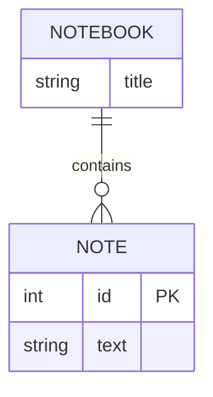
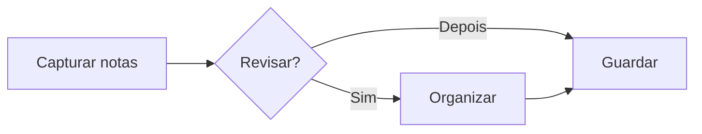
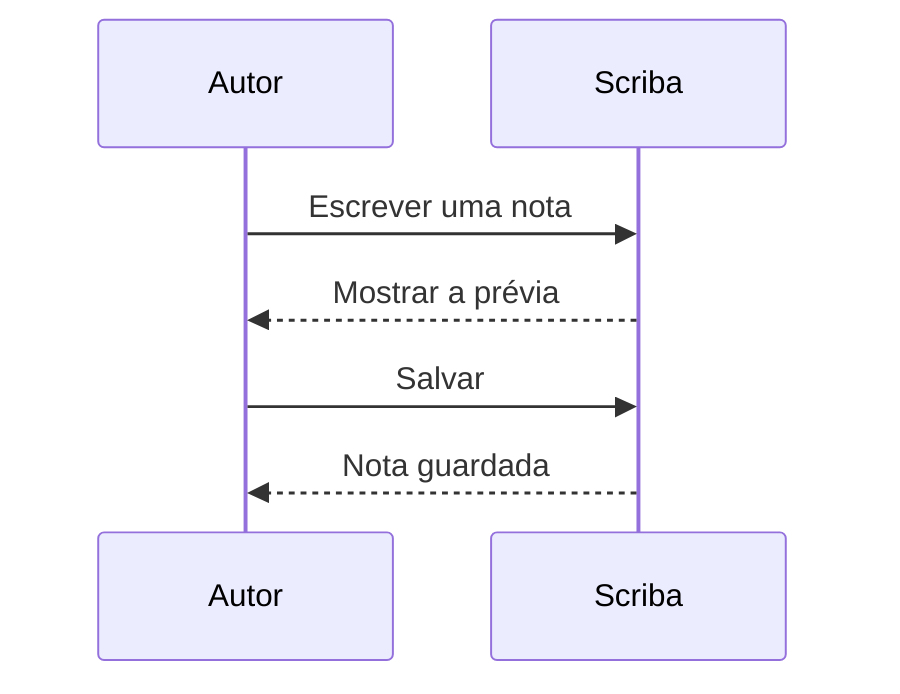
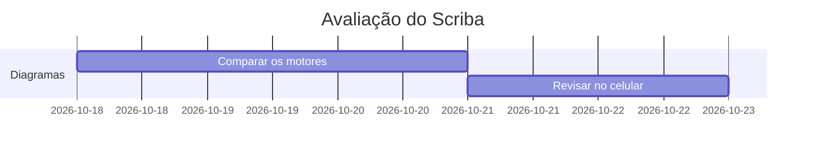

# Compare os diagramas

Use o seletor no canto superior de cada desenho para alternar entre Mermaid, Pele e Beautiful Mermaid. A escolha muda a apresentação; o Markdown continua igual.

## Entidades e relacionamentos

## Fluxo de notas

## Sequência

## Cronograma

Mermaid e Pele suportam este exemplo. Beautiful Mermaid informa sua limitação e mantém o seletor disponível para trocar o motor.

