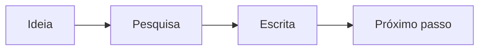

# Um lugar para suas ideias

Escreva, organize e transforme ideias em imagens. Suas notas continuam com você, mesmo sem internet.

## Do rascunho ao próximo passo



## Uma conversa clara

```zenuml
title Consulta ao Acervo Aurora
Catalogo.buscar("história urbana")
```

## Desenhe o que vem depois

```excalidraw
{
  "type": "excalidraw",
  "version": 2,
  "source": "Scriba",
  "elements": [
    {
      "id": "vocabulary-1",
      "type": "rectangle",
      "x": 0,
      "y": 100,
      "width": 180,
      "height": 90,
      "angle": 0,
      "strokeColor": "#1e293b",
      "backgroundColor": "#e0f2fe",
      "fillStyle": "solid",
      "strokeWidth": 2,
      "strokeStyle": "solid",
      "roughness": 1,
      "opacity": 100,
      "groupIds": [],
      "frameId": null,
      "index": "a0",
      "roundness": {
        "type": 3
      },
      "seed": 100,
      "version": 1,
      "versionNonce": 1,
      "isDeleted": false,
      "boundElements": [
        {
          "type": "text",
          "id": "vocabulary-7"
        }
      ],
      "updated": 1,
      "link": null,
      "locked": false
    },
    {
      "id": "vocabulary-2",
      "type": "diamond",
      "x": 270,
      "y": 70,
      "width": 200,
      "height": 150,
      "angle": 0,
      "strokeColor": "#1e293b",
      "backgroundColor": "#fef3c7",
      "fillStyle": "solid",
      "strokeWidth": 2,
      "strokeStyle": "solid",
      "roughness": 1,
      "opacity": 100,
      "groupIds": [],
      "frameId": null,
      "index": "a1",
      "roundness": {
        "type": 3
      },
      "seed": 8019,
      "version": 1,
      "versionNonce": 2,
      "isDeleted": false,
      "boundElements": [
        {
          "type": "text",
          "id": "vocabulary-8"
        }
      ],
      "updated": 1,
      "link": null,
      "locked": false
    },
    {
      "id": "vocabulary-3",
      "type": "ellipse",
      "x": 560,
      "y": 100,
      "width": 180,
      "height": 90,
      "angle": 0,
      "strokeColor": "#1e293b",
      "backgroundColor": "#dcfce7",
      "fillStyle": "solid",
      "strokeWidth": 2,
      "strokeStyle": "solid",
      "roughness": 1,
      "opacity": 100,
      "groupIds": [],
      "frameId": null,
      "index": "a2",
      "roundness": {
        "type": 3
      },
      "seed": 15938,
      "version": 1,
      "versionNonce": 3,
      "isDeleted": false,
      "boundElements": [
        {
          "type": "text",
          "id": "vocabulary-9"
        }
      ],
      "updated": 1,
      "link": null,
      "locked": false
    },
    {
      "id": "vocabulary-4",
      "type": "arrow",
      "x": 190,
      "y": 145,
      "width": 70,
      "height": 0,
      "angle": 0,
      "strokeColor": "#1e293b",
      "backgroundColor": "transparent",
      "fillStyle": "solid",
      "strokeWidth": 2,
      "strokeStyle": "solid",
      "roughness": 1,
      "opacity": 100,
      "groupIds": [],
      "frameId": null,
      "index": "a3",
      "roundness": null,
      "seed": 23857,
      "version": 1,
      "versionNonce": 4,
      "isDeleted": false,
      "boundElements": null,
      "updated": 1,
      "link": null,
      "locked": false,
      "points": [
        [
          0.5,
          0
        ],
        [
          69.5,
          0
        ]
      ],
      "lastCommittedPoint": null,
      "startBinding": null,
      "endBinding": null,
      "startArrowhead": null,
      "endArrowhead": "arrow",
      "elbowed": false
    },
    {
      "id": "vocabulary-5",
      "type": "arrow",
      "x": 480,
      "y": 145,
      "width": 70,
      "height": 0,
      "angle": 0,
      "strokeColor": "#1e293b",
      "backgroundColor": "transparent",
      "fillStyle": "solid",
      "strokeWidth": 2,
      "strokeStyle": "solid",
      "roughness": 1,
      "opacity": 100,
      "groupIds": [],
      "frameId": null,
      "index": "a4",
      "roundness": null,
      "seed": 31776,
      "version": 1,
      "versionNonce": 5,
      "isDeleted": false,
      "boundElements": [
        {
          "type": "text",
          "id": "vocabulary-10"
        }
      ],
      "updated": 1,
      "link": null,
      "locked": false,
      "points": [
        [
          0.5,
          0
        ],
        [
          69.5,
          0
        ]
      ],
      "lastCommittedPoint": null,
      "startBinding": null,
      "endBinding": null,
      "startArrowhead": null,
      "endArrowhead": "arrow",
      "elbowed": false
    },
    {
      "id": "vocabulary-6",
      "type": "text",
      "x": 15,
      "y": 290,
      "width": 506.1056213378906,
      "height": 24.3,
      "angle": 0,
      "strokeColor": "#1e293b",
      "backgroundColor": "transparent",
      "fillStyle": "solid",
      "strokeWidth": 2,
      "strokeStyle": "solid",
      "roughness": 1,
      "opacity": 100,
      "groupIds": [],
      "frameId": null,
      "index": "a5",
      "roundness": null,
      "seed": 39695,
      "version": 1,
      "versionNonce": 6,
      "isDeleted": false,
      "boundElements": null,
      "updated": 1,
      "link": null,
      "locked": false,
      "text": "Retângulo: atividade   ·   Losango: decisão   ·   Elipse: resultado",
      "fontSize": 18,
      "fontFamily": 6,
      "textAlign": "left",
      "verticalAlign": "top",
      "containerId": null,
      "originalText": "Retângulo: atividade   ·   Losango: decisão   ·   Elipse: resultado",
      "autoResize": true,
      "lineHeight": 1.35
    },
    {
      "id": "vocabulary-7",
      "type": "text",
      "x": 54.414024353027344,
      "y": 120.7,
      "width": 71.17195129394531,
      "height": 48.6,
      "angle": 0,
      "strokeColor": "#1e293b",
      "backgroundColor": "transparent",
      "fillStyle": "solid",
      "strokeWidth": 2,
      "strokeStyle": "solid",
      "roughness": 1,
      "opacity": 100,
      "groupIds": [],
      "frameId": null,
      "index": "a6",
      "roundness": null,
      "seed": 47614,
      "version": 1,
      "versionNonce": 7,
      "isDeleted": false,
      "boundElements": null,
      "updated": 1,
      "link": null,
      "locked": false,
      "text": "Capturar\nfonte",
      "fontSize": 18,
      "fontFamily": 6,
      "textAlign": "center",
      "verticalAlign": "middle",
      "containerId": "vocabulary-1",
      "originalText": "Capturar\nfonte",
      "autoResize": true,
      "lineHeight": 1.35
    },
    {
      "id": "vocabulary-8",
      "type": "text",
      "x": 325.09002685546875,
      "y": 120.7,
      "width": 89.8199462890625,
      "height": 48.6,
      "angle": 0,
      "strokeColor": "#1e293b",
      "backgroundColor": "transparent",
      "fillStyle": "solid",
      "strokeWidth": 2,
      "strokeStyle": "solid",
      "roughness": 1,
      "opacity": 100,
      "groupIds": [],
      "frameId": null,
      "index": "a7",
      "roundness": null,
      "seed": 55533,
      "version": 1,
      "versionNonce": 8,
      "isDeleted": false,
      "boundElements": null,
      "updated": 1,
      "link": null,
      "locked": false,
      "text": "Fonte\nverificável?",
      "fontSize": 18,
      "fontFamily": 6,
      "textAlign": "center",
      "verticalAlign": "middle",
      "containerId": "vocabulary-2",
      "originalText": "Fonte\nverificável?",
      "autoResize": true,
      "lineHeight": 1.35
    },
    {
      "id": "vocabulary-9",
      "type": "text",
      "x": 611.9704208211404,
      "y": 120.88019484660536,
      "width": 75.77993774414062,
      "height": 48.6,
      "angle": 0,
      "strokeColor": "#1e293b",
      "backgroundColor": "transparent",
      "fillStyle": "solid",
      "strokeWidth": 2,
      "strokeStyle": "solid",
      "roughness": 1,
      "opacity": 100,
      "groupIds": [],
      "frameId": null,
      "index": "a8",
      "roundness": null,
      "seed": 63452,
      "version": 1,
      "versionNonce": 9,
      "isDeleted": false,
      "boundElements": null,
      "updated": 1,
      "link": null,
      "locked": false,
      "text": "Publicar\nevidência",
      "fontSize": 18,
      "fontFamily": 6,
      "textAlign": "center",
      "verticalAlign": "middle",
      "containerId": "vocabulary-3",
      "originalText": "Publicar\nevidência",
      "autoResize": true,
      "lineHeight": 1.35
    },
    {
      "id": "vocabulary-10",
      "type": "text",
      "x": 502.7680130004883,
      "y": 135,
      "width": 24.463973999023438,
      "height": 20,
      "angle": 0,
      "strokeColor": "#1e293b",
      "backgroundColor": "transparent",
      "fillStyle": "solid",
      "strokeWidth": 2,
      "strokeStyle": "solid",
      "roughness": 1,
      "opacity": 100,
      "groupIds": [],
      "frameId": null,
      "index": "a9",
      "roundness": null,
      "seed": 71371,
      "version": 1,
      "versionNonce": 10,
      "isDeleted": false,
      "boundElements": null,
      "updated": 1,
      "link": null,
      "locked": false,
      "text": "Sim",
      "fontSize": 16,
      "fontFamily": 5,
      "textAlign": "center",
      "verticalAlign": "middle",
      "containerId": "vocabulary-5",
      "originalText": "Sim",
      "autoResize": true,
      "lineHeight": 1.25
    }
  ],
  "appState": {
    "viewBackgroundColor": "#ffffff"
  },
  "files": {}
}
```
